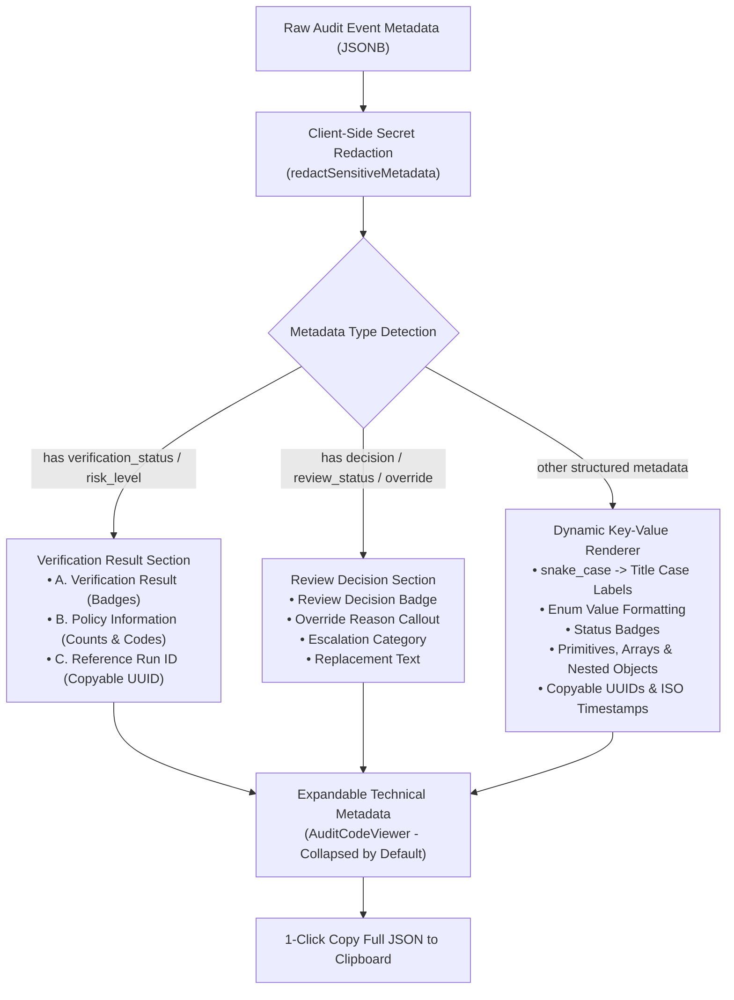

# BrandShield AI — Enterprise Audit Log Presentation Redesign Report

**Date:** November 10, 2026  
**System:** BrandShield AI — Tamper-Evident Governance & Audit Ledger  
**Target Architecture:** Next.js 16 (App Router), React 19, Tailwind CSS, TypeScript, Append-Only PostgreSQL Audit Ledger  
**Status:** **IMPLEMENTED & VERIFIED**

---

## Executive Summary

Audit logs within BrandShield AI provide tamper-evident provenance across all automated claim verifications, AI extractions, human reviewer approvals, policy overrides, and publication transitions. Previously, both the audit activity stream and the record details modal displayed raw, truncated JSON strings (`JSON.stringify(ev.after_state).slice(0, 160)`). This technical presentation created friction for compliance reviewers, corporate auditors, and enterprise legal teams.

We have redesigned the Audit Logs user experience into a human-readable, executive-grade governance suite:
1. **Audit Event Stream:** Replaced truncated raw JSON strings with contextual, human-readable executive summaries (e.g., *"Verification completed with high risk. Evidence was insufficient."*, *"Claim approved by compliance reviewer."*, *"Document successfully processed and indexed into 3 vector chunks."*) with quick-reference status badges.
2. **Audit Record Details Modal:** Replaced raw preformatted JSON dumps with a structured, multi-section inspector:
   - **Provenance Context Grid:** Actor identity, role, target entity type, entity UUID (with 1-click copy), exact UTC timestamp, and an append-only verification badge.
   - **Verification Result (A):** Color-coded status badges for Verification Status, Composite Risk Level, Evidence Sufficiency, and Policy Compliance.
   - **Policy Information (B):** Triggered policy counts, policy codes, and missing mandatory evidence lists.
   - **Verification Reference (C):** Engine Run ID UUID with copy-to-clipboard functionality.
   - **Pre-Change vs Recorded State Tabs:** Seamlessly toggle between prior and resulting state when pre-change state exists.
3. **Dynamic Metadata Renderer:** Built a reusable, type-safe metadata renderer capable of gracefully formatting strings, numbers, booleans (Yes/No), null values, arrays, deep nested objects, UUIDs, and ISO timestamps, with automatic `snake_case` to Title Case conversion, enum formatting, and secret redaction.
4. **Expandable Technical Metadata:** Added a syntax-highlighted code viewer (collapsed by default) with a 1-click "Copy JSON" action and copy confirmation state, allowing developers and technical auditors to inspect original payloads without cluttering reviewer workflows.
5. **Zero Data or Schema Mutation:** Preserved all existing database models, append-only PostgreSQL triggers, API contracts, RBAC authorization, and tenant isolation.

---

## 1. Root Cause Analysis

### 1.1 Activity Stream Preview
In `src/app/audit/page.tsx` (lines 332–337), audit records in the event stream rendered metadata as:
```tsx
{ev.after_state && (
  <div className="mt-2 p-2.5 rounded-lg bg-slate-950/80 border border-slate-800 font-mono text-[11px] text-slate-300 overflow-x-auto group-hover:border-slate-700 transition-colors">
    {JSON.stringify(ev.after_state).slice(0, 160)}
    {JSON.stringify(ev.after_state).length > 160 ? "..." : ""}
  </div>
)}
```
This resulted in hard-to-parse strings like `{"run_id":"a674960e-8545-4c25...","risk_level":"high","verification_status":"unverified"...}` which required manual inspection and deciphering by compliance reviewers.

### 1.2 Event Details Modal
In the modal (lines 402–417), both `before_state` and `after_state` were rendered directly as unformatted `<pre>` JSON blocks:
```tsx
<div>
  <span className="font-semibold text-slate-300">Recorded State & Metadata (After):</span>
  <pre className="mt-1 p-3 bg-slate-950 text-cyan-300 rounded-xl font-mono text-[11px] overflow-x-auto border border-slate-800">
    {JSON.stringify(selectedEvent.after_state, null, 2)}
  </pre>
</div>
```
This lacked structured typography, color-coded risk indicators, actionable copy buttons for UUIDs, and executive sectioning.

---

## 2. Components Created & Modified

### 2.1 New Utilities & Components

| Component / Utility | File Path | Purpose |
|---|---|---|
| `audit-presenter.ts` | `src/lib/audit/audit-presenter.ts` | Pure formatting functions: `formatSnakeCaseLabel`, `formatEnumValue`, `getStatusBadgeInfo`, `formatAuditSummary`, `redactSensitiveMetadata`, `isUuid`, `isIsoTimestamp`. |
| `AuditStatusBadge.tsx` | `src/components/audit/AuditStatusBadge.tsx` | High-contrast status badges for risk levels, verification status, policy compliance, decisions, and booleans. |
| `AuditCodeViewer.tsx` | `src/components/audit/AuditCodeViewer.tsx` | Expandable "Technical Metadata" code viewer (collapsed by default) with 1-click "Copy JSON" and copy confirmation. |
| `AuditMetadataRenderer.tsx` | `src/components/audit/AuditMetadataRenderer.tsx` | Multi-section structured metadata viewer supporting Verification Result (A), Policy Information (B), Verification Reference (C), Human Review Decisions, and dynamic key-value rendering. |
| `AuditEventSummary.tsx` | `src/components/audit/AuditEventSummary.tsx` | Replaces raw JSON previews in the audit stream with executive summaries and quick-reference badges. |
| `AuditRecordModal.tsx` | `src/components/audit/AuditRecordModal.tsx` | Redesigned audit record modal with provenance grid, state selector, structured metadata, technical JSON viewer, and entity links. |

### 2.2 Modified Components & Scripts

| File Path | Description of Changes |
|---|---|
| `src/app/audit/page.tsx` | Integrated `AuditEventSummary` in place of the raw JSON slice in the event stream; integrated `AuditRecordModal` in place of the raw `<pre>` modal. |
| `scripts/phase6-unit-test.ts` | Added clean `process.exit(0)` handling to ensure test runner finishes cleanly without unclosed event-loop handles. |
| `scripts/test-audit-presentation.ts` | Added 10-suite unit and integration test suite covering all presentation, badge, nested rendering, and secret redaction invariants. |

---

## 3. Architecture of Reusable Metadata Renderer



### Key Design Pillars:
1. **Domain-Aware Specialization:** Automatically recognizes core BrandShield governance events (deterministic verifications, human signoffs, policy overrides, and evidence ingestions) and organizes them into executive sections.
2. **Dynamic Fallback:** Handles arbitrary, nested, or novel event payloads recursively without throwing runtime exceptions or requiring hardcoded schemas.
3. **Interactive UUIDs:** All UUIDs (Event ID, Entity ID, Run ID, Decision ID, Child Claim ID) are rendered in monospace with a 1-click clipboard copy button and visual confirmation.
4. **Secret Redaction:** Redacts any sensitive keys (passwords, tokens, secrets, API keys) client-side before presentation, reinforcing backend sanitization.

---

## 4. Before & After UI Comparison

| Screen / Feature | Before (Raw JSON) | After (Redesigned Enterprise Experience) |
|---|---|---|
| **Event Stream Preview** | `{"run_id":"a674960e...","risk_level":"high","verification_status":"unverified"...}...` | `"Verification completed with high risk. Evidence was insufficient."` + `[Risk: High]` `[Evidence: Insufficient]` `[Non-compliant]` badges |
| **Claim Approval Stream** | `{"review_status":"approved","decision_id":"...","decision":"approved"}...` | `"Claim approved by compliance reviewer."` + `[Decision: Approved]` badge |
| **Ingested Chunks Stream** | `{"version_id":"...","chunks_count":3,"provider":"mock"}...` | `"Document successfully processed and indexed into 3 vector chunks."` + `[3 Vector Chunks]` pill |
| **Record Modal Metadata** | Single raw `<pre>` tag with unformatted JSON string | Structured sections: **A. Verification Result**, **B. Policy Information**, **C. Verification Reference** with badges and copy buttons |
| **Policy Override Display** | `{"override_reason":"Clinically proven formulation per trial DG-04"}` | Highlighted amber alert callout card with quote formatting: *“Clinically proven formulation per trial DG-04”* |
| **Run ID & Entity IDs** | Truncated inline text string | Full monospace UUID card with 1-click copy button and "Copied!" checkmark feedback |
| **Technical Inspection** | Cluttered default view for all users | Clean, collapsible "Technical Metadata (Raw JSON)" accordion, collapsed by default with syntax-highlighted code viewer and "Copy JSON" button |

---

## 5. Security & Audit Integrity Guarantees

1. **Zero Database Mutation:** No audit events were modified, updated, or rewritten in the PostgreSQL database. Presentation improvements operate entirely client-side on fetched data.
2. **Append-Only Immutability:** Preserved database triggers (`trg_audit_events_immutable`) blocking any `UPDATE` or `DELETE` statements on `audit_events`.
3. **Workspace Isolation:** Maintained strict tenant scoping: queries enforce `w.slug = $1` and verify session membership.
4. **RBAC Enforcement:** Access to audit trail requires `canViewAudit` permission; viewers remain read-only.
5. **Secret Redaction:** Redacts any sensitive keys (`password`, `token`, `secret`, `api_key`, `authorization`, `private_key`) to prevent leakage even if malformed historical data contains credentials.

---

## 6. Testing & Verification Results

### 6.1 Audit Presentation Test Suite (`scripts/test-audit-presentation.ts`)
Executed all 10 required test suites covering 62 checks:

| Suite | Invariant Tested | Result |
|---|---|---|
| **Suite 1** | `snake_case` label conversion (`run_id` -> `Run ID`, `sku` -> `SKU`, `fda_...` -> `FDA...`) | **PASS (7/7)** |
| **Suite 2** | Enum value formatting (`non_compliant` -> `Non-compliant`, `needs_review` -> `Needs Review`, booleans) | **PASS (11/11)** |
| **Suite 3** | Enterprise status badge mapping (High risk -> Red, Verified -> Green, Insufficient -> Amber) | **PASS (9/9)** |
| **Suite 4** | Nested object structure and multi-level attribute access | **PASS (2/2)** |
| **Suite 5** | Array rendering (primitives chips, object lists, empty array safety) | **PASS (3/3)** |
| **Suite 6** | Null and missing metadata graceful handling (no thrown errors, clean fallbacks) | **PASS (4/4)** |
| **Suite 7** | Malformed data handling (primitives, null, non-objects) | **PASS (3/3)** |
| **Suite 8** | Sensitive data redaction (passwords, tokens, API keys in shallow & nested structures) | **PASS (7/7)** |
| **Suite 9** | Copy JSON serialization and UUIDv4 / ISO timestamp detection | **PASS (6/6)** |
| **Suite 10** | Audit event stream action summaries (all 8 prompt examples + in-memory filtering) | **PASS (10/10)** |
| **Total** | | **62 / 62 PASS (100%)** |

### 6.2 Regression & Build Verification
- **Phase 8 Isolated Unit Suite:** `npm run test:phase8:unit` passed **18 / 18 tests (100%)**.
- **Core Verification & Regression Suite:** `npm test` passed **116 / 116 tests (100%)** (Phase 15, Phase 6, Phase 10D).
- **Workspace Isolation Suite:** `npx tsx scripts/test-workspace-isolation.ts` passed **52 / 52 tests (100%)**.
- **TypeScript Typecheck:** `npx tsc --noEmit` completed with **0 errors**.
- **Next.js Production Build:** `npm run build` compiled **41 static & dynamic routes** with exit code 0.
