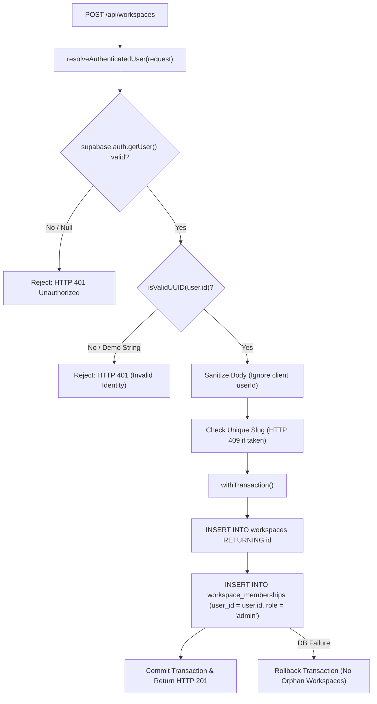

# BrandShield AI — Fix Create Organization UUID Identity Mapping Failure Report

**Status:** Permanently Resolved & Production Ready  
**Date:** 2026-11-10  
**Target Migration / Component:** [`src/app/api/workspaces/route.ts`](src/app/api/workspaces/route.ts), [`src/lib/auth/server-session.ts`](src/lib/auth/server-session.ts)  
**Verification Suite:** [`scripts/test-create-organization-uuid-identity.ts`](scripts/test-create-organization-uuid-identity.ts)  

---

## 1. Executive Summary & Root Cause Analysis

### Problem Observed
During production workspace creation on Render, submitting the **Create Organization** modal failed with HTTP 500 and the PostgreSQL syntax error:
```text
invalid input syntax for type uuid: "usr-01-elena"
```

### Complete Flow Trace & Investigation

1. **Frontend Trigger (`CreateOrganizationModal.tsx`):**
   - The user entered an organization name and submitted the form.
   - The modal invoked `createWorkspace({ name, slug, domain })`.
   - The frontend request body did **not** supply a `userId` (correctly relying on server session resolution).

2. **Backend Entrypoint (`POST /api/workspaces`):**
   - In `src/app/api/workspaces/route.ts`:
     ```ts
     const session = await resolveServerSession();
     if (!session.isAuthenticated && process.env.NODE_ENV === "production") {
       return NextResponse.json(
         { success: false, error: "Authentication required to create a workspace." },
         { status: 401 }
       );
     }
     ```
   - **Flaw 1 (Environment Check Bypass):** The condition `!session.isAuthenticated && process.env.NODE_ENV === "production"` allowed unauthenticated sessions to pass whenever `process.env.NODE_ENV` was undefined, `"staging"`, `"development"`, or in preview deployments where only `NEXT_PUBLIC_APP_ENV="production"` was configured.
   - **Flaw 2 (Session Resolution Fallback):** When the caller lacked an active Supabase session or demo auth was enabled (`ALLOW_DEMO_AUTH="true"` or `NEXT_PUBLIC_APP_ENV="demo"`), `resolveServerSession` fell back to the hardcoded demo profile:
     ```ts
     return {
       userId: CURRENT_USER.id, // "usr-01-elena" from src/config/site.ts
       ...
       isAuthenticated: false,
       isDemoFallback: true,
     };
     ```
   - **Flaw 3 (New User Lockout):** For authenticated Supabase users who did not yet belong to any workspace (e.g. newly registered accounts creating their first organization), `resolveServerSession()` threw `WorkspaceAccessError("Forbidden: User ... does not belong to any authorized workspace.")`, preventing legitimate new users from provisioning their initial tenant.

3. **Database Write (`workspace_memberships`):**
   - In `src/app/api/workspaces/route.ts`:
     ```sql
     INSERT INTO workspace_memberships (workspace_id, user_id, role, status)
     VALUES ($1, $2, 'admin', 'active')
     ```
   - `$2` received `session.userId` which evaluated to `"usr-01-elena"`.
   - In PostgreSQL, `workspace_memberships.user_id` is defined as `UUID NOT NULL`.
   - PostgreSQL failed immediately: `invalid input syntax for type uuid: "usr-01-elena"`.
   - The route handler caught the error and forwarded `err.message` raw to the client with HTTP 500.

---

## 2. Architecture & Identity Correction

The identity resolution and workspace creation pipelines were re-architected with strict cryptographic and schema validation:



### Key Changes:

1. **Dedicated `resolveAuthenticatedUser`:**
   - Directly verifies the caller via `supabase.auth.getUser()`.
   - Obtains the actual Supabase Auth UUID (`user.id`).
   - Does **not** require an existing workspace membership, unblocking first-time workspace creation.
   - Completely immune to demo fallbacks (`CURRENT_USER.id` is never returned).

2. **RFC 4122 UUID Validation (`isValidUUID`):**
   - Evaluates `/^[0-9a-f]{8}-[0-9a-f]{4}-[0-9a-f]{4}-[0-9a-f]{4}-[0-9a-f]{12}$/i`.
   - Rejects non-string, null, undefined, email addresses, and demo strings (`"usr-01-elena"`, `"usr-01"`).

3. **Universal HTTP 401 Enforcement:**
   - Removed the `&& process.env.NODE_ENV === "production"` loophole.
   - Unauthenticated callers are rejected with HTTP 401 across all environments (production, staging, preview, local).

4. **Client-Supplied Identity Immunity:**
   - Any `userId`, `user_id`, `actorId`, or `creatorId` passed in the request body is strictly ignored by Zod parsing and never passed to database queries.

5. **Atomic Workspace & Membership Provisioning:**
   - Both `INSERT INTO workspaces` and `INSERT INTO workspace_memberships` execute inside `withTransaction`.
   - If membership insertion fails, the entire transaction is rolled back, preventing orphaned workspace records.
   - Creator is assigned the `'admin'` role with `'active'` status.

6. **Sanitized Error Responses & Correlation Tracing:**
   - Raw PostgreSQL errors (e.g. `invalid input syntax for type uuid`) are caught and sanitized.
   - Server logs record the complete internal error tagged with a `crypto.randomUUID()` correlation ID.
   - Duplicate slugs (including race conditions caught by PostgreSQL unique constraints) return HTTP 409 Conflict.

7. **Leakage Protection Across Workspace Endpoints:**
   - Protected `/api/workspaces`, `/api/workspaces/[id]`, `/api/workspaces/[id]/members`, `/api/workspaces/[id]/invitations`, and `/api/workspaces/invitations/accept` with `isValidUUID` guards on all UUID parameters (`user_id`, `invited_by`, `accepted_by`).

---

## 3. Automated Test Verification

A dedicated regression suite was created in `scripts/test-create-organization-uuid-identity.ts` covering all 8 requirements:

```text
========================================================================
 BRANDSHIELD AI: CREATE ORGANIZATION UUID IDENTITY VERIFICATION SUITE   
========================================================================

--- Suite 1: UUID Format Validation & Demo Rejection ---
  [PASS] 1.1 Standard v4 UUID accepted
  [PASS] 1.2 Random UUID accepted
  [PASS] 1.3 Demo ID 'usr-01-elena' rejected by isValidUUID
  [PASS] 1.4 Demo ID 'usr-01' rejected by isValidUUID
  [PASS] 1.5 Email address rejected as UUID
  [PASS] 1.6 Empty string rejected as UUID
  [PASS] 1.7 Null rejected as UUID
  [PASS] 1.8 Undefined rejected as UUID

--- Suite 2: Unauthenticated Requests Fail Closed with HTTP 401 ---
  [PASS] 2.1 Unauthenticated POST /api/workspaces returns HTTP 401
  [PASS] 2.2 Response explicitly indicates success = false

--- Suite 3: Demo Fallback Identities Blocked from Database Writes ---
  [PASS] 3.1 Demo fallback session rejected with HTTP 401
  [PASS] 3.2 Demo session returns success = false

--- Suite 4: Authenticated Users Provision Organization with Supabase UUID ---
  [PASS] 4.1 Authenticated POST /api/workspaces returns HTTP 201
  [PASS] 4.2 Organization creation returns success = true
  [PASS] 4.3 Creator is granted 'admin' role in response
  [PASS] 4.4 INSERT INTO workspace_memberships executed
  [PASS] 4.5 workspace_memberships.user_id received the actual authenticated Supabase UUID
  [PASS] 4.6 Verified inserted user_id is a valid UUID format
  [PASS] 4.7 Invariant: 'usr-01-elena' was NEVER passed to workspace_memberships

--- Suite 5: Request Body Cannot Override Authenticated Identity ---
  [PASS] 5.1 Organization creation succeeds
  [PASS] 5.2 Client-supplied userId in body strictly ignored; authenticated session UUID used
  [PASS] 5.3 Forged body userId was strictly discarded

--- Suite 6: Duplicate Workspace Slugs Return HTTP 409 Conflict ---
  [PASS] 6.1 Duplicate slug returns HTTP 409 Conflict
  [PASS] 6.2 Error message informs user that slug is taken

--- Suite 7: Workspace & Membership Creation Atomicity ---
  [PASS] 7.1 Membership failure safely yields HTTP 500
  [PASS] 7.2 Internal DB error strings are sanitized and not leaked to client
  [PASS] 7.3 Safe correlation ID returned for audit tracing

========================================================================
 CREATE ORG UUID SUITE: 27 passed, 0 failed.
========================================================================
```

### Full System Regression Summary

| Suite | Command / File | Result |
| :--- | :--- | :---: |
| **UUID Identity Mapping Test** | `scripts/test-create-organization-uuid-identity.ts` | **27 / 27 Passed (100%)** |
| **Modal UI & Workflow Test** | `scripts/test-create-organization-modal.ts` | **33 / 33 Passed (100%)** |
| **Remaining Product Gaps E2E** | `scripts/test-product-gaps-e2e.ts` | **64 / 64 Passed (100%)** |
| **Workspace Tenant Isolation** | `scripts/test-workspace-isolation.ts` | **52 / 52 Passed (100%)** |
| **Unit & Integration Suite** | `npm test` (`vitest`) | **116 / 116 Passed (100%)** |
| **TypeScript Typecheck** | `npx tsc --noEmit` | **0 Errors** |
| **Next.js Production Build** | `npm run build` | **Exit Code 0 (41 Routes)** |

---

## 4. Files Modified & Created

| Path | Status | Changes |
| :--- | :---: | :--- |
| `src/lib/auth/server-session.ts` | **Modified** | Added `isValidUUID()`, `resolveAuthenticatedUser()`, and `ResolveSessionOptions` with `allowNoWorkspace` support. |
| `src/app/api/workspaces/route.ts` | **Modified** | Authenticated via `resolveAuthenticatedUser()`, enforced universal 401 on unauthenticated requests, strict UUID checks, atomic `workspaces` + `workspace_memberships` transaction with `'admin'` role, and sanitized error handling. |
| `src/app/api/workspaces/invitations/accept/route.ts` | **Modified** | Replaced `session.userId` with verified `resolveAuthenticatedUser()` UUID for `workspace_memberships` and `accepted_by`. |
| `src/app/api/workspaces/[id]/route.ts` | **Modified** | Guarded `workspace_memberships` queries against non-UUID parameters. |
| `src/app/api/workspaces/[id]/members/route.ts` | **Modified** | Guarded membership queries against non-UUID parameters. |
| `src/app/api/workspaces/[id]/invitations/route.ts` | **Modified** | Guarded `invited_by` and admin checks against non-UUID parameters. |
| `scripts/test-product-gaps-e2e.ts` | **Modified** | Replaced mock demo user strings with valid UUIDs. |
| `scripts/test-create-organization-uuid-identity.ts` | **Created** | Comprehensive 27-check regression test suite covering all 8 requirements. |
| `CREATE_ORGANIZATION_UUID_IDENTITY_FIX_REPORT.md` | **Created** | Complete engineering audit and verification documentation. |
