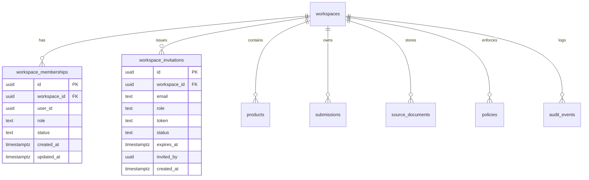

# BrandShield AI — Database Schema Audit & Migration Plan
## CodeNexus Round 3 PostgreSQL & Supabase Specification

---

## 1. Database Environment Overview

- **Engine:** PostgreSQL 17 (Supabase Managed)
- **Extensions:**
  - `uuid-ossp` (UUID generation)
  - `pgcrypto` (Cryptographic hashing)
  - `vector` (`pgvector` for 1536-dimensional vector search)
- **Active Tables:** 16 Relational Tables
- **Triggers:** 8 `updated_at` triggers, 1 audit immutability trigger, 1 policy immutability trigger

---

## 2. Comprehensive Table Inventory

### 2.1 Core Workspace & Product Domain

| Table | Primary Key | Foreign Keys | Key Constraints / Types | Purpose |
| :--- | :--- | :--- | :--- | :--- |
| **`workspaces`** | `id UUID` | None | `slug TEXT UNIQUE NOT NULL` | Master organization tenant registry |
| **`products`** | `id UUID` | `workspace_id -> workspaces(id)` | `sku TEXT UNIQUE NOT NULL`, `reference_price >= 0` | Product catalog for claim verification |
| **`approved_facts`** | `id UUID` | `product_id -> products(id)`, `source_document_id -> source_documents(id)` | `fact_key TEXT`, `fact_value JSONB`, `valid_from <= valid_until` | Ground-truth clinical & physical facts |
| **`promotions`** | `id UUID` | `product_id -> products(id)` | `discount_type IN ('fixed','percentage','bundle')`, `start_date <= end_date` | Active & historical promotional offers |

### 2.2 Evidence & RAG Intelligence Domain

| Table | Primary Key | Foreign Keys | Key Constraints / Types | Purpose |
| :--- | :--- | :--- | :--- | :--- |
| **`source_documents`** | `id UUID` | `workspace_id -> workspaces(id)`, `current_version_id -> document_versions(id)` | `approval_status IN ('approved','in_review','rejected','superseded')` | Master evidence document records |
| **`document_versions`** | `id UUID` | `source_document_id -> source_documents(id)` | `UNIQUE(source_document_id, version_number)`, `valid_from <= valid_until` | Versioned files with sha256 checksums |
| **`document_chunks`** | `id UUID` | `document_version_id -> document_versions(id)` | `embedding vector(1536)`, `UNIQUE(document_version_id, chunk_index)` | Chunked text with pgvector embeddings |

### 2.3 Marketing Submissions & Claim Extraction Domain

| Table | Primary Key | Foreign Keys | Key Constraints / Types | Purpose |
| :--- | :--- | :--- | :--- | :--- |
| **`submissions`** | `id UUID` | `workspace_id -> workspaces(id)` | `status IN ('draft','in_review','approved','changes_requested','rejected')` | Marketing collateral submissions |
| **`submission_versions`**| `id UUID` | `submission_id -> submissions(id)` | `UNIQUE(submission_id, version_number)` | Versioned campaign marketing copy |
| **`claims`** | `id UUID` | `submission_id -> submissions(id)`, `submission_version_id -> submission_versions(id)`, `product_id -> products(id)` | `text_start INT`, `text_end INT`, `verification_status IN ('supported','contradicted','outdated','unverified','needs_review')` | Extracted marketing claims with offsets |
| **`claim_evidence`** | `id UUID` | `claim_id -> claims(id)`, `document_version_id -> document_versions(id)`, `approved_fact_id -> approved_facts(id)` | `relevance_score BETWEEN 0 AND 1`, `evidence_excerpt TEXT` | Linked evidence citations per claim |

### 2.4 Verification, Review & Audit Domain

| Table | Primary Key | Foreign Keys | Key Constraints / Types | Purpose |
| :--- | :--- | :--- | :--- | :--- |
| **`verification_runs`** | `id UUID` | `claim_id -> claims(id)` | `risk_level IN ('low','medium','high','critical')`, `evidence_snapshot JSONB` | Execution record of verification engines |
| **`review_decisions`** | `id UUID` | `claim_id -> claims(id)` | `decision IN ('approved','rejected','escalated','modified')`, `override_reason TEXT` | Human reviewer decisions & overrides |
| **`audit_events`** | `id UUID` | `workspace_id -> workspaces(id)` | `actor_id TEXT`, `entity_type TEXT`, `action TEXT`, `before_state JSONB`, `after_state JSONB` | Immutable append-only audit trail |

### 2.5 Policy Intelligence Domain

| Table | Primary Key | Foreign Keys | Key Constraints / Types | Purpose |
| :--- | :--- | :--- | :--- | :--- |
| **`policies`** | `id UUID` | `workspace_id -> workspaces(id)`, `product_id -> products(id)`, `active_version_id -> policy_versions(id)` | `UNIQUE(workspace_id, code)`, `status IN ('draft','active','archived')` | Master compliance policy registry |
| **`policy_versions`** | `id UUID` | `policy_id -> policies(id)` | `rules JSONB`, `status IN ('draft','active','archived','superseded')`, `UNIQUE(policy_id, version_number)` | Immutable versioned rule definitions |

---

## 3. Database Triggers & Invariants

1. **`prevent_audit_tampering()`:**
   - Attached to `audit_events`.
   - Prevents any `UPDATE` or `DELETE` command at the SQL engine level.
   - Throws: `'Audit events are immutable and cannot be updated or deleted.'`
2. **`prevent_active_policy_tampering()`:**
   - Attached to `policy_versions`.
   - Prevents modifying `rules`, `version_number`, or `valid_from` once a version status is `active`, `archived`, or `superseded`.
   - Mandates creating a new draft version for rule revisions.
3. **`set_updated_at()`:**
   - Attached to `workspaces`, `products`, `source_documents`, `approved_facts`, `submissions`, `claims`, `policies`.

---

## 4. Current RLS Policies & Multi-Tenant Deficiencies

### Current Policies
In the initial migration (`20261105000000_initial_schema.sql`):
- All 16 tables enable RLS.
- Read policies currently filter on:
  ```sql
  WHERE slug = 'dermaglow'
  ```
- Authenticated writes filter on:
  ```sql
  WITH CHECK (workspace_id IN (SELECT id FROM workspaces WHERE slug = 'dermaglow'))
  ```

### Gaps Identified for Round 3
1. **Hardcoded Tenant Slug:** Existing RLS is locked to `'dermaglow'`. Adding a new organization (e.g. `Acme Corp`) would cause queries to fail or return empty sets under RLS.
2. **Missing Relational Membership Tables:**
   - No `workspace_memberships` table exists to link `auth.users(id)` to `workspaces(id)` with specific roles (`admin`, `compliance_reviewer`, `legal_reviewer`, `creator`, `viewer`).
   - No `workspace_invitations` table exists to track pending team invites and security tokens.

---

## 5. Round 3 Migration Plan (Non-Destructive)

To satisfy Phase 1 without altering existing data or breaking `DermaGlow` compatibility:



### Proposed Migration: `20261110000000_round3_multi_tenancy.sql`
1. Create `workspace_memberships` table with unique constraint on `(workspace_id, user_id)`.
2. Support roles: `admin`, `compliance_reviewer`, `legal_reviewer`, `creator`, `viewer`.
3. Create `workspace_invitations` table with token hashing and expiration dates.
4. Seed default memberships for existing demo accounts (`elena.vance@dermaglow.com`, `admin@dermaglow.com`, `marcus.brody@dermaglow.com`) into `workspace_memberships`.
5. Update dynamic RLS policies:
   ```sql
   CREATE POLICY "Users can access workspaces they belong to"
     ON workspaces FOR SELECT
     USING (
       id IN (SELECT workspace_id FROM workspace_memberships WHERE user_id = auth.uid() AND status = 'active')
       OR slug = 'dermaglow' -- Preserved for demo fallback
     );
   ```
6. Add citation metadata fields to `claim_evidence` for Phase 2:
   - `page_number INT`
   - `section_heading TEXT`
   - `bounding_box JSONB`
   - `source_validity_status TEXT`
