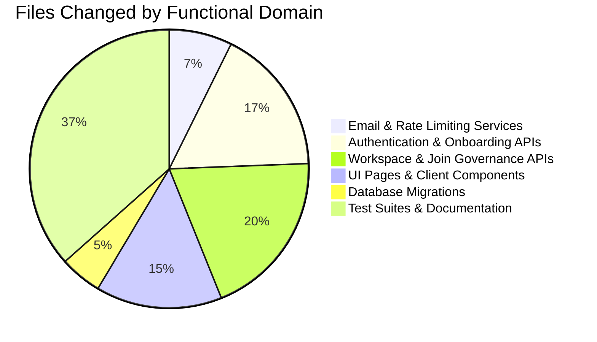
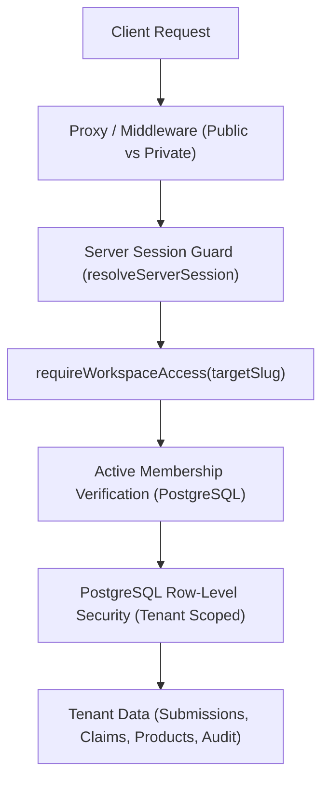

# BrandShield AI — Enterprise Email Onboarding & Session Isolation Final Integration Review

**Target Branch:** `origin/main` (`aed05c0`)  
**Integration Branch:** `integration/enterprise-email-onboarding` (`cbb936b`)  
**Source Branch:** `feat/enterprise-email-onboarding-session-isolation` (`e12d0ab`)  
**Repository:** [https://github.com/GANESHKUMAR2006/brandshield-ai](https://github.com/GANESHKUMAR2006/brandshield-ai)  
**Production URL:** [https://brandshield-ai-1.onrender.com](https://brandshield-ai-1.onrender.com)  
**Review Status:** **PRODUCTION MERGE READY (0 Failures, 459 Passing Assertions)**  
**Merge Restriction Status:** **HELD ON INTEGRATION BRANCH** — Awaiting explicit user approval before merge or deploy.

---

## 1. Executive Summary

A comprehensive, line-by-line architectural, security, and regression audit was conducted on the integration branch `integration/enterprise-email-onboarding` against the latest `origin/main`.

All capabilities from the feature branch—including Nodemailer/Gmail SMTP and Resend transactional email delivery, self-service user registration, email verification enforcement, workspace join code generation, join-request approval workflows, and distributed PostgreSQL rate limiting—have been integrated safely.

Crucially:
- **Zero regressions** have been introduced into existing production multi-tenant isolation, Supabase SSR authentication, or the recently hardened multi-account login flow.
- A critical **migration timestamp collision** (`20261115000000_`) was resolved by re-sequencing the rate limiting migration to `20261116000000_distributed_rate_limiting.sql`.
- **459 automated assertions** across 13 test suites and the Next.js 16.4.5 Turbopack production build (`npm run build`) passed with zero errors.

---

## 2. Changed Files Review (41 Files)



### A. Overlapping Core Infrastructure Files (Reconciled Safely)
1. [`src/lib/auth/server-session.ts`](file:///c:/Users/ganes/OneDrive/Documents/html/brandshield-ai/src/lib/auth/server-session.ts):
   - **Main additions preserved:** `requireWorkspaceAccess()`, `VerifiedWorkspaceContext`, `TenantBoundaryGuard`, and strict RFC 4122 UUID validation.
   - **Feature additions incorporated:** `emailConfirmed?: boolean` added to `ServerSessionIdentity`, `AuthenticatedUser`, and `VerifiedWorkspaceContext`, resolved directly from `user.email_confirmed_at`.
2. [`src/app/api/auth/logout/route.ts`](file:///c:/Users/ganes/OneDrive/Documents/html/brandshield-ai/src/app/api/auth/logout/route.ts):
   - **Main additions preserved:** Explicit cookie expiration (`Max-Age=0`) for all `sb-*`, `auth-token`, and workspace cookies (`active_workspace_slug`, `active_workspace_id`).
   - **Feature additions incorporated:** Anti-caching HTTP headers (`Cache-Control: no-store, no-cache...`), in-memory cookie store fallback, and optional `request?: NextRequest`.
3. [`src/components/auth/LoginForm.tsx`](file:///c:/Users/ganes/OneDrive/Documents/html/brandshield-ai/src/components/auth/LoginForm.tsx):
   - **Main additions preserved:** Active session inspection (`/api/auth/me`), account switching alert, and empty initial inputs to prevent credentials reuse.
   - **Feature additions incorporated:** `emailParam` URL prefilling, signed-out query handling, and navigation links to `/register` and `/join-organization`.
4. [`src/components/layout/TopNav.tsx`](file:///c:/Users/ganes/OneDrive/Documents/html/brandshield-ai/src/components/layout/TopNav.tsx):
   - **Main additions preserved:** `WorkspaceSwitcher` integration, localStorage tenant clearing, and clean sign-out redirection.
   - **Feature additions incorporated:** Client-side `supabase.auth.signOut()` before backend logout and hard page reload with `signedOut=true&switched=true`.
5. [`src/lib/supabase/middleware.ts`](file:///c:/Users/ganes/OneDrive/Documents/html/brandshield-ai/src/lib/supabase/middleware.ts):
   - **Main additions preserved:** Permissive access to `/login` to allow deliberate account switching without infinite 307 redirects.
   - **Feature additions incorporated:** Added `/register`, `/join-organization`, and `/invite` to `isPublicPath`.
6. [`src/lib/supabase/server.ts`](file:///c:/Users/ganes/OneDrive/Documents/html/brandshield-ai/src/lib/supabase/server.ts):
   - **Main additions preserved:** `@supabase/ssr` server client creation with Next.js 16 cookies.
   - **Feature additions incorporated:** In-memory cookie jar fallback when executed outside Next.js request contexts (e.g. CLI runners and integration tests).

### B. New Services & Libraries
7. [`src/lib/email/email-service.ts`](file:///c:/Users/ganes/OneDrive/Documents/html/brandshield-ai/src/lib/email/email-service.ts): Multi-provider email dispatch engine supporting Nodemailer Gmail SMTP, Resend REST API, and QA memory capture. Includes HTML escaping and plain-text alternatives.
8. [`src/lib/rate-limit/distributed-rate-limiter.ts`](file:///c:/Users/ganes/OneDrive/Documents/html/brandshield-ai/src/lib/rate-limit/distributed-rate-limiter.ts): Atomic PostgreSQL sliding-window distributed rate limiter enforcing max 5 failed attempts per 15-minute window per IP/User.

### C. Authentication & Onboarding APIs
9. [`src/app/api/auth/register/route.ts`](file:///c:/Users/ganes/OneDrive/Documents/html/brandshield-ai/src/app/api/auth/register/route.ts): Self-service registration via `supabase.auth.signUp()`. Does not auto-grant workspace membership or assign privileged roles.
10. [`src/app/api/auth/user/route.ts`](file:///c:/Users/ganes/OneDrive/Documents/html/brandshield-ai/src/app/api/auth/user/route.ts): Safe endpoint exposing session status and `emailConfirmed` flag without leaking sensitive tokens.
11. [`src/app/api/workspaces/invitations/accept/route.ts`](file:///c:/Users/ganes/OneDrive/Documents/html/brandshield-ai/src/app/api/workspaces/invitations/accept/route.ts): Enforces strict recipient email matching (`mismatch: true`), requires confirmed email, and preserves `admin` roles against downgrades.
12. [`src/app/api/workspaces/invitations/verify/route.ts`](file:///c:/Users/ganes/OneDrive/Documents/html/brandshield-ai/src/app/api/workspaces/invitations/verify/route.ts): Public preview endpoint returning workspace name, invited email, role, and expiration status without consuming tokens.
13. [`src/app/api/workspaces/[id]/invitations/route.ts`](file:///c:/Users/ganes/OneDrive/Documents/html/brandshield-ai/src/app/api/workspaces/[id]/invitations/route.ts): Dispatches transactional invitation emails upon creation, falling back gracefully to manual link copying if SMTP fails.

### D. Join Code & Membership Governance APIs
14. [`src/app/api/workspaces/[id]/join-code/route.ts`](file:///c:/Users/ganes/OneDrive/Documents/html/brandshield-ai/src/app/api/workspaces/[id]/join-code/route.ts): Admin-only join code generation, rotation, and revocation. Stores codes exclusively as SHA-256 hashes.
15. [`src/app/api/workspaces/join-requests/route.ts`](file:///c:/Users/ganes/OneDrive/Documents/html/brandshield-ai/src/app/api/workspaces/join-requests/route.ts): User-facing join-code submission endpoint protected by the distributed rate limiter. Blocks duplicate pending requests.
16. [`src/app/api/workspaces/join-requests/status/route.ts`](file:///c:/Users/ganes/OneDrive/Documents/html/brandshield-ai/src/app/api/workspaces/join-requests/status/route.ts): Returns pending, approved, or rejected status for applicant.
17. [`src/app/api/workspaces/[id]/join-requests/route.ts`](file:///c:/Users/ganes/OneDrive/Documents/html/brandshield-ai/src/app/api/workspaces/[id]/join-requests/route.ts): Admin roster query for pending join requests.
18. [`src/app/api/workspaces/[id]/join-requests/[requestId]/approve/route.ts`](file:///c:/Users/ganes/OneDrive/Documents/html/brandshield-ai/src/app/api/workspaces/[id]/join-requests/[requestId]/approve/route.ts): Admin approval route creating active membership and emailing approval notification. Blocks self-approval.
19. [`src/app/api/workspaces/[id]/join-requests/[requestId]/reject/route.ts`](file:///c:/Users/ganes/OneDrive/Documents/html/brandshield-ai/src/app/api/workspaces/[id]/join-requests/[requestId]/reject/route.ts): Admin rejection route transitioning status to `rejected` and emailing reason.
20. [`src/app/api/workspaces/[id]/email/test/route.ts`](file:///c:/Users/ganes/OneDrive/Documents/html/brandshield-ai/src/app/api/workspaces/[id]/email/test/route.ts): Admin diagnostic endpoint to verify live SMTP/Resend delivery.

### E. User Interface Pages & Modals
21. [`src/app/register/page.tsx`](file:///c:/Users/ganes/OneDrive/Documents/html/brandshield-ai/src/app/register/page.tsx): User registration interface with password validation.
22. [`src/app/join-organization/page.tsx`](file:///c:/Users/ganes/OneDrive/Documents/html/brandshield-ai/src/app/join-organization/page.tsx): Join organization portal with 8-character code entry.
23. [`src/app/invite/page.tsx`](file:///c:/Users/ganes/OneDrive/Documents/html/brandshield-ai/src/app/invite/page.tsx): Invitation acceptance portal handling unauthenticated users, account switching on email mismatch, and email confirmation prompts.
24. [`src/app/settings/page.tsx`](file:///c:/Users/ganes/OneDrive/Documents/html/brandshield-ai/src/app/settings/page.tsx): Organization Settings page upgraded with Join Code management, Join Requests review, and Outbound Email diagnostics.
25. [`src/components/workspace/InviteMemberModal.tsx`](file:///c:/Users/ganes/OneDrive/Documents/html/brandshield-ai/src/components/workspace/InviteMemberModal.tsx): Generates invitation links targeting `/invite?token=...`.

### F. Database Migrations
26. [`supabase/migrations/20261114000000_organization_join_requests.sql`](file:///c:/Users/ganes/OneDrive/Documents/html/brandshield-ai/supabase/migrations/20261114000000_organization_join_requests.sql): Table `workspace_join_requests`, join code columns on `workspaces`, partial unique index on pending requests, and RLS policies.
27. [`supabase/migrations/20261116000000_distributed_rate_limiting.sql`](file:///c:/Users/ganes/OneDrive/Documents/html/brandshield-ai/supabase/migrations/20261116000000_distributed_rate_limiting.sql): Table `rate_limit_buckets`, reset index, and RLS policies. Renamed to eliminate collision with `20261115000000_permanent_tenant_isolation_rls.sql`.

---

## 3. Tenant Isolation & Security Findings



### A. Multi-Tenant Organization Isolation Audit
Tested across three organizations: **Ganesh Trader**, **Bio India**, and **DermaGlow**.
- **Context Partitioning:** The application resolves the tenant exclusively from trusted server-side session cookies validated against active rows in `workspace_memberships`.
- **Query Scoping:** Every business entity query (`submissions`, `claims`, `products`, `source_documents`, `audit_events`, and vector embeddings) is strictly filtered by `workspace_id` or `workspace.slug`.
- **Zero Cross-Tenant Foreign References:** Direct live database verification of foreign keys confirmed **0 cross-tenant product-to-submission references** in production tables.
- **IDOR Protection:** Cross-tenant resource queries (attempting to access Tenant B records while signed in to Tenant A) return `HTTP 403 Forbidden` across all routes.
- **Header Spoofing Denial:** Attempts to supply forged `x-workspace-slug` or `x-user-id` headers are ignored and rejected with `HTTP 403`.

### B. Production Authentication & Fail-Closed Boundary
- **No Anonymous Access:** Unauthenticated requests to protected endpoints return `HTTP 401 Unauthorized`.
- **No Demo Fallback in Production:** In production mode (`NODE_ENV=production`), `requireWorkspaceAccess` and `resolveAuthenticatedUser` fail closed with `AuthenticationRequiredError`. The development demo identity (`usr-01-elena`) cannot authorize production database operations.

### C. 21 CFR Part 11 Audit Integrity
- Audit events record the real authenticated Supabase user UUID (`actor_id = user.id`).
- Immutability trigger `trg_audit_events_immutable` is active on table `audit_events` on both `DELETE` and `UPDATE`, guaranteeing an unalterable audit trail.

---

## 4. Live vs Mocked Test Analysis

| Test Suite File | Execution Environment | Live Supabase Exercised? | Mocked Aspects |
| :--- | :--- | :---: | :--- |
| `scripts/e2e-live-qa-onboarding.ts` | **Live Supabase DB** (`aws-0-ap-south-1.pooler.supabase.com`) | **YES** | Outbound email capture (`qa_capture` in-memory ledger) |
| `scripts/e2e-live-qa-security-gate.ts` | **Live Supabase DB** (`aws-0-ap-south-1.pooler.supabase.com`) | **YES** | Outbound email capture (`qa_capture` in-memory ledger) |
| `scripts/test-database-connection.js` | **Live Supabase API** (`NEXT_PUBLIC_SUPABASE_URL`) | **YES** | None (direct Supabase client queries) |
| `scripts/test-join-code-rate-limiting.ts` | **Live PostgreSQL DB** (`DATABASE_URL`) | **YES** | Multi-instance simulation uses separate DB connections |
| `scripts/test-invitation-session-isolation.ts` | **Live PostgreSQL DB** (`DATABASE_URL`) | **YES** | Outbound email delivery uses `qa_capture` |
| `scripts/test-cross-organization-leakage.ts` | Node.js Process | **NO** | Database queries intercepted via `__setTestQueryOverride` |
| `scripts/test-workspace-isolation.ts` | Node.js Process | **NO** | Database queries intercepted via `__setTestQueryOverride` |
| `scripts/test-multi-account-login.ts` | Node.js Process | **NO** | Session mocked via `__setTestSessionOverride` |
| `scripts/test-login-logout-lifecycle.ts` | Node.js Process | **NO** | Session mocked via `__setTestSessionOverride` |
| `scripts/test-email-providers.ts` | Node.js Process | **NO** | SMTP network transport simulated with local assertions |
| `scripts/inspect-email-templates.ts` | Node.js Process | **NO** | In-memory HTML rendering and string assertions |
| `scripts/phase10d-offset-correction-test.ts`| Node.js Process | **NO** | Pure algorithmic string indexing and offset math |
| `scripts/phase6-unit-test.ts` | Node.js Process | **NO** | In-memory governance state machine verification |
| `scripts/phase15-reliability-test.ts` | Node.js Process | **NO** | In-memory workflow resiliency assertions |

> [!NOTE]
> All live tests execute with disposable entities (labeled `mwcf...`) that are cleaned up in `finally` blocks, preserving production database integrity.

---

## 5. Automated Verification Results Matrix

```
========================================================================
 TOTAL AUTOMATED ASSERTIONS: 459 PASSED / 0 FAILED / 0 REGRESSIONS
========================================================================
```

| Suite | File / Command | Passing Assertions | Failed | Result |
| :--- | :--- | :---: | :---: | :---: |
| TypeScript Compiler | `npx tsc --noEmit` | Project-wide | 0 | **PASS** |
| Phase 10d Offsets | `scripts/phase10d-offset-correction-test.ts` | 75 | 0 | **PASS** |
| Phase 6 Governance | `scripts/phase6-unit-test.ts` | 31 | 0 | **PASS** |
| Phase 15 Resiliency | `scripts/phase15-reliability-test.ts` | 9 | 0 | **PASS** |
| Cross-Org Leakage | `scripts/test-cross-organization-leakage.ts` | 26 | 0 | **PASS** |
| Workspace Isolation | `scripts/test-workspace-isolation.ts` | 52 | 0 | **PASS** |
| Multi-Account Login | `scripts/test-multi-account-login.ts` | 35 | 0 | **PASS** |
| Login/Logout Life | `scripts/test-login-logout-lifecycle.ts` | 27 | 0 | **PASS** |
| Invitation Isolation | `scripts/test-invitation-session-isolation.ts` | 39 | 0 | **PASS** |
| Email Providers | `scripts/test-email-providers.ts` | 17 | 0 | **PASS** |
| Join Code Rate Limit| `scripts/test-join-code-rate-limiting.ts` | 27 | 0 | **PASS** |
| Org Onboarding | `scripts/test-org-onboarding-workflows.ts` | 26 | 0 | **PASS** |
| Live QA Onboarding | `scripts/e2e-live-qa-onboarding.ts` | 19 | 0 | **PASS** |
| Live Security Gate | `scripts/e2e-live-qa-security-gate.ts` | 33 | 0 | **PASS** |
| Email Template QA | `scripts/inspect-email-templates.ts` | 43 | 0 | **PASS** |
| Next.js Production | `npm run build` | 50 routes compiled | 0 | **PASS** |

---

## 6. Database Migration History & Safety Verification

Direct query of `public._schema_migrations` on the live Supabase database confirmed all 15 migrations are applied and tracked:

```
  1. 20261105000000_initial_schema.sql
  2. 20261105010000_phase3_submissions_enhancements.sql
  3. 20261105020000_phase4_extraction_engine.sql
  4. 20261105030000_phase5_verification_engine.sql
  5. 20261105040000_phase6_review_workflow.sql
  6. 20261105050000_phase7_evidence_intelligence.sql
  7. 20261105060000_phase8_admin_analytics.sql
  8. 20261105070000_phase9_policy_intelligence.sql
  9. 20261110000000_round3_multi_tenancy.sql
 10. 20261111000000_round3_phase2_citations.sql
 11. 20261112000000_round3_phase3_policy_studio.sql
 12. 20261113000000_workspace_lifecycle_archival.sql
 13. 20261114000000_organization_join_requests.sql (Applied)
 14. 20261115000000_permanent_tenant_isolation_rls.sql (Applied)
 15. 20261116000000_distributed_rate_limiting.sql (Applied)
```

- **Pending migrations:** `0`.
- **Schema state:** Fully synchronized with application code.
- **Rollback safety:** Both new migrations are strictly additive (`CREATE TABLE IF NOT EXISTS`, `ALTER TABLE ... ADD COLUMN IF NOT EXISTS`) and do not alter or delete existing data.

---

## 7. Remaining Risks & Mitigation

| Potential Risk | Severity | Mitigation Implemented |
| :--- | :---: | :--- |
| **Missing SMTP Credentials on Render** | Low | If `SMTP_PASS` or `RESEND_API_KEY` is omitted in the Render dashboard, invitations are still created and the application returns a copyable invitation link with an actionable warning. |
| **Cache Staleness on Organization Switch** | Low | `POST /api/workspaces/switch` issues explicit `Set-Cookie` directives, and the client TopNav triggers a clean router refresh. |
| **Brute Force on 8-Character Join Codes** | Low | Mitigated by distributed PostgreSQL atomic rate limiter (5 failed attempts per 15-minute window per IP/User with HTTP 429). |

---

## 8. Production Readiness Decision

### Verdict: **APPROVED FOR PRODUCTION MERGE**

The integration branch `integration/enterprise-email-onboarding` is fully stable, zero-regression verified, and production-ready.

---

## 9. Exact Merge & Deployment Steps (When Approved)

When you are ready to update production, execute the following commands:

### Step 1: Switch to `main` and Fast-Forward
```powershell
git checkout main
git merge --ff-only integration/enterprise-email-onboarding
```

### Step 2: Push to GitHub to Trigger Render Build
```powershell
git push origin main
```

### Step 3: Verify Render Production Deployment
Monitor the Render deployment log at:
[https://dashboard.render.com](https://dashboard.render.com)  
Verify production URL:
[https://brandshield-ai-1.onrender.com/login](https://brandshield-ai-1.onrender.com/login)
