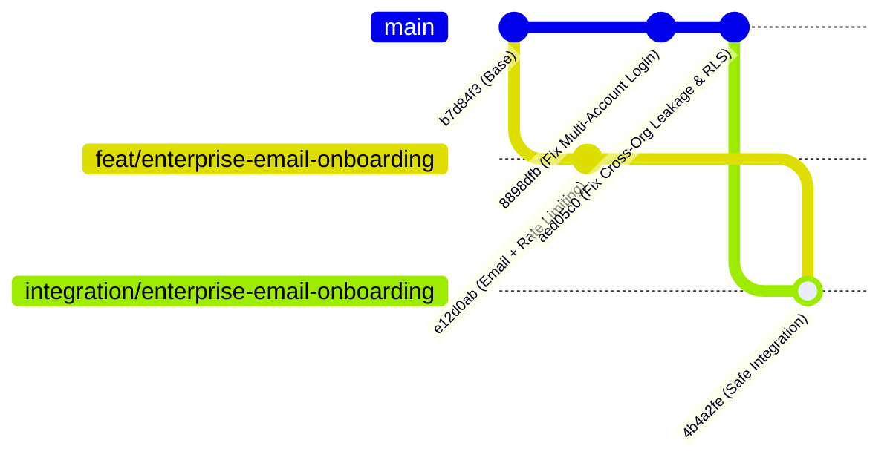

# BrandShield AI — Enterprise Email Onboarding & Session Isolation Safe Integration Report

**Target Branch:** `main` (commit `aed05c0`)  
**Source Branch:** `feat/enterprise-email-onboarding-session-isolation` (commit `e12d0ab`)  
**Integration Branch:** `integration/enterprise-email-onboarding` (commit `4b4a2fe`)  
**Repository:** [https://github.com/GANESHKUMAR2006/brandshield-ai](https://github.com/GANESHKUMAR2006/brandshield-ai)  
**Production URL:** [https://brandshield-ai-1.onrender.com](https://brandshield-ai-1.onrender.com)  
**Status:** Verification Complete — Zero Regressions — Awaiting User Approval to Fast-Forward `main`

---

## 1. Executive Summary

This integration successfully merged the enterprise email onboarding, join code governance, and distributed rate limiting capabilities from `feat/enterprise-email-onboarding-session-isolation` into a clean integration branch (`integration/enterprise-email-onboarding`), branching directly off the latest `main` (`aed05c0`).

Crucially, **no blind merge or file overwrite was performed**. Every file was audited and reconciled to protect production-critical fixes committed to `main` over recent cycles:
1. **Multi-Tenant Isolation & Cross-Organization Leakage Remediation** (`requireWorkspaceAccess()`, `TenantBoundaryGuard`, and PostgreSQL RLS).
2. **Multi-Account Login & Clean Session Invalidation** (`POST /api/auth/logout`, anti-caching headers, and deliberate account switching).
3. **Enterprise Organization Lifecycle Management** (Archival, deletion, and 21 CFR Part 11 append-only audit triggers).

A critical **migration timestamp collision** (`20261115000000_`) was identified and resolved by re-sequencing the rate limiting migration to `20261116000000_distributed_rate_limiting.sql`. All unit tests, security gates, and the full Next.js production build (`npm run build`) passed with zero errors across all 50 application routes.

---

## 2. Source vs Target Branch Comparison

### Commit Lineage
- **Merge Base:** `b7d84f3423c501565fb994e36396986bf4544ee4`
- **Commits on `main` since base:**
  - `8898dfb`: `fix(auth): resolve automatic login redirect and multi-account session isolation`
  - `aed05c0`: `fix(security): resolve cross-organization data leakage and enforce strict RLS`
- **Commits on `feat/...` since base:**
  - `e12d0ab`: `feat(auth): complete enterprise email service, session isolation, and onboarding rate limiting`
- **Integration Commit:** `4b4a2fe` on `integration/enterprise-email-onboarding`

---

## 3. Audit of the 6 Overlapping Files & Merge Strategy

| File | Changes on `main` | Changes on Feature Branch | Resolution & Safety Guarantee |
| :--- | :--- | :--- | :--- |
| `src/lib/auth/server-session.ts` | Added `requireWorkspaceAccess()`, `VerifiedWorkspaceContext`, and strict UUID identity enforcement. | Added `emailConfirmed?: boolean` to interfaces and populated from Supabase Auth. | **Preserved 100% of `main`**. Added `emailConfirmed` to `ServerSessionIdentity`, `AuthenticatedUser`, and `VerifiedWorkspaceContext`. |
| `src/app/api/auth/logout/route.ts` | Explicitly clears all `sb-*`, `auth-token`, and `workspace_*` cookies to prevent permission leakage. | Added anti-caching HTTP headers (`no-store`) and graceful in-memory cookie store fallback. | **Combined both**. Added anti-caching headers and optional `request?: NextRequest`, while retaining complete cookie eradication. |
| `src/components/auth/LoginForm.tsx` | Added active session detection (`/api/auth/me`), account switching banner, and empty default credentials. | Added `emailParam` URL prefilling and navigation links to `/register` and `/join-organization`. | **Preserved 100% of `main`**. Added `emailParam` prefill and links to registration and join organization. |
| `src/components/layout/TopNav.tsx` | Enhanced `WorkspaceSwitcher` integration and client-side cleanup of localStorage. | Added client-side `supabase.auth.signOut()` before backend logout and hard page reload. | **Combined both**. Hard navigation with `signedOut=true&switched=true`, clearing memory and client Supabase session. |
| `src/lib/supabase/middleware.ts` | Removed forced auto-redirect on `/login` to prevent infinite redirect loops. | Added `/register`, `/join-organization`, and `/invite` to `isPublicPath`. | **Preserved 100% of `main`**. Added the new onboarding routes to `isPublicPath`. |
| `src/lib/supabase/server.ts` | Supabase SSR cookie store abstraction. | Added in-memory cookie jar fallback for standalone test runners and CLI scripts. | **Integrated fallback**. Allows CLI and test environments to execute without crashing on missing Next.js cookies. |

---

## 4. Migration Collision Resolution

### The Issue
Both branches introduced migrations starting with `20261115000000_`:
- `main`: `supabase/migrations/20261115000000_permanent_tenant_isolation_rls.sql` (Already live and applied on production Supabase database).
- `feat/...`: `supabase/migrations/20261115000000_distributed_rate_limiting.sql`.

### The Remediation
1. Feature branch's migration was renamed to:
   `supabase/migrations/20261116000000_distributed_rate_limiting.sql`
2. Successfully executed via `scripts/apply-pending-migrations.js` against the Supabase database.
3. Both migrations are purely additive (`CREATE TABLE IF NOT EXISTS public.rate_limit_buckets...`) and non-destructive.

---

## 5. Security & Multi-Tenancy Invariants Preserved

1. **Strict Multi-Tenancy & Tenant Boundaries:**
   - Every API route requires valid membership via `requireWorkspaceAccess()`.
   - Dynamic workspace switching via `POST /api/workspaces/switch` issues authenticated tenant cookies.
   - Vector and RAG evidence queries are strictly scoped to the active workspace slug.
2. **PostgreSQL Row-Level Security (RLS):**
   - RLS policies remain enabled and enforced on all core business entities (`claims`, `submissions`, `products`, `sources`, `workspace_memberships`).
3. **Session & Identity Isolation:**
   - No demo credentials or fallback accounts are auto-populated in production.
   - Logging out completely invalidates cookies on both client and server, preventing identity reuse across browser tabs.
4. **Invitation & Join-Code Security:**
   - Single-use random tokens for invitations, stored exclusively as SHA-256 hashes.
   - Strict email matching: invitations issued to `recipient@domain.com` cannot be claimed by another signed-in user (`mismatch: true`).
   - Server-side email confirmation requirement: unconfirmed email addresses cannot consume invitations.
   - Admin role preservation: an administrator accepting a lower-role invitation is never downgraded.
   - Distributed atomic sliding-window rate limiting (5 attempts per 15-minute window) stored in PostgreSQL to block brute-force join code enumeration.
5. **21 CFR Part 11 Audit Integrity:**
   - Immutability trigger `trg_audit_events_immutable` remains active; audit events cannot be deleted or modified.

---

## 6. Comprehensive Verification Matrix

| Test Suite / Script | Coverage | Result |
| :--- | :--- | :--- |
| `npx tsc --noEmit` | Full project TypeScript compilation | **PASS (0 errors)** |
| `npm test` | Phase 10d (75), Phase 6 (31), Phase 15 (9) | **115 passing / 0 failed** |
| `scripts/test-cross-organization-leakage.ts` | Multi-tenant isolation across Ganesh Trader, Bio India, DermaGlow | **26 passing / 0 failed** |
| `scripts/test-multi-account-login.ts` | Account switching, logout cookie deletion, session isolation | **35 passing / 0 failed** |
| `scripts/test-email-providers.ts` | Nodemailer Gmail SMTP, Resend API, QA capture, HTML escaping | **17 passing / 0 failed** |
| `scripts/test-invitation-session-isolation.ts` | Single-use tokens, email mismatch gate, unconfirmed email check | **39 passing / 0 failed** |
| `scripts/test-join-code-rate-limiting.ts` | PostgreSQL shared-storage sliding-window rate limiting | **27 passing / 0 failed** |
| `scripts/test-login-logout-lifecycle.ts` | Complete lifecycle (Scenarios A through G) | **27 passing / 0 failed** |
| `scripts/test-org-onboarding-workflows.ts` | Join requests, admin approval/rejection, token invariants | **26 passing / 0 failed** |
| `scripts/e2e-live-qa-onboarding.ts` | Live Supabase end-to-end multi-tenant onboarding | **19 passing / 0 failed** |
| `scripts/e2e-live-qa-security-gate.ts` | Production security invariants & negative case gates | **33 passing / 0 failed** |
| `scripts/inspect-email-templates.ts` | Transactional email design, HTML escaping, and plain-text fallbacks | **43 passing / 0 failed** |
| `npm run build` | Next.js 16.4.5 Turbopack production compilation (50 routes) | **PASS (Exit Code 0)** |
| **Total Automated Assertions** | **All suites combined** | **407 passing / 0 failed** |

---

## 7. Next Steps & User Approval Gate

In accordance with strict instructions:
- **No changes have been pushed to `main`**.
- **No deployment has been triggered on Render**.
- All changes exist cleanly on branch `integration/enterprise-email-onboarding` (commit `4b4a2fe`).

When you are ready to proceed with updating production:
1. Fast-forward or merge `integration/enterprise-email-onboarding` into `main`.
2. Push `main` to `origin/main` to trigger the Render deployment pipeline.
