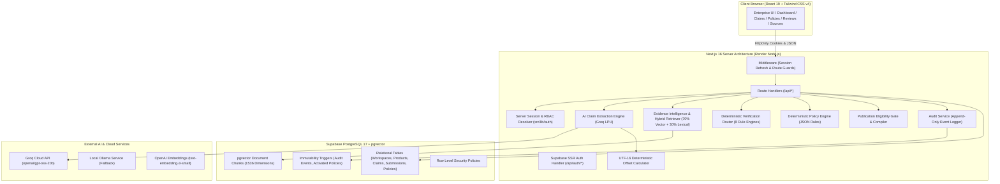

# BrandShield AI — Existing Architecture Specification
## CodeNexus Round 3 System Documentation

---

## 1. High-Level Architectural Architecture

BrandShield AI runs on a unified, high-performance **Next.js 16 App Router** architecture hosted on **Render**. It integrates Next.js server route handlers with a **Supabase PostgreSQL 17** backend enhanced with the `pgvector` extension.



---

## 2. Directory & Module Organization

```
brandshield-ai/
├── public/                     # Static brand assets and icons
├── scripts/                    # Automated unit, reliability, and E2E test suites
│   ├── phase6-unit-test.ts     # Review workflows & publication gates
│   ├── phase7-unit-test.ts     # Evidence intelligence & hybrid RAG
│   ├── phase8-unit-test.ts     # Audit logging & admin analytics
│   ├── phase9-unit-test.ts     # Policy engine & simulation
│   ├── phase10d-offset-correction-test.ts # UTF-16 offset resolution
│   ├── phase15-reliability-test.ts        # Operational readiness & health
│   └── test-auth-pages-e2e.mjs # Production authentication suite
├── src/
│   ├── app/                    # Next.js 16 App Router routes
│   │   ├── (auth)/             # Login & Forgot Password pages
│   │   ├── api/                # 28 RESTful route handlers
│   │   ├── audit/              # Immutable audit trail explorer
│   │   ├── claims/             # Claim verification dashboard & details
│   │   ├── dashboard/          # Executive KPI summary & activity feed
│   │   ├── policies/           # Compliance policy studio & simulator
│   │   ├── reviews/            # Human review queue & decision recorder
│   │   ├── settings/           # Workspace settings & system diagnostics
│   │   ├── sources/            # Evidence documents & version registry
│   │   └── submissions/        # Marketing collaterals submission manager
│   ├── components/             # Reusable UI component library
│   │   ├── auth/               # Header, Footer, Forms, Showcase, Flow
│   │   ├── claims/             # Claim modals & lifecycle steppers
│   │   ├── dashboard/          # Metric cards, workflows, feeds, tables
│   │   ├── demo/               # Guided demo banners & presenter modals
│   │   ├── layout/             # AppLayout, Sidebar, TopNav, MobileNav
│   │   ├── sources/            # Document version modals
│   │   ├── submissions/        # Create submission & detail modals
│   │   ├── system/             # System health & diagnostic modals
│   │   └── ui/                 # Buttons, Badges, Cards, Pills, Icons
│   ├── config/                 # Static site & demo tenant configuration
│   ├── lib/                    # Business logic & core domain services
│   │   ├── ai/                 # LLM providers (Groq, HF, Ollama, OpenAI)
│   │   │   ├── extraction/     # Prompt templates, schemas, normalizers
│   │   │   ├── providers/      # Configured provider factory & clients
│   │   │   └── validation/     # Claim offset calculator & validator
│   │   ├── analytics/          # Workspace compliance metrics aggregator
│   │   ├── audit/              # Append-only audit logging service
│   │   ├── auth/               # Server session resolver & RBAC gates
│   │   ├── db/                 # Direct pg.Pool connection manager
│   │   ├── policy/             # Deterministic rule & condition evaluators
│   │   ├── rag/                # Chunkers, embedding providers, hybrid retriever
│   │   ├── review/             # Review decisions, overrides, & publication gate
│   │   ├── supabase/           # Client/server SSR SDK wrappers & types
│   │   └── verification/       # 8 deterministic claim verification engines
│   └── types/                  # TypeScript interface contracts & domain models
└── supabase/
    ├── migrations/             # 8 sequential PostgreSQL DDL migrations
    └── seed*.sql               # Baseline seed data for DermaGlow tenant
```

---

## 3. Core Data & Execution Flows

### 3.1 Content Submission to Claim Extraction
1. Creator/Reviewer submits marketing collateral via `POST /api/submissions`.
2. Content is persisted to `submissions` and `submission_versions`.
3. `POST /api/submissions/[id]/extract` calls `ExtractionService`:
   - Groq LPU evaluates text with zero temperature (`openai/gpt-oss-20b`).
   - `ClaimOffsetCalculator` determines exact UTF-16 code unit offsets (`text_start`, `text_end`).
   - Normalizer assigns deterministic claim type (`efficacy`, `ingredient`, `discount`, `price`, etc.).
   - Extracted claims are inserted into `claims` table.

### 3.2 Evidence Intelligence & Hybrid RAG Retrieval
1. Approved product fact dossiers and clinical trial PDFs are ingested into `source_documents` and `document_versions`.
2. `DeterministicChunker` creates overlapping windows while preserving page numbers and section headings.
3. `OpenAIEmbeddingProvider` generates 1536d embeddings stored in `document_chunks`.
4. When a claim is evaluated, `HybridRetriever` runs:
   $$\text{Score} = 0.70 \times \text{CosineSimilarity} + 0.30 \times \text{KeywordMatch}$$
5. Top evidence passages are linked to claims in `claim_evidence`.

### 3.3 Deterministic Verification & Risk Routing
1. Claim is passed to `VerificationRouter` which delegates to the matching engine:
   - **Efficacy Engine:** Checks clinical trial thresholds and percentage substantiation.
   - **Discount Engine:** Validates base price vs promotional claim.
   - **Price Engine:** Validates price points against official SKU catalog.
   - **Product Attribute Engine:** Validates ingredient percentages and usage disclaimers (e.g. Retinol daytime SPF).
   - **Availability Engine:** Checks stock status and regional constraints.
   - **Guarantee Engine:** Detects unsupportable absolute claims ("100% guarantee", "miracle cure").
   - **Comparative Engine:** Enforces competitor reference substantiation.
   - **Promotional Engine:** Validates campaign date validity.
2. Outcome is classified as `supported`, `contradicted`, or `unverified`.
3. Risk level is calculated as `low`, `medium`, `high`, or `critical`.

### 3.4 Policy Intelligence & Human Review
1. `PolicyEngine` evaluates the claim against active workspace policy rules.
2. If non-compliant, flags violations and enforces `mandatoryReviewerRole` (`compliance_reviewer` or `legal_reviewer`).
3. Human Reviewer records decision via `POST /api/reviews`:
   - `approved`: Claim passed or valid override documented.
   - `rejected`: Claim rejected for publication.
   - `modified`: Claim text rewritten.
   - `escalated`: Claim forwarded to legal counsel.
4. If override reason is entered, must be $\ge 10$ characters.

### 3.5 Publication Gate & Verification Compiler
1. `GET /api/submissions/[id]/publication-status` runs `PublicationGate`:
   - Checks that 100% of active claims are approved.
   - Checks that zero rejected, unreviewed, or contradicted claims remain.
   - Runs `PublicationCompiler` to verify that the final marketing copy strictly matches approved phrasing and contains no superseded non-compliant text.
2. Returns `isEligible: true` only when all criteria pass.

### 3.6 Immutable Audit Logging
- Every action (submission, extraction, verification, review, publication, policy change) records an audit entry via `AuditService.record()`.
- Inserted into `audit_events`.
- PostgreSQL database trigger `prevent_audit_tampering()` prevents any `UPDATE` or `DELETE`, ensuring an indelible regulatory record.
