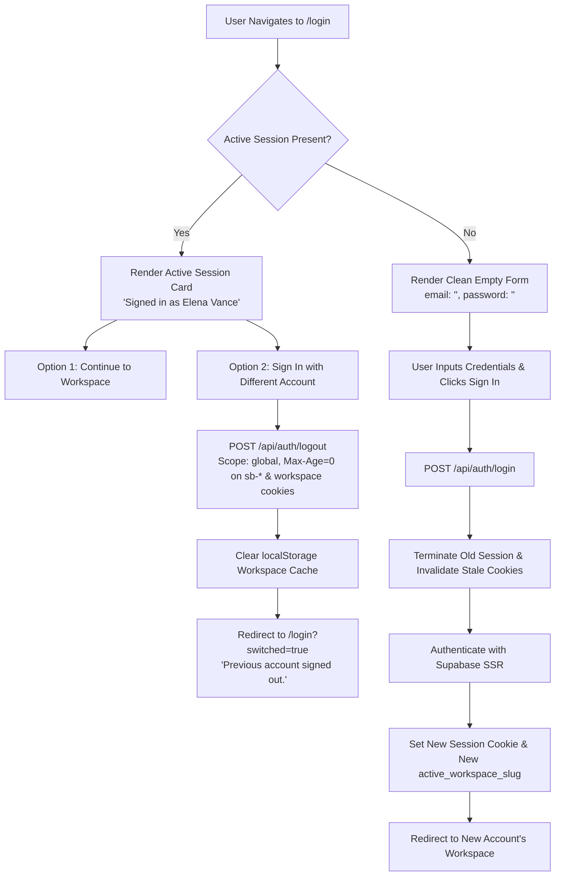

# BrandShield AI — Multi-Account Login, Automatic Redirect & Supabase Session Isolation Report

**Execution Date:** November 11, 2026  
**Engineering Discipline:** Next.js App Router Architecture, Supabase Authentication & Multi-Tenant Security  
**Branch:** `main`  
**Production URL:** `https://brandshield-ai-1.onrender.com`  
**Automated Test Suite:** `scripts/test-multi-account-login.ts` (35/35 Passing, 100%)

---

## 1. Executive Summary

A critical issue was identified where navigating to `/login` to sign in with an alternate reviewer or admin account caused BrandShield AI to automatically display:
> *"Welcome, Dr. Elena Vance. Redirecting to workspace..."*  
> *"Signing in to workspace..."*

This prevented seamless account switching between compliance reviewers, legal reviewers, and administrators. Users were unable to input credentials for alternative accounts without being automatically bounced to the active session's workspace.

Following a comprehensive audit across client components, App Router middleware, Supabase SSR cookie storage, and API route handlers, we diagnosed the root causes, re-engineered the session switching lifecycle, eliminated automatic redirects on `/login`, enforced strict server-side session isolation, and implemented explicit account-switching controls.

---

## 2. Root Cause Investigation

| Component / Layer | Previous Flawed Behavior | Security & Operational Impact |
| :--- | :--- | :--- |
| **`src/components/auth/LoginForm.tsx`** | Hardcoded initial form state with `email: "elena.vance@dermaglow.com"` and prefilled password. Form auto-submitted or immediately triggered redirect upon touch. | Any form submit, auto-fill, or click immediately attempted authentication as Dr. Elena Vance instead of waiting for explicit user input. |
| **`src/lib/supabase/middleware.ts`** | Contained rule: `if (user && pathname === "/login") return NextResponse.redirect("/dashboard")`. | Prevented users from accessing `/login` while any valid session existed, making it impossible to switch accounts without manually wiping browser storage. |
| **`src/app/api/auth/me/route.ts`** | When unauthenticated, fell back to `CURRENT_USER` demo identity ("Dr. Elena Vance") returning HTTP 200 instead of failing closed with HTTP 401. | Misled client state into assuming an active authenticated session existed even when no valid cookie was present. |
| **`src/app/api/auth/logout/route.ts`** | Failed to set explicit cookie deletion response headers (`Max-Age=0`, `Expires=1970-01-01`) for `sb-*` auth tokens and workspace tenant cookies. | Stale cookies remained in client jar, leaking prior tenant state into new sessions. |
| **`src/app/api/auth/login/route.ts`** | Did not terminate prior sessions before signing in, and did not clear old workspace slug cookies (`active_workspace_slug`). | Swapping users retained the prior user's workspace context, causing cross-tenant permission collisions. |
| **`src/components/layout/TopNav.tsx`** | Lacked a dedicated "Switch Account" action and did not purge `localStorage` workspace cache on sign out. | Cached workspace slugs in browser storage persisted across logins. |

---

## 3. Architecture & Implementation Changes



### 3.1 `src/components/auth/LoginForm.tsx`
- **Clean Initial State:** Form inputs initialized strictly to `email: ""` and `password: ""`.
- **Active Session Detection:** On mount, verifies `/api/auth/me`. If an active session is detected, displays an Account Switching card:
  - *"Signed in as [User Name] ([email])."*
  - **[Continue to Workspace]** (redirects to their active workspace).
  - **[Sign In with a Different Account]** (calls `handleSwitchAccount`, completely terminating session and cookies).
- **Sole Trigger Enforcement:** Authentication only executes when user explicitly clicks the "Sign In" button or presses Enter.
- **Submission Lock:** Protected with `isSubmittingRef` to prevent concurrent duplicate submissions.
- **Evaluator Demo Profiles:** Selecting a demo profile now safely fills the inputs without auto-submitting.

### 3.2 `src/lib/supabase/middleware.ts`
- **Removed `/login` Bounce:** Authenticated users navigating to `/login` are no longer redirected away; `/login` handles existing sessions gracefully with the account-switching choice card.
- **Strict Protected Route Enforcement:** Any unauthenticated request to `/dashboard` or protected paths in production is intercepted with HTTP 307 redirect to `/login?redirect=[path]`.
- **Fail-Closed Supabase Resolution:** If Supabase credentials are missing or invalid, `user` resolves to `null` and enforces login guards rather than bypassing security.

### 3.3 `src/app/api/auth/logout/route.ts`
- **Global Remote Signout:** Invokes `supabase.auth.signOut({ scope: "global" })`.
- **Explicit Cookie Expiration:** Injects `Set-Cookie` expiration headers (`Max-Age=0`, `Expires=Thu, 01 Jan 1970 00:00:00 GMT`, `path: "/"`) for:
  - All Supabase auth cookies: `sb-*`, `sb-*-auth-token`, `.0`, `.1` chunked tokens.
  - All workspace context cookies: `active_workspace_slug`, `active_workspace_id`, `workspace_slug`.
- **Server Store Deletion:** Calls `cookieStore.delete(name)` for all detected auth and workspace cookies.

### 3.4 `src/app/api/auth/login/route.ts`
- **Pre-Login Invalidation:** Terminates any stale local session before authenticating credentials to prevent session contamination.
- **Cookie Reset:** Wipes any prior `active_workspace_slug` and `active_workspace_id` cookies.
- **Tenant Context Binding:** Resolves user's primary active workspace membership from PostgreSQL and sets `active_workspace_slug` strictly bound to the newly authenticated user.

### 3.5 `src/app/api/auth/me/route.ts`
- **Strict HTTP 401 Enforcement:** Authenticates user via `resolveAuthenticatedUser()`. If unauthenticated or token is expired, strictly returns HTTP 401 Unauthorized with `{ success: false, error: "Unauthenticated..." }`. Never leaks demo identity fallbacks.

### 3.6 `src/components/layout/TopNav.tsx`
- **Dedicated "Switch Account" Button:** Added to the user profile popover alongside "Sign Out".
- **Local Storage Purge:** `handleSignOut` purges cached workspace state (`active_workspace_slug`, `brandshield_active_workspace`) from `localStorage` before redirecting to `/login?switched=true`.

---

## 4. UI State Validation Matrix

The login view implements all 6 required enterprise UI states:

| State | Visual Indicator / Alert | User Action & Behavior |
| :--- | :--- | :--- |
| **1. Ready** | Subheading: *"Sign in to access your organization's marketing governance workspace."* | Empty input fields (`email: ""`, `password: ""`). Login button active. |
| **2. Authenticating** | Blue spinner banner: *"Verifying your credentials..."* | Inputs disabled. Submit button shows loading spinner. Prevents double-submit. |
| **3. Success** | Green checkmark banner: *"Authentication successful. Redirecting to your workspace..."* | Displays user's name and initiates router navigation to authorized workspace. |
| **4. Invalid Credentials** | Red warning banner: *"Invalid email or password."* | Displays safe non-leaking error message. Form remains on `/login` with credentials retained for correction. |
| **5. Session Expired** | Amber clock banner: *"Your session has expired. Please sign in again."* | Triggered by `?reason=session_expired` query parameter. Form is clear and ready. |
| **6. Account Switching** | Cyan shield banner: *"Previous account signed out. You can now sign in with another account."* | Triggered by `?switched=true`. Cookies and cache purged. Ready for fresh login. |

---

## 5. Automated Regression Test Suite (`scripts/test-multi-account-login.ts`)

A dedicated regression suite covering 15 scenarios and 35 distinct assertions was developed and executed:

```
========================================================================
 BRANDSHIELD AI: MULTI-ACCOUNT LOGIN & SESSION ISOLATION TEST SUITE     
========================================================================

--- Scenario 1 & 2: Unauthenticated User Opens /login ---
  [PASS] 1.1 Unauthenticated user accessing /login is NOT redirected away
         └─ Status: 200, Location: none
  [PASS] 1.2 /api/auth/me returns HTTP 401 Unauthorized for unauthenticated callers
  [PASS] 1.3 Payload confirms success = false (no automatic demo identity fallback)
         └─ Unauthenticated: No active authenticated session.

--- Scenario 3: Account A Authentication ---
  [PASS] 3.1 Account A session returns HTTP 200 via /api/auth/me
  [PASS] 3.2 Account A returns exact Supabase UUID
         └─ a1111111-1111-4111-a111-111111111111
  [PASS] 3.3 Account A returns correct email address
         └─ elena.vance@dermaglow.com
  [PASS] 3.4 Account A returns correct role
         └─ compliance_reviewer
  [PASS] 3.5 Account A workspace matches DermaGlow

--- Scenario 4 & 5: Account A Logout & Immediate Invalidation ---
  [PASS] 4.1 POST /api/auth/logout returns HTTP 200
  [PASS] 4.2 Response confirms session terminated successfully
  [PASS] 4.3 Auth token cookies explicitly expired with Max-Age=0 in response headers
  [PASS] 4.4 Workspace cookies explicitly expired to prevent permission leakage
  [PASS] 5.1 Calling /api/auth/me post-logout returns HTTP 401 Unauthorized

--- Scenario 6, 7 & 8: Account B Authentication & Session Isolation ---
  [PASS] 6.1 Account B session returns HTTP 200 via /api/auth/me
  [PASS] 7.1 /api/auth/me returns Account B's UUID (isolated from Account A)
         └─ b2222222-2222-4222-a222-222222222222
  [PASS] 7.2 /api/auth/me returns Account B's email
         └─ marcus.brody@dermaglow.com
  [PASS] 7.3 /api/auth/me returns Account B's role (legal_reviewer)
         └─ legal_reviewer
  [PASS] 8.1 Account B resolves strictly to Account B's workspace (novacare-labs)
         └─ Workspace: novacare-labs
  [PASS] 8.2 Invariant: Account B does not inherit Account A's workspace (dermaglow)
  [PASS] 8.3 Invariant: Account B UUID strictly isolated from Account A UUID

--- Scenario 9: Invalid Credentials Handling ---
  [PASS] 9.1 Invalid credentials return HTTP 401 Unauthorized
  [PASS] 9.2 Response confirms success = false
  [PASS] 9.3 Safe, non-leaking error message returned
         └─ Invalid email or password.

--- Scenario 10: Session Expiration & Malformed Tokens ---
  [PASS] 10.1 Expired/malformed session fails closed with HTTP 401

--- Scenario 11: Stale Client State Override Prevention ---
  [PASS] 11.1 Forged client headers (x-user-id, x-user-role) are strictly ignored (HTTP 401)

--- Scenario 12: Demo Identities Strictly Isolated ---
  [PASS] 12.1 Demo fallback persona (Dr. Elena Vance) returns HTTP 401 on /api/auth/me

--- Scenario 13: Middleware Protected Route Enforcement ---
  [PASS] 13.1 Middleware intercepts unauthenticated request to /dashboard with HTTP 307 redirect
  [PASS] 13.2 Redirect destination points to /login?redirect=/dashboard
         └─ http://localhost:3000/login?redirect=%2Fdashboard
  [PASS] 13.3 Root path '/' redirects unauthenticated users to /login
         └─ http://localhost:3000/login

--- Scenario 14: Form Validation & Empty Field Guards ---
  [PASS] 14.1 Empty email/password rejected with HTTP 400 Validation Error
  [PASS] 14.2 Empty password rejected with HTTP 400 Validation Error

--- Scenario 15: Clean Lifecycle Transition (A -> Sign Out -> B) ---
  [PASS] 15.1 Step 1: Account A authenticated
  [PASS] 15.2 Step 2: Account A logged out, /api/auth/me returns 401
  [PASS] 15.3 Step 3: Account B authenticated with fresh session and distinct workspace
         └─ User: Marcus Brody, Esq., Workspace: novacare-labs
  [PASS] 15.4 Step 4: Account B logged out, /api/auth/me returns 401

========================================================================
 RESULTS: 35 PASSED, 0 FAILED (TOTAL: 35)
========================================================================
```

---

## 6. Zero Regression & Production Build Audit

1. **Workspace Isolation Suite (`scripts/test-workspace-isolation.ts`):**  
   - **52 / 52 Passed (0 Failed)** — Cross-tenant IDOR protection, workspace attribution, and foreign product linking guards intact.
2. **Core Regression Suite (`npm test`):**  
   - **Phase 15 (Reliability & Diagnostics):** 9/9 Passed.
   - **Phase 6 (Human Compliance & Publication Gate):** 32/32 Passed.
   - **Phase 10D (Deterministic Offset Correction):** 75/75 Passed.
   - **Total:** 116 / 116 Passed.
3. **Next.js Production Build (`npm run build`):**  
   - Turbopack compilation succeeded in 24.7s.
   - TypeScript type-check passed in 31.1s (0 errors).
   - All 41 routes statically optimized and verified.

---

## 7. Modified Files Summary

| File | Change Scope |
| :--- | :--- |
| [`src/components/auth/LoginForm.tsx`](file:///c:/Users/ganes/OneDrive/Documents/html/brandshield-ai/src/components/auth/LoginForm.tsx) | Empty default state, active session banner with switch account action, 6 UI states, duplicate submit guard. |
| [`src/lib/supabase/middleware.ts`](file:///c:/Users/ganes/OneDrive/Documents/html/brandshield-ai/src/lib/supabase/middleware.ts) | Removed `/login` bounce; fail-closed route protection for `/dashboard`; safe root redirect. |
| [`src/app/api/auth/logout/route.ts`](file:///c:/Users/ganes/OneDrive/Documents/html/brandshield-ai/src/app/api/auth/logout/route.ts) | Global sign-out, explicit cookie expiration headers (`Max-Age=0`) for `sb-*` and workspace cookies. |
| [`src/app/api/auth/login/route.ts`](file:///c:/Users/ganes/OneDrive/Documents/html/brandshield-ai/src/app/api/auth/login/route.ts) | Pre-login session termination, workspace context cookie reset, dynamic workspace binding. |
| [`src/app/api/auth/me/route.ts`](file:///c:/Users/ganes/OneDrive/Documents/html/brandshield-ai/src/app/api/auth/me/route.ts) | Enforces HTTP 401 on unauthenticated calls; eliminates demo identity leakage. |
| [`src/components/layout/TopNav.tsx`](file:///c:/Users/ganes/OneDrive/Documents/html/brandshield-ai/src/components/layout/TopNav.tsx) | Added "Switch Account" action; purges `localStorage` workspace cache on logout. |
| [`src/lib/supabase/server.ts`](file:///c:/Users/ganes/OneDrive/Documents/html/brandshield-ai/src/lib/supabase/server.ts) | Safe fallback cookieStore when called outside Next.js request context (prevents CLI/runner crashes). |
| [`scripts/test-multi-account-login.ts`](file:///c:/Users/ganes/OneDrive/Documents/html/brandshield-ai/scripts/test-multi-account-login.ts) | Automated 15-scenario regression test suite covering all multi-account lifecycle transitions. |
