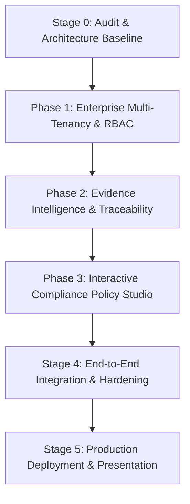

# BrandShield AI — Comprehensive Project Audit
## CodeNexus Hackathon — Round 3 (Final Round)

**Date:** November 9, 2026  
**Repository Branch:** `round3-development`  
**Application Version:** `1.0.0`  
**Deployment Platform:** Render (Unified Next.js 16 App Router)  
**Database:** Supabase PostgreSQL 17 with `pgvector`  
**Test Suite Baseline:** 178 passing automated unit, reliability, and invariant tests  

---

## 1. Executive Summary

BrandShield AI is an enterprise-grade AI marketing claim verification and brand governance platform. Its core mission is:
> **"Marketing claims. Verified before publication against approved product evidence, with human oversight."**

The platform has reached Round 3 (Final Round) of the CodeNexus Hackathon. This audit provides an exhaustive architectural and codebase baseline to prepare the platform for enterprise multi-tenancy, advanced evidence traceability, and an interactive compliance policy studio without disrupting existing, validated functionality.

---

## 2. Technology Stack & Infrastructure

| Layer | Component | Version / Provider | Status |
| :--- | :--- | :--- | :--- |
| **Framework** | Next.js (App Router, Turbopack) | `16.4.5` | Stable, Production Built |
| **Frontend Runtime** | React & React DOM | `19.3.0` | Active |
| **Styling** | Tailwind CSS v4 | `@tailwindcss/turbopack ^4` | Active, Figma-aligned |
| **Icons** | Lucide React | `^1.70.0` | Active |
| **Database** | PostgreSQL 17 (Supabase Managed) | `pg ^8.23.1` (Direct Pool) | 14 tables, RLS, triggers |
| **Vector Engine** | `pgvector` | `vector(1536)` | Cosine distance index |
| **Auth & Sessions** | Supabase Auth (`@supabase/ssr`) | `^0.12.7` | HttpOnly cookies, SSR |
| **Primary Cloud LLM** | Groq LPU Inference | `openai/gpt-oss-20b` | Structured JSON extraction |
| **Secondary LLMs** | Hugging Face Router, Ollama, OpenAI | Fallback architecture | Operational |
| **Document Parsing** | `pdf-parse`, custom XML DOCX, text | Digital text extraction | Multi-format active |
| **Schema Validation**| Zod | `^4.6.7` | Request validation |
| **Deployment** | Render Cloud Application | Docker / Node.js 20+ | Active on Render |

---

## 3. Subsystem Architectural Audits

### 3.1 Authentication & Multi-Tenancy

- **Current Implementation:**
  - Route handlers: `/api/auth/login`, `/api/auth/logout`, `/api/auth/me`, `/api/auth/forgot-password`.
  - Session verification: Handled via `@supabase/ssr` cookies and `resolveServerSession()` in `src/lib/auth/server-session.ts`.
  - Fails closed in production: Rejects unauthenticated requests with HTTP 401 (`AuthenticationRequiredError`).
  - Roles currently supported in code: `admin`, `compliance_reviewer`, `legal_reviewer`, `viewer`.
  - Single Workspace: Pre-configured for `DermaGlow` (`00000000-0000-0000-0000-000000000001`, slug: `dermaglow`).
- **Gaps & Deficiencies for Round 3:**
  1. **Missing `creator` Role:** Round 3 explicitly mandates 5 roles: `Admin`, `Compliance Reviewer`, `Legal Reviewer`, `Creator`, and `Viewer`. Currently, `creator` is not defined in `ReviewerRole` or RBAC gates.
  2. **No Workspace Membership Tables:** Workspace assignment is currently stored loosely in Supabase Auth `app_metadata.workspaces`. There is no relational `workspace_memberships` table or `workspace_invitations` table.
  3. **No Workspace Management APIs:** No endpoints exist to create organizations, update organization metadata, invite members, or accept/revoke invitations.
  4. **Direct DB Pool Bypasses RLS:** `server-db.ts` uses direct `pg.Pool` connection string. Queries must explicitly enforce `WHERE workspace_id = $1` to guarantee tenant isolation.

### 3.2 Evidence Intelligence & Retrieval-Augmented Generation (RAG)

- **Current Implementation:**
  - Ingestion service (`src/lib/rag/ingestion/`): Handles `.txt`, `.md`, `.docx` (including tables), and `.pdf`.
  - Chunking (`deterministic-chunker.ts`): Splits documents by headings and character windows with overlaps while preserving page telemetry and section titles.
  - Embeddings (`embedding-provider.ts`): Uses 1536-dimensional vectors (`text-embedding-3-small`). Validates vector length strictly against `vector(1536)` in `document_chunks`.
  - Hybrid Retrieval (`hybrid-retriever.ts`): Scores 70% cosine similarity + 30% lexical keyword overlap.
  - Evidence Stance: Categorizes evidence as `supporting`, `contradicting`, or `unverified`.
- **Gaps & Deficiencies for Round 3:**
  1. **Scanned PDF Rejection:** `pdf-parser.ts` line 143 explicitly throws `DocumentExtractionError` for scanned or image-only PDFs (`Optical Character Recognition (OCR) is unsupported`). Round 3 requires handling scanned document OCR.
  2. **PDF Table Extraction:** While DOCX tables are parsed to Markdown pipe tables, PDF tabular evidence lacks structured table boundaries.
  3. **In-Document Citation Viewer:** There is no interactive citation viewer in the UI that loads the original document, navigates to the exact page, highlights the specific evidence span, and shows validity/expiration dates.

### 3.3 Claim Extraction & Deterministic Verification

- **Current Implementation:**
  - Extraction Service: Invokes Groq LLM (or fallback) with structured JSON schemas (`extraction-prompt.ts`).
  - Offset Resolution (`ClaimOffsetCalculator`): UTF-16 code unit offset calculator resolving verbatim substrings, emoji/surrogate pairs, and unicode currency symbols (₹, €, $, £).
  - Verification Router: Evaluates claims across **8 deterministic rule engines**:
    1. `availability-verification.ts`
    2. `comparative-verification.ts`
    3. `discount-verification.ts`
    4. `efficacy-verification.ts`
    5. `guarantee-verification.ts`
    6. `price-verification.ts`
    7. `product-attribute-verification.ts`
    8. `promotional-verification.ts`
  - Fails closed: Missing evidence strictly defaults to `unverified`, never false contradictions.
- **Status:** **Rock solid.** 100% test coverage across all 8 engines and offset calculation invariants. Must be preserved untouched.

### 3.4 Compliance Policy Studio

- **Current Implementation:**
  - 6 Master baseline policies implemented in `default-policies.ts`:
    1. `POL-DERMA-001`: Medical Disease Cure Prohibition (`flag_violation`, `legal_reviewer`)
    2. `POL-DERMA-002`: Absolute Guarantee Ban (`require_human_review`, `compliance_reviewer`)
    3. `POL-DERMA-003`: Quantitative Efficacy Requirement (`require_evidence`, `clinical_dossier`)
    4. `POL-DERMA-004`: Comparative Superiority Advertising (`require_human_review`, `legal_reviewer`)
    5. `POL-DERMA-005`: Deep Discount Disclosure (`require_human_review`, `compliance_reviewer`)
    6. `POL-DERMA-006`: Mandatory Results Disclaimer (`flag_violation`, `compliance_reviewer`)
    + Product-specific Retinol SPF requirement (`POL-DERMA-RET-01`)
  - Rule Evaluator (`rule-evaluator.ts`) & Condition Evaluator (`condition-evaluator.ts`): JSON-based deterministic policy engine supporting `contains_phrase`, `matches_regex`, `claim_type_is`, `lacks_evidence_type`, `discount_exceeds`, `lacks_disclaimer`.
  - Policy Simulation (`/api/policies/simulate`): Evaluates draft rules against sample claims in memory with 0 database side effects.
  - Database schema: `policies` and `policy_versions` with immutability triggers on activated versions.
- **Gaps & Deficiencies for Round 3:**
  1. **Visual Policy Builder:** The current modal on `/policies` only supports simple phrase comma lists. Needs an intuitive visual condition builder with multi-condition logic (`ALL` / `ANY`), action pickers, severity selectors, and reviewer role assignment.
  2. **Comprehensive Simulation Studio:** Needs side-by-side claim evaluation against existing QA claims and real-time impact inspection.
  3. **Policy Version Management:** Needs UI controls to draft, validate, simulate, activate, and archive versions.

### 3.5 Review, Approval, Publication & Audit

- **Current Implementation:**
  - Multi-stage lifecycle: `draft` -> `submitted` -> `in_review` -> `approved` / `rejected` / `modified` / `escalated` -> `published`.
  - Override rules: Requires documented justifications (>= 10 characters) to override high/critical risks or contradicted claims.
  - Publication Gate: Verifies 100% of claims are approved and zero non-compliant phrases remain in the final published collaterals.
  - Audit Trail: Immutable append-only PostgreSQL table `audit_events` with trigger `prevent_audit_tampering()`.
- **Status:** Fully functional and verified.

---

## 4. Security & Compliance Audit

| Area | Current State | Risk Level | Mitigation Required in Round 3 |
| :--- | :--- | :--- | :--- |
| **Authentication** | Real Supabase Auth with secure cookies | Low | Maintain strict server-side validation |
| **Tenant Isolation** | Verified in middleware & server-session, but lacks DB membership tables | Medium | Add `workspace_memberships` table, enforce workspace slug resolution across all routes |
| **DB Direct Connection** | `server-db.ts` uses connection pool connecting as DB superuser | High | Ensure every SQL query explicitly includes `workspace_id = $x` parameter or uses tenant query wrappers |
| **Policy Engine Code Injection** | Deterministic JSON rules only | Low | Maintain strict prohibition of executable code inside policy definitions |
| **Secret Sanitization** | Diagnostic endpoints strip secrets | Low | Verified by Phase 15 tests |
| **Audit Immutability** | Database trigger blocks `UPDATE` and `DELETE` | Low | Preserved |

---

## 5. Round 3 Enhancement Roadmap

1. **Phase 1: Multi-Tenancy & RBAC**: Add `creator` role, create `workspace_memberships` and `workspace_invitations` tables, build workspace switcher, and enforce strict cross-tenant isolation.
2. **Phase 2: Evidence Intelligence & Traceability**: Add OCR capability for scanned documents, PDF table extraction, and build an interactive Citation Viewer modal.
3. **Phase 3: Interactive Compliance Policy Studio**: Enhance visual policy builder, expand simulation studio against QA claims dataset, and expose full version lifecycle controls.
4. **Stage 4: Integration & Hardening**: End-to-end integration tests connecting tenant creation -> evidence registration -> policy configuration -> submission -> verification -> review -> publication.
5. **Stage 5: Deployment & Documentation**: Render verification, migration execution, pitch deck and presentation assets.
