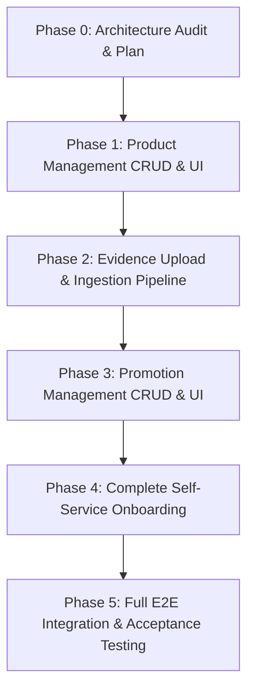

# BrandShield AI — Remaining Product Gaps Architecture Audit

**Date:** 2026-11-10  
**Status:** Audit Complete — Phase 0  
**Scope:** Product Management, Evidence Management, Promotion Management, Self-Service Onboarding  
**Architect:** Senior Full-Stack Engineer, SaaS Architect, Database Engineer & QA Specialist  

---

## 1. Executive Summary

BrandShield AI has completed foundational enterprise security hardening, workspace isolation, row-level security (RLS), deterministic claim verification, and multi-tenant authentication. However, a comprehensive capability audit reveals four key operational and functional gaps preventing autonomous, end-to-end multi-tenant SaaS adoption:

1. **Product Management Gap:** Products are queryable via `GET /api/products`, but no UI or API exists for creating, editing, or deleting products. The UI displays products in a read-only table in the Evidence Library with hardcoded DermaGlow labels.
2. **Evidence Management Gap:** The backend ingestion engine supports multi-format parsing, semantic chunking, and pgvector embeddings via `POST /api/sources/ingest`, but the UI upload button (`+ Upload Evidence Dossier` in `/sources`) is inactive with no file upload modal, progress indicator, or error feedback.
3. **Promotion Management Gap:** The promotions table and verification rules exist, but promotions are entirely read-only. No UI or dedicated API exists for creating, editing, or archiving promotional pricing rules.
4. **Self-Service Onboarding Gap:** While organizations can be created via `POST /api/workspaces`, there is no unified self-service onboarding wizard or checklist that guides a new company through workspace setup, inviting reviewers, registering products, uploading evidence dossiers, creating promotions, and running their first marketing claim extraction and verification.

---

## 2. Detailed Gap Analysis

### Gap A: Product Management

#### 1. Existing Implementation
- **Database Schema:** `products` table exists in PostgreSQL with `id`, `workspace_id`, `name`, `sku`, `description`, `category`, `reference_price`, `currency`, `status`, `created_at`, `updated_at`.
- **API Route:** `src/app/api/products/route.ts` has a `GET` handler returning products scoped to `session.workspaceSlug` with aggregated `approved_facts`.
- **UI:** `src/app/sources/page.tsx` contains a "Product Catalog" tab displaying products in a table, but with a hardcoded header title *"DermaGlow Product Catalogue"* and zero action buttons.

#### 2. Missing Implementation
- **API Handlers:**
  - `POST /api/products`: Create a new product scoped to the caller's active workspace.
  - `PATCH /api/products/[id]`: Edit product fields (name, description, category, reference_price, currency, status) scoped to the caller's workspace.
  - `DELETE /api/products/[id]`: Delete or archive a product with referential integrity safeguards (prevent deleting products associated with active submissions/policies unless intended).
- **UI Components:**
  - `RegisterProductModal.tsx`: Form to add a new product (Name, SKU, Category, Reference Price, Currency, Description).
  - `EditProductModal.tsx`: Form to update existing product details.
  - `DeleteProductDialog.tsx`: Confirmation modal with safeguards.
  - Dynamic workspace header replacing the hardcoded "DermaGlow Product Catalogue".
  - Dedicated `/products` page and enhanced interactive controls directly in `/sources` (Product Catalog tab).

#### 3. Relevant Files
- Schema: `supabase/migrations/20261105000000_initial_schema.sql`
- API: `src/app/api/products/route.ts`
- New API: `src/app/api/products/[id]/route.ts`
- Client: `src/lib/api-client.ts`
- UI: `src/app/sources/page.tsx` and new `src/app/products/page.tsx`
- Components: `src/components/products/`

#### 4. Database Changes Required
- None. The `products` table already contains all required columns (`id`, `workspace_id`, `name`, `sku`, `description`, `category`, `reference_price`, `currency`, `status`).

#### 5. Security Considerations
- Workspace isolation: Every insert, update, and delete must enforce `workspace_id = session.workspaceId`.
- RBAC: Product creation and deletion restricted to `admin` and `compliance_reviewer` roles; `viewer` rejected with HTTP 403.
- SKU Uniqueness: Check for duplicate SKU within the workspace before insertion to provide user-friendly feedback.

---

### Gap B: Evidence Management

#### 1. Existing Implementation
- **Ingestion Pipeline:** `src/app/api/sources/ingest/route.ts` parses multi-format documents (PDF, DOCX, TXT, MD) via `DocumentIngestionService`, chunks text deterministically via `DeterministicChunker`, generates vector embeddings via `embedding-provider`, and writes to `document_chunks`.
- **Sources API:** `src/app/api/sources/route.ts` lists source documents, document versions, approved facts, and promotions for `session.workspaceSlug`.
- **UI:** `src/app/sources/page.tsx` displays documents, but the `+ Upload Evidence Dossier` button has no `onClick` handler.

#### 2. Missing Implementation
- **API Enhancements:**
  - Ensure `POST /api/sources/ingest` cleanly creates the parent `source_documents` and initial `document_versions` record when `sourceDocumentId` is not provided, linking everything in a single atomic transaction.
- **UI Components:**
  - `UploadEvidenceModal.tsx`:
    - Drag-and-drop zone and file picker accepting `.pdf`, `.docx`, `.txt`, `.md`.
    - Input fields for Document Title, Document Type (`clinical_dossier`, `scientific_study`, `regulatory_guideline`, `lab_test_report`), and Description.
    - Multi-stage upload progress indicator:
      1. *Reading file contents*
      2. *Parsing document sections & page boundaries*
      3. *Generating deterministic chunks & provenance IDs*
      4. *Generating vector embeddings*
      5. *Writing to PostgreSQL vector store*
    - Error and success alerts with clear status messaging.
    - Automatic refresh of the Evidence Library upon successful ingestion.

#### 3. Relevant Files
- Ingestion API: `src/app/api/sources/ingest/route.ts`
- Sources API: `src/app/api/sources/route.ts`
- Ingestion Engine: `src/lib/rag/ingestion/document-ingestion-service.ts`
- UI: `src/app/sources/page.tsx`
- New Component: `src/components/sources/UploadEvidenceModal.tsx`

#### 4. Database Changes Required
- None. `source_documents`, `document_versions`, and `document_chunks` tables already possess required schemas.

#### 5. Security Considerations
- Max payload size enforcement (15MB limit).
- Magic bytes validation for PDF and DOCX uploads to block disguised malicious files.
- Tenant isolation: Documents must be linked to `session.workspaceId`.
- RBAC: `viewer` role rejected with HTTP 403; only `admin`, `compliance_reviewer`, `legal_reviewer`, or `creator` permitted to ingest.

---

### Gap C: Promotion Management

#### 1. Existing Implementation
- **Database Schema:** `promotions` table exists in PostgreSQL with `id`, `product_id`, `promotion_name`, `discount_type`, `discount_value`, `resulting_price`, `currency`, `start_date`, `end_date`, `applicable_channels`, `terms`, `status`, `created_at`.
- **Verification Logic:** `promotional-verification.ts` and `price-verification.ts` verify claim prices against active promotions.
- **UI:** Read-only table in `src/app/sources/page.tsx` (Tab 4).

#### 2. Missing Implementation
- **API Endpoints:**
  - `POST /api/promotions`: Create promotion with workspace product verification.
  - `GET /api/promotions`: Fetch promotions for the active workspace.
  - `PATCH /api/promotions/[id]`: Update promotion details, pricing rules, dates, or status.
  - `DELETE /api/promotions/[id]`: Cancel or delete promotion with workspace isolation.
- **UI Components:**
  - `CreatePromotionModal.tsx`: Modal allowing selection of workspace products, discount type (`fixed`, `percentage`, `bundle`), discount value, automated resulting price calculation, validity dates, channels, and terms.
  - `EditPromotionModal.tsx`: Modal to update active promotion terms.
  - `DeletePromotionDialog.tsx`: Confirmation modal.
  - Action buttons in `/sources` (Tab 4) and dedicated promotion management UI.

#### 3. Relevant Files
- Verification Rule: `src/lib/verification/rules/promotional-verification.ts`
- Verification Context: `src/lib/verification/verification-context.ts`
- New API: `src/app/api/promotions/route.ts` & `src/app/api/promotions/[id]/route.ts`
- Client: `src/lib/api-client.ts`
- UI: `src/app/sources/page.tsx` and new `src/components/promotions/`

#### 4. Database Changes Required
- None. `promotions` table schema is complete.

#### 5. Security Considerations
- Foreign product validation: Must verify that `product_id` belongs to `session.workspaceId` before inserting or updating a promotion.
- Workspace boundary: Promotion lookup must join `products` on `workspace_id`.
- RBAC: Only `admin` and `compliance_reviewer` may create, modify, or delete promotions.

---

### Gap D: Complete Self-Service Company Onboarding

#### 1. Existing Implementation
- **Workspace API:** `src/app/api/workspaces/route.ts` supports `POST` to create a workspace and auto-assigns the creator as `admin`.
- **Members & Invitations:** `src/app/api/workspaces/[id]/members/route.ts` and `src/app/api/workspaces/[id]/invitations/route.ts` support team invitations and RBAC assignment.
- **UI:** `WorkspaceSwitcher.tsx` allows switching between workspaces, and `src/app/settings/page.tsx` allows managing organization info and inviting members.

#### 2. Missing Implementation
- **Cohesive Onboarding Flow:**
  - A new organization has zero products, zero evidence documents, zero promotions, and zero submissions.
  - Currently, there is no guided onboarding checklist or wizard that walks the newly registered company through:
    1. Registering the company/workspace.
    2. Inviting team members and configuring governance roles.
    3. Registering the company's first commercial product.
    4. Ingesting their first clinical or substantiation dossier.
    5. Setting up their first active promotional campaign.
    6. Configuring a compliance policy in Policy Studio.
    7. Submitting their first marketing ad copy.
    8. Extracting claims and seeing AI verification citations.
- **Onboarding Hub UI:**
  - `src/app/onboarding/page.tsx`: An interactive 10-step self-service onboarding checklist with live status indicators, quick-action launchers, and progress bar showing completion percentage.
  - Seamless navigation back to Dashboard once onboarding steps are underway.

#### 3. Relevant Files
- Workspace API: `src/app/api/workspaces/route.ts`
- Navigation: `src/components/layout/Sidebar.tsx`
- New Page: `src/app/onboarding/page.tsx`
- New Component: `src/components/onboarding/OnboardingWizard.tsx`

---

## 3. Implementation Plan & Execution Order

### Dependency Chain:
1. **Phase 1 (Product Management):** Required first because Evidence, Promotions, and Submissions all link to Products.
2. **Phase 2 (Evidence Management):** Connects the upload UI to the existing RAG chunker and embedding pipeline.
3. **Phase 3 (Promotion Management):** Connects promotional pricing rules to registered products.
4. **Phase 4 (Self-Service Onboarding):** Orchestrates all capabilities into a guided onboarding workflow.
5. **Phase 5 (Testing & Verification):** Validates all 6 user acceptance scenarios, runs regression tests, typechecks, and builds.

---

## 4. Verification & Testing Matrix

| Scenario | Scope | Expected Result | Pass Criteria |
|---|---|---|---|
| **Scenario 1** | New Company Creation | `POST /api/workspaces` creates workspace & admin membership | HTTP 201; visible in switcher |
| **Scenario 2** | Product Management | Create, View, Edit, Delete product | HTTP 200/201; isolated to workspace |
| **Scenario 3** | Evidence Upload | Ingest PDF/DOCX/TXT/MD with chunking & embedding | Chunks in `document_chunks`; status displayed |
| **Scenario 4** | Promotion Management | Create, Edit, Delete promotion | HTTP 200/201; verified in context loader |
| **Scenario 5** | End-to-End Governance | Product + Evidence + Promo + Submission -> Verification | Claims extracted; citations verified |
| **Scenario 6** | Multi-Tenant RBAC | Admin vs Reviewer vs Viewer permissions | 403 on unauthorized mutations; 401 unauthenticated |
