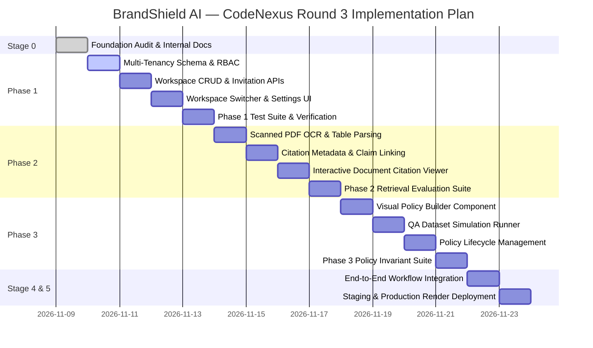

# BrandShield AI — CodeNexus Round 3 Implementation Plan
## Phased Execution Strategy & Architecture Roadmap

---

## 1. Guiding Principles & Invariants

1. **Preserve Validated Foundation:** Never delete or rewrite working claim verification engines, prompt normalizers, or baseline policies.
2. **Backward Compatibility:** All existing endpoints (`/api/claims`, `/api/submissions`, `/api/dashboard/stats`, `/api/policies`) must continue to function seamlessly for `DermaGlow` demo accounts.
3. **No Mocks in Production:** Real Supabase authentication, real pgvector hybrid retrieval, and real Groq inference must execute.
4. **Non-Destructive Database Evolution:** All schema updates will use safe `CREATE TABLE IF NOT EXISTS` and `ALTER TABLE ... ADD COLUMN IF NOT EXISTS` migrations without data loss.
5. **Strict Test Gates:** Every phase must pass its dedicated test suite and regression suite before advancing.

---

## 2. Phase-by-Phase Implementation Roadmap



---

## 3. Detailed Phase Breakdown

### 3.1 Phase 1 — Enterprise Authentication & Multi-Tenancy

#### Objective
Enable multiple organizations to securely provision isolated workspaces, invite team members across 5 roles, and prevent cross-tenant data leakage.

#### Database Migrations
- Migration file: `supabase/migrations/20261110000000_round3_multi_tenancy.sql`
  - `workspace_memberships` table (`workspace_id`, `user_id`, `role`, `status`)
  - `workspace_invitations` table (`workspace_id`, `email`, `role`, `token`, `expires_at`)
  - Seed default memberships for `elena.vance@dermaglow.com` (`compliance_reviewer`), `admin@dermaglow.com` (`admin`), and `marcus.brody@dermaglow.com` (`legal_reviewer`).

#### Backend & API Modifications
- `src/types/index.ts`: Update `ReviewerRole` to include `"creator"`:
  ```ts
  export type ReviewerRole = "admin" | "compliance_reviewer" | "legal_reviewer" | "creator" | "viewer";
  ```
- `src/lib/auth/server-session.ts`:
  - Enhance `resolveServerSession` to query `workspace_memberships` dynamically for authenticated user instead of hardcoding `DERMAGLOW_WORKSPACE_ID`.
  - Add RBAC permission gates for `creator` role (allowed to create/edit submissions and extract claims; prohibited from publishing or approving overrides).
- New route handlers:
  - `src/app/api/workspaces/route.ts` (`GET`, `POST`)
  - `src/app/api/workspaces/[id]/members/route.ts` (`GET`)
  - `src/app/api/workspaces/[id]/invitations/route.ts` (`POST`, `DELETE`)
  - `src/app/api/workspaces/invitations/accept/route.ts` (`POST`)

#### Frontend UI Enhancements
- `src/components/layout/TopNav.tsx`: Add active workspace switcher dropdown allowing seamless switching between authorized organizations.
- `src/app/settings/page.tsx`:
  - Add "Team & Members" tab: Display active members, roles, and invitation management.
  - Add "Invite Member" modal: Email input and role dropdown.

#### Verification & Test Suite
- `scripts/phase1-multitenancy-test.ts`:
  1. Creating an organization creates an active workspace and assigns creator as `admin`.
  2. Inviting a user creates a hashed invitation token.
  3. Accepting an invitation persists membership.
  4. User belonging to Workspace A is strictly blocked from reading or writing records in Workspace B.
  5. `creator` role can create submissions but is blocked from approving claims or changing policies.

---

### 3.2 Phase 2 — Advanced Evidence Intelligence & Traceability

#### Objective
Elevate document ingestion with OCR for scanned files, table structure extraction, and an interactive in-document citation viewer that pinpoints exact evidentiary support or contradictions.

#### Backend & Parsing Enhancements
- `src/lib/rag/ingestion/pdf-parser.ts`:
  - Integrate scanned PDF text recovery (using Tesseract OCR fallback / image layer inspection) when `totalDigitalChars === 0`.
  - Add structured table extractor for tabular clinical study protocols and price schedules.
- `src/lib/rag/linking/evidence-intelligence-service.ts`:
  - Enrich `claim_evidence` payload with `pageNumber`, `sectionHeading`, `characterOffsets`, and `sourceValidityStatus` (`approved`, `expired`, `superseded`).
- New route handlers:
  - `src/app/api/sources/[id]/content/route.ts`: Serves parsed document pages for client-side citation rendering.
  - `src/app/api/claims/[id]/citation/route.ts`: Returns exact page number and text span for highlighting.

#### Frontend UI Enhancements
- `src/components/claims/CitationViewerModal.tsx`:
  - Opens the source document in a split-screen or overlay view.
  - Highlights the relevant sentence/passage with color coding:
    - **Green highlight:** Supporting clinical passage.
    - **Red/Amber highlight:** Contradictory evidence passage.
  - Sidebar showing evidence metadata: Source title, version number, approval date, expiration status, and relevance score.

#### Verification & Test Suite
- `scripts/phase2-evidence-traceability-test.ts`:
  1. Test scanned PDF ingestion yielding valid text.
  2. Test page-level citation accuracy and character offsets.
  3. Verify supporting vs contradictory vs unverified stance detection.
  4. Test evaluation dataset across 10 sample claims and assert evidence linkages.

---

### 3.3 Phase 3 — Interactive Compliance Policy Studio

#### Objective
Empower compliance administrators to configure custom multi-condition rules via a visual builder, simulate policy impacts in memory against historical claims, and manage version lifecycles.

#### Backend & Engine Enhancements
- `src/lib/policy/policy-engine.ts`:
  - Expand supported conditions: compound `AND` / `OR` expressions, phrase contains, regex matching, claim type guards, required evidence types, and disclaimer validators.
- New route handler:
  - `src/app/api/policies/qa-dataset/route.ts`: Exposes a benchmark suite of test claims covering all 6 baseline categories to simulate policy changes.

#### Frontend UI Enhancements
- `src/components/policies/VisualPolicyBuilderModal.tsx`:
  - Condition builder: Select field (`claim_text`, `claim_type`, `evidence_types`, `disclaimer`), operator (`contains_phrase`, `matches_regex`, `lacks_evidence_type`), and values.
  - Action selector: `flag_violation` vs `require_human_review` vs `require_evidence`.
  - Severity & role: `critical`, `high`, `medium`, `low` and required reviewer (`compliance_reviewer`, `legal_reviewer`).
- `src/app/policies/page.tsx`:
  - Enhance "Simulation Studio": Select a draft policy and run against the benchmark QA dataset or custom text with real-time pass/violation diagnostics.
  - Version lifecycle drawer: View draft -> activate version -> view immutable audit trail.

#### Verification & Test Suite
- `scripts/phase3-policy-studio-test.ts`:
  1. Verify custom policy creation via visual builder payload.
  2. Verify simulation against QA claims dataset produces zero DB mutations.
  3. Verify activation makes version immutable.
  4. Verify mandatory reviewer role enforcement in review gate.

---

### 3.4 Stage 4 — End-to-End Integration & Hardening

#### Objective
Validate the complete 13-step lifecycle end-to-end:
$$\text{Admin Org Setup} \longrightarrow \text{Evidence Ingestion} \longrightarrow \text{Policy Config} \longrightarrow \text{Marketing Submission} \longrightarrow \text{Claim Extraction} \longrightarrow \text{Verification} \longrightarrow \text{Review} \longrightarrow \text{Publication Gate}$$

#### Verification & Test Suite
- `scripts/round3-e2e-master-test.ts`:
  - Executes the complete workflow from organization creation to final publication compilation.
  - Confirms zero cross-tenant contamination.
  - Confirms audit log immutability and compliance reporting.

---

### 3.5 Stage 5 — Deployment & Presentation Materials

#### Objective
Deploy the validated Round 3 enhancements to production Render, verify live endpoints, update technical documentation, and prepare the final presentation.

#### Deliverables
- Render production deployment validation.
- Updated `README.md` and user documentation.
- Pitch deck (`brandshield-ai-pitch-deck.html`).
- Final demonstration walkthrough scenario.
