# BrandShield AI — Core Workflow UI/UX Audit
**Document Version:** 1.0.0  
**Phase:** Core Governance Stabilization & Usability Optimization  
**Target:** First-Time User Understandability & Workflow Clarity  
**Mode:** READ-ONLY Architectural & Usability Analysis  

---

## 1. Executive Summary & Objective

BrandShield AI provides deterministic, evidence-linked marketing claim governance for enterprise teams spanning Marketing, Regulatory Compliance, Legal Counsel, and Brand Operations.

While the underlying multi-tenant architecture, automated claim extraction pipeline, and PostgreSQL database are functionally robust and high-performing, user testing and heuristic evaluation reveal that **first-time users experience significant cognitive friction**. 

### 1.1 The Core Usability Challenge
The primary source of confusion is **status conflation** across three independent layers of governance:
1. **Automated Machine Verification:** What the deterministic NLP and vector retrieval engine found in approved dossiers (*Supported*, *Contradicted*, *Unverified*).
2. **Human Review Decision:** What an authorized compliance or legal officer determined (*Pending Review*, *Approved*, *Modified*, *Rejected*, *Escalated*).
3. **Publication Gate Eligibility:** Whether the campaign asset as a whole is legally and programmatically permitted to go live (*Publication Blocked* vs *Publication Eligible*).

When these distinct concepts are presented as interchangeable colored badges on the same cards and tables, first-time creators mistakenly believe their content was rejected by human reviewers, while first-time reviewers do not understand why an automated "Supported" claim still sits in their queue.

### 1.2 Audit Scope
This audit provides a structured, actionable evaluation of the four core screens that define the primary user journey:
$$\text{Submit Marketing Content} \longrightarrow \text{Extract Claims} \longrightarrow \text{Verify Against Evidence} \longrightarrow \text{Human Review} \longrightarrow \text{Publication Eligibility}$$

All proposed recommendations preserve BrandShield AI's established visual identity: midnight navy (`#090D16`), restrained glassmorphism, subtle violet/cyan accents, and deterministic semantic status colors. **Zero underlying backend logic, database schemas, or RBAC security rules are modified.**

---

## 2. Core User Journey Flow & State Machine

```mermaid
flowchart TD
    subgraph S1["Stage 1: Content Ingestion"]
        A["Marketing Creator submits ad copy / collateral"] --> B["Draft Submission Created"]
        B --> C["Automated Claim Extraction (NLP / LLM)"]
    end

    subgraph S2["Stage 2: Deterministic Evidence Matching"]
        C --> D["Character offsets & atomic claims indexed"]
        D --> E["Cross-referenced against Clinical Dossiers & Product Facts"]
        E --> F1["Tier 1 Status: Supported"]
        E --> F2["Tier 1 Status: Contradicted"]
        E --> F3["Tier 1 Status: Unverified"]
    end

    subgraph S3["Stage 3: Compliance & Legal Review"]
        F1 --> G["Prioritized Review Queue"]
        F2 --> G
        F3 --> G
        G --> H1["Action: Approve Sign-Off"]
        G --> H2["Action: Apply Suggested Correction"]
        G --> H3["Action: Escalate to Legal"]
        G --> H4["Action: Reject Assertion"]
        G --> H5["Action: Authorize High-Risk Override"]
    end

    subgraph S4["Stage 4: Publication Gate"]
        H1 --> I{"Are ALL claims in asset approved & clean?"}
        H2 --> I
        H3 --> J["Publication Blocked (Pending Legal)"]
        H4 --> K["Publication Blocked (Contains Prohibited Claim)"]
        H5 --> I
        I -- Yes --> L["Tier 3: Publication Eligible (Ready to Launch)"]
        I -- No --> M["Tier 3: Publication Blocked (Invariants Pending)"]
        L --> N["Published Asset (Live Campaign)"]
    end

    style S1 fill:#0f172a,stroke:#3b82f6,stroke-width:1px
    style S2 fill:#0f172a,stroke:#8b5cf6,stroke-width:1px
    style S3 fill:#0f172a,stroke:#f59e0b,stroke-width:1px
    style S4 fill:#0f172a,stroke:#10b981,stroke-width:1px
```



---

## 3. Deep-Dive Audit of the Four Core Screens

---

### 3.1 Screen 1: Dashboard (`/dashboard`)
*Component & Files:* `src/app/dashboard/page.tsx`, `src/components/dashboard/ComplianceWorkflow.tsx`

#### A. Current Usability Problem
The current dashboard presents a prominent headline, two primary action links ("Check Marketing Content" and "Review Queue"), an Action Needed banner, five KPI metric cards, a static five-step workflow graphic, and a recent submissions table.

While visually cohesive, it fails the **"3-Second Rule"** for a first-time user:
1. **Ambiguous Primary Call-to-Action:** The main button reads *"Check Marketing Content"*. For a marketing creator, this does not clearly indicate whether it creates a new persistent submission, runs a temporary sandbox test, or uploads a file.
2. **Disconnected Metrics:** First-time users see five numeric cards (*Claims Analyzed*, *Evidence Supported*, *Contradicted Claims*, *Awaiting Human Review*, *Published Submissions*). The cards intermingle atomic claim counts with submission counts without visual distinction between claims (granular statements) and campaigns (entire documents).
3. **Passive Workflow Diagram:** The 5-step `ComplianceWorkflow` component displays static cards ("01 Submit Content", "02 Extract Claims", etc.). It explains the product conceptually, but it does not tell the user *where their team is right now* or provide interactive shortcuts to clear bottlenecks.

#### B. Why It Confuses Users (Cognitive Walkthrough)
- **Creator Persona:** Logged in for the first time, Elena or Alex sees *"Check Marketing Content"*. They wonder: *"Is this saving to our live Dermaglow campaign registry, or is it a preview tool?"* After clicking and submitting, they are redirected back without clear visual feedback on where the claims went.
- **Reviewer Persona:** Marcus (Compliance) logs in. The prominent CTA is still *"Check Marketing Content"* (a creator task), while his actual daily responsibility (*"Review Queue (8)"*) is a secondary text link with much lower visual hierarchy.
- **Executive Persona:** Sees *"Contradicted Claims: 4"*. They immediately ask: *"Does this mean we published illegal claims, or were they caught and stopped?"* The dashboard does not clearly reassure them that contradicted claims are locked in a blocked gate.

#### C. Recommended Improvements
1. **Role-Adaptive Hero Section:**
   - For **Creators**: Primary CTA = `"New Campaign Submission"` (prominent violet button with sub-caption: *"Submit copy for automated claim extraction"*).
   - For **Reviewers**: Primary CTA = `"Open Review Queue (N Claims Need Action)"` (amber/violet gradient button).
   - For **Admins**: Primary CTA = `"Manage Dossiers & Team Settings"`.
2. **Restructured Information Hierarchy (Action-First Layout):**
   - **Row 1:** Status Summary Bar: *"Governance Status: Active — 3 Submissions Blocked, 8 Claims Require Sign-Off"*.
   - **Row 2:** Action-Oriented KPI Groups (Split into *Assets Pending Action* vs *Cleared / Safe Assets*).
   - **Row 3:** Active Pipeline Stepper with Live Counters (converting the static 5-step diagram into an interactive pipeline tracker).
   - **Row 4:** Prioritized Submissions Table with explicit *Publication Gate* status pills.
3. **Elimination of Confusing Metrics:**
   - Group the KPI row into two clear containers:
     - **Active Compliance Gate (Needs Attention):** *Contradicted Claims*, *Awaiting Review*, *Blocked Submissions*.
     - **Verified Ground-Truth (Safe):** *Supported Claims*, *Cleared Campaigns*.

#### D. Content Hierarchy & Suggested Labels
| Location | Current Label | Recommended Label | Rationale |
| :--- | :--- | :--- | :--- |
| Hero Button | `Check Marketing Content` | `New Marketing Submission` | Clarifies that this action starts a tracked governance workflow. |
| Hero Sublink | `Review Queue (8)` | `Pending Compliance Reviews (8)` | Explicitly states who owns the action and what the count means. |
| KPI Card 1 | `Claims Analyzed (Total)` | `Total Extracted Claims` | Differentiates atomic statements from submission documents. |
| KPI Card 2 | `Evidence Supported (Verified)`| `Backed by Dossier Evidence` | Explains *how* it was supported (evidence dossiers). |
| KPI Card 3 | `Contradicted Claims (Conflicts)`| `Contradicted by Evidence (Blocked)`| Immediately clarifies that contradictions are locked from publishing. |
| KPI Card 4 | `Awaiting Human Review (Queue Active)`| `Pending Human Sign-Off` | Clarifies that automated check is done and human decision is needed. |

#### E. Relevant Files & Risk Assessment
- **Files:** `src/app/dashboard/page.tsx`, `src/components/dashboard/ComplianceWorkflow.tsx`.
- **Risk:** **Low**. Visual restructuring only. All data hooks (`/api/dashboard/stats`, `fetchProducts`) remain identical. Tour targets (`[data-tour="check-content-btn"]`, `[data-tour="review-queue-link"]`, `[data-tour="kpi-cards"]`) are preserved.

---

### 3.2 Screen 2: Marketing Submissions (`/submissions`)
*Component & Files:* `src/app/submissions/page.tsx`, `src/components/submissions/CreateSubmissionModal.tsx`, `src/components/submissions/SubmissionDetailModal.tsx`

#### A. Current Usability Problem
The Submissions screen is the workhorse for marketing teams. While it lists campaigns effectively, users struggle to understand the **lifecycle post-creation**:
1. **The "Silent Draft" Trap:** When a creator creates a submission via `<CreateSubmissionModal>`, it saves with status `draft`. The modal closes, but claim extraction is **not** automatically triggered. The user must manually click the submission, navigate into `<SubmissionDetailModal>`, locate the *"Extract Claims with AI"* button, and run it. Many first-time users assume the platform failed or did nothing.
2. **Hidden Publication Gate Invariants:** In the details drawer, a submission shows `Publication Gate: Ineligible`. While a small alert lists *"Publication Gate Invariants Pending"*, it uses engineering language (*"invariants"*, *"publication_status"*). First-time creators do not know what steps are required to turn an ineligible campaign into an eligible one.
3. **Table Column Ambiguity:** The submissions table lists: `Submission / Campaign`, `Channel`, `Product SKU`, `Extraction`, `Status`, `Submitted Date`, `Actions`. The `Status` column displays `draft`, `submitted`, `in_review`, or `approved`, which reflects the *administrative document state*, but fails to show the *publication safety state* (whether it is safe to push to Instagram/Google Ads).

#### B. Why It Confuses Users (Cognitive Walkthrough)
- **First-Time Creator Story:** Sarah uploads copy for *"Vitamin C Festive Launch"*. She returns to `/submissions`. The table says `Draft`. She clicks it. She sees the raw text. She doesn't realize she must manually click *"Extract Claims with AI"*. She waits 10 minutes thinking an asynchronous worker is running.
- **Compliance Lead Story:** Marcus looks at the submissions table. One submission has status `In Review`, but 4 of its 5 claims were already approved yesterday. The table doesn't show *claim-level progress* (e.g., `4/5 Approved`), so he has to click into every single submission to check status.

#### C. Recommended Improvements
1. **Automatic or Guided Extraction Pipeline:**
   - In `<CreateSubmissionModal>`, add an opt-in toggle (default **ON**): `[x] Automatically extract claims immediately after saving`.
   - If extraction is not run immediately, show an unmissable inline banner inside the submission row: `"Ready for claim extraction — Click to run automated analysis"`.
2. **Plain-English Publication Gate Explainer:**
   - Replace *"Publication Gate Invariants Pending"* with a clear 3-point checklist:
     - `[✓] Claims Extracted: 4 claims identified`
     - `[✓] Evidence Corroboration: 4/4 matched to clinical dossiers`
     - `[ ] Compliance Sign-Off: 3 of 4 approved (1 pending reviewer decision)`
     - *Result Callout:* `"Cannot publish until 1 pending claim is approved in the Review Queue."`
3. **High-Signal Submissions Table Columns:**
   - Replace the single ambiguous `Status` pill with two clear indicators:
     - **Workflow State:** `Draft` → `In Review` → `Approved`.
     - **Publication Gate:** `Blocked (1 Claim Pending)` vs `Ready to Publish`.
   - Add a visual progress badge: `4/5 Claims Cleared`.

#### D. Content Hierarchy & Suggested Labels
| Component / Element | Current Label | Recommended Label | Rationale |
| :--- | :--- | :--- | :--- |
| Submissions Action | `Check Marketing Content` | `Submit New Campaign Copy` | Accurate description of the action. |
| Ingestion Modal Preset | `High-Risk Overclaim` | `Preset: High-Risk Overclaim Example` | Clarifies that it is sample educational content. |
| Detail Modal Banner | `Publication Gate: Ineligible` | `Publication Gate: BLOCKED (Action Required)` | Immediate clarity on status and urgency. |
| Invariant Explainer | `Publication Gate Invariants Pending` | `Requirements to Unlock Publication` | Plain-English, objective-oriented guidance. |
| Detail Modal Tab 3 | `Associated Claims (4)` | `Extracted Claims & Evidence (4)` | Clarifies that this tab contains the factual verification results. |

#### E. Relevant Files & Risk Assessment
- **Files:** `src/app/submissions/page.tsx`, `src/components/submissions/SubmissionDetailModal.tsx`, `src/components/submissions/CreateSubmissionModal.tsx`.
- **Risk:** **Low to Medium**. Updating UI badges and tooltips has zero risk. Automatically triggering extraction on modal submit must remain resilient to network timeouts (using existing async helper `extractClaims()`).

---

### 3.3 Screen 3: Evidence Library (`/sources`)
*Component & Files:* `src/app/sources/page.tsx`, `src/components/sources/UploadEvidenceModal.tsx`, `src/components/sources/DocumentVersionModal.tsx`, `src/components/claims/CitationViewerModal.tsx`

#### A. Current Usability Problem
The Evidence Library is the ground-truth anchor of BrandShield AI. It contains clinical trials, FDA monographs, ISO standards, and brand substantiation guidelines.

However, its current architecture creates two significant usability hurdles:
1. **Entity Congestion across Tabs:** The screen has four tabs: `Verified Documents`, `Approved Facts`, `Product Catalog`, `Promotions`. 
   - Having a `Product Catalog` tab inside Evidence Library while there is *simultaneously* a dedicated `/products` navigation link in the main sidebar confuses users about where products are supposed to be managed.
   - First-time users do not understand the architectural difference between a *Source Document* (e.g. 50-page clinical study PDF) and an *Approved Fact* (e.g. structured key-value: `stabilised_vitamin_c = 10%`).
2. **Missing In-Context Evidence Preview:**
   - On `/sources`, clicking a document opens `DocumentVersionModal`, which only displays metadata and version numbers (v1, v2). Users cannot read the document text or preview chunked citations from this screen.
   - To actually view document citations, users have to navigate all the way to `/reviews` or `/claims` and click *"Inspect Document Citation"*.
3. **Ambiguity on "Unverified" Claims:**
   - When a claim is marked *Unverified*, users cannot tell *why*: Is it unverified because no dossier has been uploaded for this product SKU yet, or did the AI search the dossier and fail to find a matching sentence?

#### B. Why It Confuses Users (Cognitive Walkthrough)
- **Regulatory Officer Story:** Elena uploads a 20-page clinical study PDF. The upload modal succeeds. The document appears in the table with status `Active`. She clicks it expecting to see the indexed text chunks and verify that Page 4 was parsed correctly. Instead, she gets a small modal showing only the file name and creation date. She wonders: *"Did the system actually read and index this document?"*
- **Creator Story:** Alex writes an ad claiming *"Dermatologist tested for sensitive skin"*. The system flags it as *Unverified*. Alex visits `/sources` to see what is missing. He has to manually search through dossiers without an easy search filter by *Product Association*.

#### C. Recommended Improvements
1. **Direct Document Inspection & Chunk Preview:**
   - In the documents table, add an explicit action: `"Preview Indexed Content & Pages"` alongside `"Versions"`.
   - Reuse the existing `fetchSourceDocumentContent(docId)` endpoint to show parsed pages, page counts, and indexed text chunks directly within `/sources`.
2. **Product-Centric Dossier Filtering:**
   - Add a prominent filter dropdown: `Filter by Product: [All Products | DermaGlow Vitamin C Serum | ...]`.
   - Add a visual badge on every document row indicating which products are corroborated by that dossier.
3. **Clarify Document vs Structured Fact Hierarchy:**
   - In the header of the `Approved Facts` tab, add a one-sentence orientation banner:
     > *"Approved Facts are extracted specifications (active ingredients, retail prices, clinical trial endpoints) derived directly from your verified Source Documents."*
4. **Missing Evidence Explainer Card:**
   - In empty search results or when inspecting unverified claims, display a helpful orientation card:
     > *"No Corroborating Evidence Found. To substantiate this claim, upload an approved clinical trial dossier or add a verified product fact in this library."*

#### D. Content Hierarchy & Suggested Labels
| Component / Element | Current Label | Recommended Label | Rationale |
| :--- | :--- | :--- | :--- |
| Tab 1 | `Verified Documents` | `Scientific Dossiers & Studies` | More descriptive of the enterprise clinical documents uploaded. |
| Tab 2 | `Approved Facts` | `Verified Product Specifications` | Clarifies that these are structured ground-truth facts. |
| Upload Button | `Upload Dossier` | `Upload Evidence Dossier (PDF, DOCX)` | Explicitly states accepted formats on the button. |
| Document Action | `Inspect Versions` | `View Document Content & Versions` | Signals that users can read the parsed content. |
| Status Badge | `active` | `Verified Ground Truth` | Reassures users that the document is actively used in matching. |

#### E. Relevant Files & Risk Assessment
- **Files:** `src/app/sources/page.tsx`, `src/components/sources/DocumentVersionModal.tsx`, `src/components/sources/UploadEvidenceModal.tsx`.
- **Risk:** **Low**. Read-only presentation changes. The existing ingestion endpoint (`/api/sources/ingest`) and content endpoint (`/api/sources/[id]/content`) are preserved verbatim.

---

### 3.4 Screen 4: Compliance Review Queue (`/reviews`)
*Component & Files:* `src/app/reviews/page.tsx`, `src/components/claims/CitationViewerModal.tsx`, `src/components/claims/ClaimLifecycleStepper.tsx`

#### A. Current Usability Problem
The Review Queue is the critical gatekeeper of the platform where compliance officers approve, reject, modify, or escalate marketing claims.

While the queue card contains rich data, it suffers from **information density overload and button ambiguity**:
1. **Six Competing Badges on Every Header:**
   Each claim card header currently displays:
   - `[CLAIM TYPE]` (e.g. `EFFICACY`)
   - `[VERIFICATION STATUS]` (e.g. `SUPPORTED`)
   - `[HUMAN STATUS]` (e.g. `PENDING`)
   - `[RISK BADGE]` (e.g. `LOW RISK`)
   - `Campaign Name`
   - `Claim ID`
   First-time compliance reviewers report scanning fatigue. They must mentally deconstruct six pills before reading the actual marketing statement.
2. **The "Why is a Supported Claim in Review?" Paradox:**
   A claim that is *Supported* and *Low Risk* still appears in the Review Queue. First-time reviewers frequently ask: *"If the AI already verified it as supported, why does it need my action?"* The card does not explain that enterprise brand policy mandates formal human sign-off prior to external release.
3. **Approve vs Authorize Override Confusion:**
   When a claim is *Contradicted* or *High Risk*, the primary button dynamically changes from *"Approve Sign-Off"* to *"Authorize Override"*. 
   While this is correct compliance policy, the card does not provide a warning explanation prior to opening the modal. Reviewers need an explicit warning banner: *"Warning: This claim contradicts clinical dossier data. Approving requires documented legal justification."*
4. **Action Buttons Lack Descriptive Outcomes:**
   The footer presents four raw buttons: `Reject`, `Escalate`, `Apply Revision`, `Approve Sign-Off`. First-time reviewers do not know the consequence of each click:
   - Does *Reject* delete the campaign, or just block this one sentence?
   - Who receives the claim when I click *Escalate*?

#### B. Why It Confuses Users (Cognitive Walkthrough)
- **New Compliance Reviewer Story:** Jordan logs in to review claims. On Claim #1 (*"Reduces wrinkles in 3 days"*), she sees `CONTRADICTED` in red and `CRITICAL RISK` in red. She understands it's bad. But on Claim #2 (*"Contains 10% Vitamin C"*), she sees `SUPPORTED` in green and `LOW RISK` in green. She assumes Claim #2 is finished and doesn't click anything. As a result, the campaign remains blocked in the publication gate because she didn't realize Claim #2 still needed her formal sign-off.
- **Creator Observing Review Story:** Alex sees that his claim was *Escalated*. He has no idea what that means or who is handling it.

#### C. Recommended Improvements
1. **Clean Two-Zone Card Header:**
   - **Zone A (The Assertion & Context):** Large, prominent claim text in quotation marks + campaign title + product name.
   - **Zone B (Status Strip):** Cleanly separate **AI Machine Finding** (e.g. `[AI: Contradicted]`) from **Your Required Action** (e.g. `[Action Needed: Sign-Off or Reject]`). Remove redundant Claim ID and internal type pills from the primary view.
2. **Contextual Action Callout Box:**
   - Above the action buttons, display an explicit one-line instruction based on the claim status:
     - For *Supported*: *"AI verified against Clinical Dossier Page 4. Review citation below and confirm approval."*
     - For *Contradicted*: *"Directly conflicts with clinical trial limits. Recommend rejecting or applying the defensible revision."*
     - For *Unverified*: *"No dossier corroboration on file. Require evidence upload before approving."*
3. **Explicit Button Consequence Tooltips / Sub-Labels:**
   - `Reject`: *"Prohibits this claim; blocks publication until copy is revised."*
   - `Apply Revision`: *"Replaces marketing text with AI defensible alternative."*
   - `Escalate`: *"Transfers to Legal Counsel for regulatory determination."*
   - `Approve Sign-Off`: *"Grants compliance clearance for campaign publication."*
   - `Authorize Override`: *"Requires mandatory justification log to bypass clinical conflict."*
4. **Enhanced Citation Drawer Integration:**
   - The button *"Inspect Document Citation"* is highly effective. Ensure the excerpt display directly quotes the document title and page number alongside the text preview (e.g. `"DermaGlow Clinical Trial Report, Page 12"`).

#### D. Content Hierarchy & Suggested Labels
| Component / Element | Current Label | Recommended Label | Rationale |
| :--- | :--- | :--- | :--- |
| Card Subheading | `Human Status: pending` | `Review Status: Awaiting Compliance Decision` | Removes technical jargon. |
| Discrepancy Panel | `AI Discrepancy & Verification Rationale` | `Automated Verification Finding` | Clear, concise description. |
| Suggestion Panel | `AI Defensible Correction Suggestion` | `Recommended Compliant Phrasing` | Focuses on the practical business solution. |
| Primary Button (Normal) | `Approve Sign-Off` | `Approve Claim for Publication` | Connects the decision to the final publication outcome. |
| Primary Button (Risk) | `Authorize Override` | `Authorize Policy Override (High Risk)` | Signals elevated caution and responsibility. |
| Modal Title (Override) | `Review Decision: Override` | `Log Mandatory Justification for Override` | Clarifies that documentation is legally required. |

#### E. Relevant Files & Risk Assessment
- **Files:** `src/app/reviews/page.tsx`, `src/components/claims/CitationViewerModal.tsx`.
- **Risk:** **Low**. The decision submission logic (`submitReviewDecision()`) and modal state machines remain 100% untouched.

---

## 4. The Unified Three-Tier Status & Vocabulary Framework

To permanently eliminate terminology confusion across all screens, modals, and notifications, BrandShield AI must adopt this rigorous **Three-Tier Governance Vocabulary**.

```
┌─────────────────────────────────────────────────────────────────────────────────┐
│ TIER 1: AUTOMATED MACHINE VERIFICATION (Deterministic NLP & Dossier Retrieval)  │
│ Question: "What does the ground-truth scientific evidence say?"                │
├───────────────────┬─────────────────────────────────────────────────────────────┤
│ Supported         │ Statistically corroborated by verified dossier or catalogue.│
│ Contradicted      │ Directly conflicts with approved clinical limits or facts.  │
│ Unverified        │ No matching dossier or specification exists in library.     │
└───────────────────┴─────────────────────────────────────────────────────────────┘
                                       │
                                       ▼
┌─────────────────────────────────────────────────────────────────────────────────┐
│ TIER 2: HUMAN REVIEW WORKFLOW DECISION (Authorized Officer Determination)       │
│ Question: "What did the Compliance or Legal reviewer decide?"                   │
├───────────────────┬─────────────────────────────────────────────────────────────┤
│ Pending Review    │ Awaiting evaluation by an authorized compliance reviewer.   │
│ Approved          │ Formally signed off as legally and scientifically compliant.│
│ Modified          │ Revised to defensible wording suggested by AI or reviewer.  │
│ Rejected          │ Strictly prohibited from customer-facing marketing copy.    │
│ Escalated         │ Transferred to Legal Counsel due to regulatory ambiguity.   │
└───────────────────┴─────────────────────────────────────────────────────────────┘
                                       │
                                       ▼
┌─────────────────────────────────────────────────────────────────────────────────┐
│ TIER 3: PUBLICATION GATE STATUS (Campaign-Level Deployment Release)              │
│ Question: "Is this campaign asset legally permitted to go live?"                │
├───────────────────┬─────────────────────────────────────────────────────────────┤
│ Publication Blocked│ Asset cannot publish. Contains unreviewed or rejected claims│
│ Publication Ready │ 100% of extracted assertions have received verified approval│
│ Published (Live)  │ Campaign asset cleared publication gate and marked active.  │
└───────────────────┴─────────────────────────────────────────────────────────────┘
```

### 4.1 Detailed Status Glossary for User Guidance

| Status Term | Governance Tier | Visual Treatment | Clear Definition for First-Time Users |
| :--- | :---: | :---: | :--- |
| **Supported** | Tier 1 (AI) | Emerald Pill (`#10b981`) | *"This claim is proven by your uploaded clinical trials or product specifications."* |
| **Contradicted** | Tier 1 (AI) | Rose Pill (`#f43f5e`) | *"This claim contradicts approved data (e.g. claiming 100% wrinkle elimination when clinical results show 24%)."* |
| **Unverified** | Tier 1 (AI) | Slate Pill (`#94a3b8`) | *"No evidence dossier has been uploaded to substantiate this statement yet."* |
| **Pending Review** | Tier 2 (Human) | Amber Pill (`#f59e0b`) | *"Awaiting human review by Compliance or Legal officers before it can be cleared."* |
| **Approved** | Tier 2 (Human) | Emerald Pill (`#10b981`) | *"A compliance reviewer has formally signed off on this claim as safe for marketing."* |
| **Modified** | Tier 2 (Human) | Cyan Pill (`#06b6d4`) | *"The claim has been rephrased with defensible wording to ensure compliance."* |
| **Rejected** | Tier 2 (Human) | Rose Pill (`#f43f5e`) | *"A compliance officer has rejected this claim. It cannot be used in your marketing copy."* |
| **Escalated** | Tier 2 (Human) | Purple Pill (`#a855f7`)| *"Transferred to Legal Counsel for regulatory assessment and policy determination."* |
| **Publication Blocked** | Tier 3 (Gate) | Rose Badge + Lock Icon | *"Campaign cannot launch. Contains claims that are contradicted, rejected, or unreviewed."* |
| **Publication Ready** | Tier 3 (Gate) | Emerald Badge + Check | *"All claims in this asset have passed compliance review. Approved to launch."* |
| **Published (Live)** | Tier 3 (Gate) | Emerald Glow Badge | *"Campaign cleared the compliance gate and has been released to marketing channels."* |

---

## 5. Role-Specific Usability Analysis

BrandShield AI enforces strict Role-Based Access Control (RBAC). The user interface must adapt so that each role immediately understands its specific responsibility without being presented with disabled, irrelevant, or confusing controls.

```mermaid
graph LR
    subgraph Roles["Enterprise Roles"]
        Admin["Workspace Admin"]
        Creator["Marketing Creator"]
        CompRev["Compliance Reviewer"]
        LegRev["Legal Reviewer"]
        Viewer["Executive Viewer"]
    end

    subgraph PrimaryFocus["Primary Screen & Action"]
        Admin --> A1["Settings & Dossiers: Manage Team & Upload Ground Truth"]
        Creator --> B1["Submissions: Draft Campaign & Review Cleared Assets"]
        CompRev --> C1["Review Queue: Sign-Off or Flag Clinical Claims"]
        LegRev --> D1["Escalations: Authorize Overrides & Regulatory Policies"]
        Viewer --> E1["Dashboard & Audit: Monitor Risk Posture & Export Logs"]
    end

    style Admin fill:#1e1b4b,stroke:#818cf8,stroke-width:1px
    style Creator fill:#042f2e,stroke:#2dd4bf,stroke-width:1px
    style CompRev fill:#14532d,stroke:#4ade80,stroke-width:1px
    style LegRev fill:#3b0764,stroke:#c084fc,stroke-width:1px
    style Viewer fill:#1e293b,stroke:#94a3b8,stroke-width:1px
```



### 5.1 Role Matrix: Main Responsibility vs What First-Time Users Must See

| Enterprise Role | Primary Responsibility | First Experience (What They Should See) | Prohibited / Hidden Actions |
| :--- | :--- | :--- | :--- |
| **Workspace Administrator** | Team access, join codes, organization settings, role definitions, audit trail. | - Workspace Health card<br>- Team Member count & Join Code status<br>- Quick link to Upload Dossiers | Never forced to review claims as default screen. |
| **Marketing Creator** | Ingesting campaign copy, checking claims against evidence, resolving copy edits. | - Big `"New Campaign Submission"` CTA<br>- Status of my active campaigns (`Draft`, `Under Review`, `Publication Ready`)<br>- One-click copy revision options | **Strictly hide** `Approve`, `Reject`, `Override`, and `Escalate` buttons in the Review Queue. |
| **Compliance Reviewer** | Evaluating clinical assertions, verifying document citations, approving or rejecting claims. | - Big `"Review Queue (N Awaiting Sign-Off)"` CTA<br>- Prioritized risk queue (Critical first)<br>- Document citation viewer | Hide Admin organization settings and billing controls. |
| **Legal Reviewer** | Resolving escalated edge-cases, high-risk overrides, drafting compliance policies. | - Filtered `"Escalations & Overrides"` view<br>- Policy Studio & Rule Simulator<br>- Full audit export capability | Hide raw draft creation forms. |
| **Executive / Viewer** | Risk posture monitoring, compliance pass-rates, governance audit proof. | - High-level KPI pass/fail rates<br>- Recent published campaigns list<br>- Export Audit Log button | **Disable all mutation controls** (no create, no edit, no review decisions). |

---

## 6. First-Time User Usability Evaluation: The Six Core Tasks

To evaluate real-world usability, we analyzed the step-by-step cognitive journey of a first-time user attempting to complete the six fundamental tasks without external assistance.

---

### Task 1: Submit Marketing Copy for Review
- **User Goal:** Upload a new social media ad copy to test its claims.
- **Current Pathway:** `Dashboard` → Click *"Check Marketing Content"* → Select Product → Paste Text → Click *"Submit for Verification"*.
- **Friction Points:**
  - *"Check Marketing Content"* sounds like a temporary spellchecker rather than creating a persistent campaign submission.
  - If the user doesn't select a product, the submission defaults to the first SKU in the DB without clear warning that claims will be matched against that product's specific dossiers.
- **Usability Grade:** **B+** (Functional, but terminology causes slight hesitation).
- **Recommended Fix:** Change button to `"New Marketing Submission"` and add an explicit product selector label: *"Select the product formulation this copy promotes"*.

---

### Task 2: Understand Extracted Claims
- **User Goal:** See which sentences in the marketing copy were flagged as legal/compliance claims.
- **Current Pathway:** `Submissions` → Click Submission Row → Click Tab *"Associated Claims"*.
- **Friction Points:**
  - When opening `<SubmissionDetailModal>`, it defaults to the *"Current Content"* tab. The user must manually notice and click the *"Associated Claims (4)"* tab.
  - Claims are displayed as isolated cards without highlighting their exact position inside the original marketing paragraph.
- **Usability Grade:** **B** (Users find it, but it requires an extra tab navigation step).
- **Recommended Fix:** In `<SubmissionDetailModal>`, if claims have already been extracted, split the view side-by-side: Left side shows highlighted marketing copy; Right side shows extracted claims with interactive click-to-highlight synchronization.

---

### Task 3: Locate Supporting Evidence
- **User Goal:** Verify that a claim (e.g. *"Reduces fine lines by 24%"*) is backed by a real clinical trial page.
- **Current Pathway:** `Reviews` or `Claims` → Click *"Inspect Document Citation"*.
- **Observations:**
  - The `<CitationViewerModal>` component is **outstanding**. It highlights the exact text chunk, displays the page number, and lets the user browse pages.
  - However, discovering this button on `/sources` is currently impossible because the Evidence Library does not expose citation inspection on its document list.
- **Usability Grade:** **A-** on `/reviews`, **D** on `/sources`.
- **Recommended Fix:** Add a `"Preview Document Citations"` button on `/sources` so evidence managers can inspect citations directly from the Evidence Library without needing an active review claim.

---

### Task 4: Understand Why a Claim is Flagged
- **User Goal:** Understand why the AI marked a claim *Contradicted* or *Critical Risk*.
- **Current Pathway:** Look at Review Queue card → Read *"AI Discrepancy & Verification Rationale"*.
- **Friction Points:**
  - The explanation panel uses dense regulatory language (*"Deterministic verification evaluated against clinical dossier"*).
  - When a contradiction occurs, the AI's explanation and the AI's suggested correction are placed side-by-side in equal-sized boxes, making it hard to discern the problem from the solution at a glance.
- **Usability Grade:** **B+**.
- **Recommended Fix:** Structure the discrepancy card with visual contrast:
  - Red box header: **"The Problem:"** *"The copy claims '100% elimination', but Clinical Trial #CT-2026-01 establishes a maximum observed reduction of 24%."*
  - Green box header: **"Compliant Alternative:"** *"Rephrase to: 'Clinically shown to reduce the appearance of fine lines by up to 24%'."*

---

### Task 5: Review or Correct a Claim According to Permissions
- **User Goal:** As a compliance officer, approve a supported claim or accept a suggested revision.
- **Current Pathway:** Review Queue card → Click *"Apply Revision"* or *"Approve Sign-Off"* → Fill Modal → Confirm.
- **Observations:**
  - Extremely smooth. The modal captures reviewer notes and assigns user stamps accurately.
  - However, creators who navigate to `/reviews` see disabled or confusing buttons if they do not have reviewer permissions.
- **Usability Grade:** **A-** for Reviewers; **C** for Creators.
- **Recommended Fix:** Hide review decision buttons completely for creator and viewer roles. Replace with a read-only pill: `[Awaiting Compliance Reviewer Sign-Off]`.

---

### Task 6: Understand Publication Eligibility
- **User Goal:** Know with 100% certainty if an Instagram campaign is legally cleared to be posted.
- **Current Pathway:** `Submissions` → Click Submission → Check Publication Gate banner.
- **Friction Points:**
  - Banner shows `Publication Gate: Ineligible`.
  - Below it lists four technical bullet points.
  - Users have to read all four points to figure out that only 1 claim is holding up the entire campaign.
- **Usability Grade:** **B-**.
- **Recommended Fix:** Use an unmistakable status card:
  - **If Blocked:** Big red banner: `"PUBLICATION BLOCKED — 1 claim requires compliance sign-off before launch"`.
  - **If Eligible:** Big green banner with checkmark: `"PUBLICATION READY — All claims approved. Safe to publish"`.
  - Include an interactive button: `[View the 1 Blocking Claim in Review Queue]`.

---

## 7. Interaction, Design System & Accessibility Alignment

BrandShield AI's visual design is sophisticated, modern, and dark-themed. All UX improvements must honor these established front-end tokens:

### 7.1 Visual Tokens & Color Palette
- **Primary Background:** Midnight Navy (`#090D16` / `bg-[#090D16]`).
- **Surface Elevation:** Translucent Slate (`bg-slate-900/60 backdrop-blur-md border border-slate-800/80`).
- **Brand Accent:** Electric Violet (`text-violet-400`, `bg-violet-600`, border `border-violet-500/40`).
- **Secondary Accent:** Cyan / Teal (`text-cyan-400`, `border-cyan-500/40`).
- **Semantic Status Signals:**
  - **Supported / Approved / Eligible:** Emerald (`text-emerald-400`, `bg-emerald-950/80`, `border-emerald-800/60`).
  - **Contradicted / Rejected / Blocked:** Rose (`text-rose-400`, `bg-rose-950/80`, `border-rose-800/60`).
  - **Needs Review / Pending / Caution:** Amber (`text-amber-400`, `bg-amber-950/80`, `border-amber-800/60`).
  - **Modified / Technical:** Cyan / Violet (`text-cyan-400`, `text-violet-300`).
  - **Draft / Inactive:** Slate (`text-slate-400`, `bg-slate-800/60`).

### 7.2 Micro-Interactions & Accessibility
- **Loading Skeletons:** Maintain pulse skeletons instead of jarring spinners on cards.
- **Keyboard Navigation:** Preserve existing global shortcut (`/` or `Ctrl+K`) for global search.
- **Focus Rings:** Ensure all interactive buttons maintain `focus:outline-none focus:ring-2 focus:ring-violet-500` for accessibility compliance.
- **Guided Tour Stability:** Ensure that all modified button labels or headers preserve their exact `data-tour="..."` DOM selector attributes so the 235-test onboarding tour suite remains 100% green.

---

## 8. Prioritized Implementation Roadmap

Improvements are ranked strictly by **User Impact vs Implementation Risk**:

```
HIGH IMPACT
   ▲
   │  [P1] Submissions Post-Ingest Auto-Extract & Checklist
   │  [P1] Three-Tier Status Glossary Alignment across Pills
   │  [P2] Review Queue Header De-Cluttering & Action Tooltips
   │  [P2] Dashboard Hero Role-Adaptive CTAs
   │  
   │  [P3] Evidence Library Product-Centric Dossier Filter
   │  [P3] Hide Reviewer Controls from Creator/Viewer Roles
   │  [P4] Side-by-Side Highlighted Content View in Submission Modal
   │
───┼─────────────────────────────────────────────────────────────► LOW RISK
   │                                                 HIGH RISK
```

### 8.1 Detailed Action Items

| Priority | Screen / Area | Action Item Description | User Impact | Implementation Risk | Target Components |
| :---: | :--- | :--- | :---: | :---: | :--- |
| **P1** | **Submissions** | Replace technical *"invariants"* banner with plain-English 3-point Publication Checklist and auto-extract toggle. | **Very High** | **Very Low** | `SubmissionDetailModal.tsx`, `CreateSubmissionModal.tsx` |
| **P1** | **All Screens** | Adopt Three-Tier Status vocabulary in `StatusPill.tsx` (*Machine vs Human vs Publication*). | **Very High** | **Very Low** | `StatusPill.tsx`, `ClaimLifecycleStepper.tsx` |
| **P2** | **Review Queue** | Reduce card header clutter from 6 badges down to 2 clear zones (*AI Finding* vs *Required Human Action*). | **High** | **Very Low** | `src/app/reviews/page.tsx` |
| **P2** | **Dashboard** | Change ambiguous `"Check Marketing Content"` button to `"New Marketing Submission"` and highlight pending reviews. | **High** | **Very Low** | `src/app/dashboard/page.tsx` |
| **P3** | **Evidence** | Add direct document page & chunk preview button on `/sources` and product association badges. | **Medium** | **Low** | `src/app/sources/page.tsx`, `DocumentVersionModal.tsx` |
| **P3** | **Review Queue** | Hide decision buttons from Creator and Viewer roles; show informative read-only state instead. | **Medium** | **Low** | `src/app/reviews/page.tsx` |
| **P4** | **Submissions** | Synchronize highlighted claim character offsets with the raw marketing text in `<SubmissionDetailModal>`. | **Medium** | **Medium** | `SubmissionDetailModal.tsx` |

---

## 9. Conclusion & Next Steps

This audit establishes that BrandShield AI's functional capabilities are enterprise-grade, but its first-time user experience is held back by overlapping vocabulary and multi-step action discovery.

By implementing the **Three-Tier Governance Status Framework** and the high-priority, zero-risk UI refinements identified above, BrandShield AI can achieve **intuitive first-run clarity** for creators, reviewers, and executives alike—without altering any backend verification engines or security rules.

**Next Step:** Review this audit with stakeholders before approving implementation of Priority 1 (P1) refinements.

