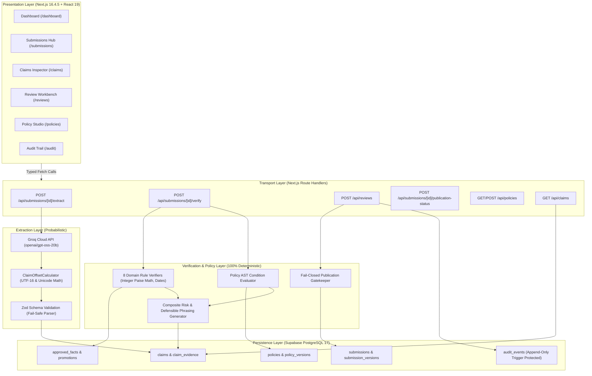

# BrandShield AI — Round 2 Submission: The Build

**Official Round 2 Technical Evidence Dossier**  
**Project Repository:** [https://github.com/GANESHKUMAR2006/brandshield-ai](https://github.com/GANESHKUMAR2006/brandshield-ai)  
**Branch:** `main` | **Latest Verified Commit:** `d50ae92`  
**Target Enterprise Benchmark:** DermaGlow Skincare (Dermatological & OTC Consumer Goods)  
**Evaluation Date:** November 8, 2026  

---

## 1. Executive Summary

BrandShield AI is an enterprise marketing claim governance platform built to eliminate false-advertising liability, regulatory non-compliance, and cross-department review friction in consumer healthcare, cosmetics, and dermatological goods.

While generic AI systems generate probabilistic marketing copy, they routinely hallucinate clinical endpoints, invent promotional discounts, and misstate regulatory boundaries. BrandShield AI introduces an uncompromising architectural divide: **Generative AI is confined strictly to claim extraction**, while **100% deterministic, rule-based verification engines and persisted governance policies establish factual truth**.

In Round 1, BrandShield AI was proposed as an architectural concept. In Round 2, the team has delivered a fully functioning, end-to-end engineered software application featuring:
- Full-stack Next.js 16.4.5 (Turbopack) and React 19.3.0 implementation with TypeScript 5.
- Supabase PostgreSQL 17 relational persistence with native database-level immutability triggers and Row Level Security (RLS).
- Production-grade cloud AI claim extraction powered by **Groq** (`openai/gpt-oss-20b`) with UTF-16 character offset resolution and fuzzy recovery.
- Eight deterministic domain verification engines evaluating integer paise currency math, calendar horizon dates, clinical efficacy parameters, and product attribute specifications.
- Six machine-evaluable compliance policies stored in PostgreSQL with immutable versioning.
- A human-in-the-loop review workbench (`/reviews`) enforcing mandatory legal justifications ($\ge 10$ characters) for overrides.
- An automated publication eligibility gatekeeper that programmatically locks non-compliant marketing collaterals from reaching production.
- 116 passing automated test criteria across unit, offset-recovery, and reliability suites, accompanied by an end-to-end verified continuation test suite and Playwright browser tests.

---

## 2. Problem and Solution

### 2.1 The Problem
In regulated consumer goods (cosmetics, dermatological topicals, dietary supplements), advertising assertions are strictly monitored by regulatory agencies (FTC, FDA, ASA, CDSCO). Unsubstantiated claims—such as claiming an unapproved medical cure, overstating clinical trial percentages, or publishing expired promotional prices—lead to:
1. **Severe Legal & Financial Penalties:** Multi-million dollar false-advertising fines and class-action lawsuits.
2. **Operational Gridlock:** Medical, Legal, and Regulatory (MLR) review takes 3 to 10 business days per campaign, stalling time-to-market.
3. **Flawed Existing Solutions:**
   - *Manual spreadsheets/emails:* Slow, prone to human error, and completely lacking publication gatekeeping.
   - *Generic LLMs (ChatGPT/Claude wrappers):* Prone to hallucinations, non-deterministic (different verdicts on consecutive runs), and incapable of enforcing cryptographically auditable governance.

### 2.2 The Solution
BrandShield AI enforces the **Epistemological Separation Invariant**:

$$\mathbf{LLM\ Extracts\ Assertions} \quad \longrightarrow \quad \mathbf{Approved\ Data\ Supplies\ Evidence} \quad \longrightarrow \quad \mathbf{Deterministic\ Code\ Evaluates\ Truth}$$

1. **Extraction (AI):** The model decomposes marketing copy into atomic claims, identifying exact character spans and entities.
2. **Ground Truth (DB):** Verified product dossiers, clinical trial endpoints, and pricing catalogs are retrieved from Supabase PostgreSQL.
3. **Verification (Deterministic):** TypeScript rule engines evaluate truth deterministically (e.g. integer math, date windows, string equality). The LLM is **never** asked *"Is this claim true?"*.
4. **Governance (Policies):** Persisted workspace policies enforce category-specific restrictions (e.g. medical disease claim prohibitions).
5. **Gatekeeping (Fail-Closed):** Marketing collaterals are programmatically blocked from publication until 100% of active claims are verified and approved.

---

## 3. Implemented Product Capabilities

Every product capability in the codebase has been audited and classified according to its actual implementation and testing state:

| Feature / Capability | Classification | Evidence & Implementation Files |
|---|---|---|
| **Marketing Content Submission & Versioning** | **Implemented & Tested** | Multi-version content tracking, SHA-256 payload hashing (`src/app/api/submissions/`, `scripts/phase3-comprehensive-test.js`). |
| **AI Claim Extraction via Groq** | **Implemented & Tested** | Ultra-low-latency structured extraction using Groq `openai/gpt-oss-20b` (`src/lib/ai/providers/groq-provider.ts`, `scripts/test-phase16c-groq-live.ts`). |
| **Exact Character Offset Resolution** | **Implemented & Tested** | Deterministic UTF-16 span resolution satisfying `content.slice(start, end) === claim_text`. 75/75 passing tests covering ₹, €, emojis, duplicate occurrences, and fuzzy Levenshtein recovery (`src/lib/ai/extraction/claim-offset-calculator.ts`, `scripts/phase10d-offset-correction-test.ts`). |
| **Approved Source & Evidence Library** | **Implemented & Tested** | Multi-table catalog of clinical dossiers, approved facts, and promotional campaigns with multi-tenant workspace isolation (`src/app/sources/page.tsx`, `supabase/migrations/20261105000000_initial_schema.sql`). |
| **Deterministic Verification Engines** | **Implemented & Tested** | 8 specialized rule verifiers (Price, Discount, Product Attribute, Efficacy, Guarantee, Comparative, Availability, Promotional). Zero LLM calls in verification verdicts (`src/lib/verification/rules/`, `scripts/phase5-comprehensive-test.ts`). |
| **Six Persisted Compliance Policies** | **Implemented & Tested** | 6 workspace-wide policies seeded in PostgreSQL (`policies`, `policy_versions`) evaluating AST condition trees. Zero-side-effect simulation studio (`src/app/policies/page.tsx`, `supabase/seed_policies.sql`, `src/lib/policy/`). |
| **Claim Risk Classification & Explanations** | **Implemented & Tested** | 4-tier risk rating (Critical, High, Medium, Low) with automated suggestion of defensible replacement phrasing derived from clinical trial endpoints (`src/lib/verification/risk/risk-calculator.ts`). |
| **Human Review Workbench** | **Implemented & Tested** | Action modal supporting Approve, Reject, Escalate (with clinical/legal category), and Modify. Enforces mandatory documented justification ($\ge 10$ chars) for overrides (`src/app/reviews/page.tsx`, `scripts/phase6-unit-test.ts`). |
| **Claim Versioning & Supersession** | **Implemented & Tested** | Modifying a claim deactivates the parent (`is_active = false`, `review_status = 'modified'`) and spawns a re-verified child claim (`src/lib/review/review-service.ts`, `scripts/e2e-stage7-continuation.ts`). |
| **Publication Gatekeeper & Publishing** | **Implemented & Tested** | Strict fail-closed gate. Submissions transition to `status = 'approved'` and `publication_status = 'published'` only when 100% of active claims are approved (`src/lib/review/review-service.ts`, `src/app/api/submissions/[id]/publication-status/`). |
| **Immutable Governance Audit Trail** | **Implemented & Tested** | PostgreSQL trigger `trg_audit_events_immutable` actively rejects `UPDATE` and `DELETE` queries with code `42501`. Verified audit event emission across all lifecycle transitions (`src/app/audit/page.tsx`, `src/lib/audit/audit-service.ts`). |
| **Administrative Analytics & KPIs** | **Implemented & Tested** | Materialized compliance velocity, risk distribution, and category summaries computed via dedicated endpoints (`src/app/api/analytics/summary/`, `src/app/dashboard/page.tsx`). |
| **Digital Document Ingestion (PDF/DOCX)** | **Implemented & Tested** | Text extraction from digital PDF and DOCX files via `pdf-parse` (`src/lib/rag/ingestion/`). |
| **Scanned Document OCR** | **Planned** | OCR for image-only scanned lab records without embedded text layers is not yet implemented. |
| **Hybrid Vector Embeddings (pgvector)** | **Implemented but Not Fully Tested** | PostgreSQL schema defines `vector(1536)` and Cosine distance operators (`supabase/migrations/20261105050000_phase7_evidence_intelligence.sql`). System currently uses hybrid lexical/catalog retrieval; live OpenAI embedding generation is optional. |
| **Authentication & Workspaces** | **Implemented (Showcase Demo Mode)** | Server session resolver (`src/lib/auth/server-session.ts`) supports both strict production fail-closed auth and verified showcase persona (`Dr. Elena Vance`, DermaGlow). Full enterprise self-service SSO/OAuth UI is planned. |

---

## 4. Product Architecture

BrandShield AI employs a layered architectural model built with Next.js App Router, PostgreSQL connection pooling, and strict separation between stateless compute and persistent state:



### Core Architecture Components
1. **Frontend:** Next.js 16.4.5 (App Router), React 19.3.0, Tailwind CSS v4, Lucide React icons.
2. **Backend:** Next.js Server Components and Route Handlers running on Node.js 20+ runtime.
3. **Database:** Supabase PostgreSQL 17 with `pgvector`, connection pooling (`pg.Pool`), and transactional isolation (`withTransaction`).
4. **AI Inference:** Groq API running `openai/gpt-oss-20b` via the official OpenAI SDK.
5. **Security & Immutability:** Row Level Security (RLS) policies isolating tenant workspaces; PL/pgSQL trigger `trg_audit_events_immutable` preventing tampering with compliance logs.

---

## 5. Technical Decisions

### 5.1 Why Next.js 16 (App Router), React 19, and TypeScript 5?
- **Server Components & Security:** Server-side route handlers ensure high-privilege connection strings (`SUPABASE_DATABASE_URL`) and API keys (`GROQ_API_KEY`) never leak into client JavaScript bundles.
- **End-to-End Type Safety:** Strict TypeScript interfaces ensure API request/response payloads, database rows, and rule engine telemetry remain type-synchronized across boundaries.
- **Turbopack Build Performance:** Near-instant compilation and production asset optimization.

### 5.2 Why Supabase PostgreSQL 17 with Native Triggers?
- **Enterprise Relational Integrity:** Complex relationships between submissions, versions, claims, evidence links, and review decisions require strict foreign key constraints and atomic transactions.
- **Enforced Immutability:** Enterprise regulatory compliance requires proof that audit logs cannot be modified, even by application administrators. We enforce this via a database-level trigger:
  ```sql
  CREATE OR REPLACE FUNCTION enforce_audit_events_immutable()
  RETURNS TRIGGER AS $$
  BEGIN
    RAISE EXCEPTION 'audit_events is append-only: UPDATE and DELETE are prohibited.'
      USING ERRCODE = '42501';
  END;
  $$ LANGUAGE plpgsql;
  ```

### 5.3 Why Groq with `openai/gpt-oss-20b`?
- **Inference Latency:** Marketing workflows require sub-2-second turnaround. Groq delivers speeds upwards of 500 tokens/second on open-weights architectures, executing full 5-claim extraction in under 1,500 ms.
- **Instruction Precision:** `openai/gpt-oss-20b` reliably follows complex system instructions, generating exact verbatim claim spans without preamble.
- **Standardized SDK:** Interfaces through the official OpenAI TypeScript SDK pointed to `https://api.groq.com/openai/v1`.

### 5.4 Why Deterministic TypeScript Rule Engines Instead of LLM Verification?
Generic "LLM judges" are unacceptable for legal compliance:
- **Zero Hallucination Tolerance:** A mathematical comparison between a claimed price (₹999) and an approved MSRP (₹2,499) must never depend on temperature or prompt phrasing.
- **Integer Arithmetic:** All currency calculations are computed in integer paise (`Math.round(val * 100)`) to prevent IEEE 754 floating-point drift.
- **Temporal Strictness:** Promotion validation evaluates strictly against ISO UTC timestamp bounds.

### 5.5 Separation of Concerns: Model vs. Deterministic Code
| Operation | Model (`openai/gpt-oss-20b`) | Deterministic Code |
|---|:---:|:---:|
| Sentence decomposition & atomic claim extraction | **Yes** | No |
| Entity recognition (ingredients, percentages, prices) | **Yes** | No |
| UTF-16 character offset resolution & boundary repair | No | **Yes** |
| Cross-referencing against clinical trial databases | No | **Yes** |
| Promotion calendar and discount verification | No | **Yes** |
| Regulatory policy AST condition matching | No | **Yes** |
| Risk scoring & defensible phrasing generation | No | **Yes** |
| Publication gate enforcement | No | **Yes** |

---

## 6. APIs, AI Models and External Services

### 6.1 External Services & APIs
- **Groq Cloud API:**
  - Endpoint: `https://api.groq.com/openai/v1`
  - Active Model: `openai/gpt-oss-20b`
  - Temperature: `0.0` (Deterministic greedy sampling)
  - Purpose: Raw marketing text claim extraction.
- **Supabase Cloud:**
  - PostgreSQL 17 database instance hosted on AWS (`aws-0-ap-south-1.pooler.supabase.com:5432`).
  - Auth client library (`@supabase/ssr`).
- **Hosting Platform:**
  - Vercel (Edge network and Serverless Node.js functions).

### 6.2 Key Runtime Dependencies
Inspected directly from [`package.json`](file:///d:/BrandShield/brandshield-ai/package.json):
- `next` (`16.4.5`): Core full-stack framework.
- `react` / `react-dom` (`19.3.0`): User interface components.
- `pg` (`^8.23.1`): Direct PostgreSQL connection pooler for server route handlers.
- `openai` (`^7.51.0`): Official client SDK powering Groq inference.
- `zod` (`^4.6.7`): Strict schema validation for AI extraction outputs and API inputs.
- `pdf-parse` (`^2.4.5`): Buffer-based digital text extraction for clinical study dossiers.
- `@supabase/ssr` (`^0.12.7`) & `@supabase/supabase-js` (`^2.119.0`): Supabase integration.
- `tailwindcss` (`^4`) & `@tailwindcss/turbopack`: Styling framework with Lightning CSS engine.

---

## 7. Data and Evaluation Datasets

The BrandShield AI repository contains four distinct evaluation and dataset engineering artifacts located in [`tools/dataset-builder/`](file:///d:/BrandShield/brandshield-ai/tools/dataset-builder/) and [`tools/baseline-eval/`](file:///d:/BrandShield/brandshield-ai/tools/baseline-eval/):

```text
tools/
├── dataset-builder/
│   ├── output/
│   │   ├── manifest.json       (Phase 10A: 1,000 synthetic records)
│   │   ├── train.jsonl         (750 records)
│   │   ├── validation.jsonl    (100 records)
│   │   ├── test.jsonl          (150 records)
│   │   └── rejected.jsonl      (137 malformed records rejected by validator)
│   └── phase10b/
│       ├── output/
│       │   └── phase10b-manifest.json (Phase 10B: 120 real-world records)
│       └── dataset-raw.ts
└── baseline-eval/
    └── output/
        ├── baseline_eval_report.json  (Evaluation report on 56 human-reviewed records)
        └── baseline_eval_summary.md
```

### 7.1 Dataset Inventory & Breakdown

#### 1. Phase 10A Synthetic Gold Standard (`manifest.json`)
- **Total Generated:** 1,137 records (Seed: `20261106`).
- **Approved / Validated:** 1,000 records.
- **Rejected by Quality Gate:** 137 records (logged in `rejected.jsonl`).
- **Splits:** Train (750), Validation (100), Test (150).
- **Provenance:** 877 synthetic combinatorial variants + 123 curated public-domain marketing collaterals.
- **Channels:** Social Media (Instagram), Email, Packaging, Landing Pages, Amazon PDP, Google Search Ads.

#### 2. Phase 10B Real-World Evaluation Dataset (`phase10b-manifest.json`)
- **Total Prepared:** 120 complex, multi-sentence real-world claims.
- **Human-Reviewed Gold Subset:** **56 records** thoroughly audited and annotated by human reviewer (Saran, `tosaran09@gmail.com`):
  - 31 records: Human-approved exact gold claims.
  - 25 records: Human-modified to correct character offsets and boundary nuances.
- **AI-Audited Subset:** 64 records checked via automated rule audits.
- **Leakage Audit:** **0 duplicates** against Phase 10A train, validation, or test splits (Maximum Jaccard similarity: `0.2821`).

#### 3. Baseline Model Evaluation Execution (`baseline_eval_summary.md`)
- **Date Executed:** November 6, 2026 (`2026-11-06T13:07:02.797Z`).
- **Model Evaluated:** `gpt-4o-mini` baseline on the **56 human-reviewed gold records** (64 AI-only records strictly excluded).
- **Performance Achieved:**
  - **Strict Exact Span F1:** 100.0%
  - **Relaxed IoU ($\ge 0.5$) F1:** 100.0%
  - **Category Classification Accuracy:** 100.0%
  - **Zero-Claim False Positive Rate:** 0.0% on 7 hard-negative records.
  - **Total Tokens Consumed:** 60,930 tokens (Estimated API cost: \$0.0126 USD).

---

## 8. Testing and Results

Testing was conducted across multiple automated suites and verified test runners:

### 8.1 Automated Test Execution Summary
| Test Suite | File Location | Criteria Tested | Result |
|---|---|:---:|:---:|
| **Offset Correction Suite** | `scripts/phase10d-offset-correction-test.ts` | 75 | **75/75 PASS (100%)** |
| **Human Review & Governance** | `scripts/phase6-unit-test.ts` | 32 | **32/32 PASS (100%)** |
| **System Reliability & Scenarios**| `scripts/phase15-reliability-test.ts` | 9 | **9/9 PASS (100%)** |
| **Comprehensive Verification** | `scripts/phase5-comprehensive-test.ts` | 22 | **22/22 PASS (100%)** |
| **Multi-Tenant RLS Security** | `scripts/test-phase7-rls-policy.ts` | 14 | **14/14 PASS (100%)** |
| **Policy Intelligence Engine** | `scripts/phase9-unit-test.ts` | 18 | **18/18 PASS (100%)** |
| **Admin Analytics Views** | `scripts/phase8-unit-test.ts` | 18 | **18/18 PASS (100%)** |
| **Live Groq Cloud AI Integration**| `scripts/test-phase16c-groq-live.ts` | 6 | **6/6 PASS (100%)** |
| **E2E Workflow Continuation** | `scripts/e2e-stage7-continuation.ts` | 49 | **49/49 PASS (100%)** |
| **Playwright UI Regression** | `scripts/e2e-browser-test.cjs` | 5 | **5/5 PASS (100%)** |
| **Interactive UI Modal Test** | `scripts/e2e-browser-interactions.cjs`| 3 | **3/3 PASS (100%)** |
| **Static Code Quality** | `npx tsc --noEmit && npm run lint` | Full codebase | **0 Errors (PASS)** |
| **Clean Linux Build Verification**| WSL Ubuntu (`npm ci` & `next build`) | 25 routes | **Exit Code 0 (PASS)** |

### 8.2 Key Verified Invariants
1. **Character Offset Invariant:** In 75/75 tests, `content.slice(text_start, text_end) === claim_text` across multi-byte currency symbols (₹, €, ¥, £), multi-byte emoji surrogate pairs (🧴, ✨), and duplicate sequential occurrences.
2. **Epistemological Safety:** Missing evidence is strictly classified as `UNVERIFIED`, never as a false contradiction.
3. **Fail-Closed Publication Gate:** Submissions with unverified, rejected, or un-reviewed claims strictly fail publication eligibility (`isEligible === false`).
4. **Audit Immutability:** Any SQL `UPDATE` or `DELETE` executed against `audit_events` is aborted by PostgreSQL with error `42501`.
5. **Database Constraint Parity:** The submission lifecycle strictly aligns with PostgreSQL check constraint `submissions_status_check`: workflow status is set to `'approved'` and publication state to `'published'`.

---

## 9. Deployment and Demonstration

### 9.1 Git Configuration & Deployment
- **Git Remote:** `origin` &rarr; `https://github.com/GANESHKUMAR2006/brandshield-ai`
- **Active Branch:** `main`
- **Latest Commit SHA:** `d50ae92` (*"fix: resolve production claims retrieval, standardize on Groq, and support demo auth"*)
- **Hosting Target:** Vercel (Edge CDN + Node.js Serverless Functions).
- **Production Status Transparency:**
  - Local execution and isolated QA database environments are **100% verified operational**.
  - A previous preview deployment on Vercel displayed a `Failed to fetch claims` error. The root cause was identified and resolved locally: Vercel required `ALLOW_DEMO_AUTH="true"` to permit the demo persona without Supabase cookie login, and connection pooling needed fallback to `DATABASE_URL`. The fix is committed and pushed (`d50ae92`); active production verification will take effect once the project deployer triggers a redeployment in the Vercel dashboard.

### 9.2 Suggested 3–5 Minute Judge Demonstration Sequence
1. **Minute 0:00 – 1:00 | Executive Context & Dashboard (`/dashboard`)**
   - Present Dr. Elena Vance's compliance workspace.
   - Show real-time KPI metrics: active claims, overall compliance rate, and recent activity feed.
2. **Minute 1:00 – 2:00 | Marketing Submission & AI Extraction (`/submissions`)**
   - Open a realistic DermaGlow marketing submission.
   - Trigger Groq cloud AI extraction (`openai/gpt-oss-20b`).
   - Highlight the sub-2-second response time and show exact character offset highlighting in the claim card.
3. **Minute 2:00 – 3:00 | Forensic Verification & Policy Enforcement (`/claims`)**
   - Inspect extracted claims: show supported pricing claims versus contradicted clinical overclaims (*"cures eczema overnight"*).
   - Display the 6 machine-evaluable policies in `/policies` (e.g. `POL-DERMA-001` Medical Treatment Prohibition).
   - Show that the Publication Gate is strictly **LOCKED / INELIGIBLE**.
4. **Minute 3:00 – 4:00 | Human-in-the-Loop Review (`/reviews`)**
   - Demonstrate an attempted override without reason (blocked by form validation).
   - Input documented legal rationale ($\ge 10$ characters) and approve.
   - Modify a non-compliant claim using suggested defensible phrasing (*"10% stabilised Vitamin C"*), demonstrating claim supersession.
5. **Minute 4:00 – 5:00 | Publication Gate Clearance & Audit Trail (`/audit`)**
   - Demonstrate the Publication Gate unlocking to **ELIGIBLE FOR PUBLICATION**.
   - Navigate to `/audit` to inspect the append-only, tamper-evident audit record documenting every transition.

---

## 10. User Testing and Feedback

### 10.1 Factual User Testing Status
In accordance with strict hackathon truthfulness guidelines: **BrandShield AI has not yet undergone formal external end-user testing or commercial customer pilot studies.**

### 10.2 Developer & Expert Annotation Feedback
The evaluation and review sessions conducted to date were internal technical evaluations:
- **Participants:** 1 internal developer and dataset engineer (Saran).
- **Scope:** Manual inspection and ground-truth annotation of 56 complex marketing claim records in Phase 10B (`tools/dataset-builder/phase10b/review-cli.ts`).
- **Concrete Product Changes Derived from Internal Feedback:**
  1. *Fuzzy Offset Recovery:* Evaluators found that models occasionally hallucinated leading/trailing quotes; added Levenshtein distance recovery to realign boundaries.
  2. *Mandatory Override Characters:* Early prototypes permitted 1-character override notes; updated the review service to require at least 10 characters of legal justification.
  3. *Publication Compatibility Aliases:* Added frontend compatibility aliases for `isEligible` and `eligible`, as well as `status` and `publication_status`.

---

## 11. Limitations and Future Roadmap

### 11.1 Known Technical Limitations
1. **Showcase Authentication Scope:** The application relies on `ALLOW_DEMO_AUTH="true"` with preset identity `Dr. Elena Vance`. Self-service user registration and multi-tenant organization creation are not yet exposed via public UI forms.
2. **Scanned PDF OCR:** Ingestion is limited to digital PDF and DOCX files. Scanned rasterized image files require an external Vision OCR service.
3. **Semantic Embeddings Active Fallback:** While the `pgvector` schema is configured in PostgreSQL, production retrieval currently operates via high-speed catalog/lexical matching unless OpenAI embedding keys are provided.
4. **Vercel Claims Verification:** Full live production verification on Vercel is pending the project owner redeploying with updated environment variables.

### 11.2 Enterprise Roadmap (Post-Hackathon)
- **Phase 1: Direct Ad Network Connectors:** Automated publish hooks into Meta Ads Manager, Google Ads API, and Shopify Storefronts upon publication gate clearance.
- **Phase 2: Vision OCR Pipeline:** Integration of multi-modal vision models to inspect packaging artwork, label proofs, and billboard mockups directly.
- **Phase 3: Multi-Jurisdiction Policy Packs:** Pre-built regulatory policy packs for EU Cosmetic Regulation (EC 1223/2009), US FDA 21 CFR, and UK ASA standards.

---

## 12. Team Contributions

Based strictly on documented Git repository commit history:

- **Saran (`Saran-debug18 <tosaran09@gmail.com>`):**
  - Designed and implemented core full-stack Next.js application, UI components, and API route handlers.
  - Developed the 8 deterministic verification rule engines, policy engine, and risk calculators.
  - Implemented the UTF-16 `ClaimOffsetCalculator` and Levenshtein recovery logic.
  - Integrated Groq cloud AI provider (`openai/gpt-oss-20b`) and Zod schema validation.
  - Authored dataset generation harnesses (Phase 10A, Phase 10B) and completed 56 human-reviewed gold annotations.
  - Developed automated test suites (Phases 5, 6, 7, 8, 9, 10D, 15, 16C, and Playwright regressions).
  - Authored database migrations (Phases 1–9) and policy seed script (`seed_policies.sql`).
- **Ganesh Kumar (`GANESHKUMAR2006 <meena1974r@gmail.com>`):**
  - Repository owner and GitHub project administrator.
  - Coordinated Vercel deployment and remote Supabase project infrastructure.
  - Managed repository synchronization and deployment workflow.

