# BrandShield AI — AI Pipeline & Deterministic Verification Specification

## 1. Pipeline Overview & Mermaid Architecture

BrandShield AI follows a strict design principle:
> **The LLM extracts claims. Approved organizational data provides evidence. Deterministic rules verify truth.**

```mermaid
flowchart LR
    subgraph Raw["Input Copy"]
        RawText["Marketing Text\n(Natural Language)"]
    end

    subgraph Step1["Step 1: LLM Claim Extraction"]
        PromptEngine["Few-Shot System Prompt\n(src/lib/ai/extraction/)"]
        LLM["Configured Provider\n(Ollama / OpenAI / Mock)"]
        RawJSON["Raw Extracted JSON"]
        ZodValidator["Schema Validation\n(ExtractionSchema)"]
    end

    subgraph Step2["Step 2: Deterministic Offset Resolution"]
        OffsetCalc["ClaimOffsetCalculator\n(UTF-16 Character Bounds)"]
        FuzzyRecovery["Fuzzy Matcher &\nSurrogate Pair Safe"]
        ClaimsWithOffsets["Validated Claims\n[text_start, text_end]"]
    end

    subgraph Step3["Step 3: Deterministic Rule Verification"]
        EvidenceGate["Evidence Sufficiency Gate"]
        RuleRouter["Verification Router"]
        CategoryRules["8 Domain Rule Engines\n(Price, Efficacy, etc.)"]
        RiskScore["Composite Risk Calculator\n(0 - 100)"]
    end

    subgraph Step4["Step 4: Output & Storage"]
        Persist["Claims & Verification Runs\n(Supabase PostgreSQL)"]
        Audit["Immutable Audit Event"]
    end

    RawText --> PromptEngine --> LLM --> RawJSON --> ZodValidator
    ZodValidator --> OffsetCalc --> FuzzyRecovery --> ClaimsWithOffsets
    ClaimsWithOffsets --> EvidenceGate --> RuleRouter --> CategoryRules --> RiskScore
    RiskScore --> Persist & Audit
```



---

## 2. LLM Claim Extraction (`src/lib/ai/`)

### Supported Providers
- **Local Ollama**: Interacts with local Ollama daemon at `http://localhost:11434/v1` using `qwen3:4b` or `llama3`.
- **Cloud OpenAI**: Interacts with OpenAI API using `gpt-4o-mini` with strict JSON schema outputs.
- **Offline Deterministic Mock**: Automatically engaged when providers are unreachable or in test environments (`mock-provider.ts`).

### Structured Few-Shot Prompting
Extraction instructions enforce:
1. **Verbatim Text Preservation**: The model must extract exact substrings from the marketing text without paraphrasing or correcting grammar.
2. **Atomic Decomposition**: Complex compound sentences must be decomposed into single, verifiable factual assertions.
   - *Example*: *"DermaGlow Vitamin C Serum contains 10% Vitamin C and costs ₹1,999"* decomposes into two atomic claims:
     1. Attribute Claim: *"10% Vitamin C"*
     2. Pricing Claim: *"costs ₹1,999"*
3. **Claim Categorization**: Each claim is assigned one of 10 closed enum categories:
   - `product_attribute`, `price`, `discount`, `efficacy`, `guarantee`, `comparative`, `clinical`, `availability`, `promotional`, `other`.

---

## 3. Deterministic UTF-16 Character Offsets & Fault Recovery

### The Offset Invariant
For every valid claim, the start and end offsets must strictly satisfy:
$$\text{content.slice}(\text{text\_start}, \text{text\_end}) \equiv \text{claim\_text}$$

### Edge Cases Handled Deterministically
1. **Unicode Currency Symbols**: Handles multi-byte currency symbols (₹, €, ¥, £, $) without byte-boundary distortion.
2. **Emoji & UTF-16 Surrogate Pairs**: Validates offsets across emoji characters (🧴, ✨, 🌟) without splitting 2-code-unit surrogate pairs.
3. **Repeated Claims in Document**: If the same claim string appears multiple times (e.g., *"clinically proven"*), the engine uses sequential greedy matching across the document reading order.
4. **Fuzzy Recovery for Hallucinated Quotes**: If an LLM returns slightly modified quotes (e.g. omitting a leading quote or punctuation), the fuzzy recovery module calculates Levenshtein distance against candidate spans to realign the exact substring.

---

## 4. Evidence Retrieval & Linking (RAG)

1. **Document Ingestion**:
   - Parses clinical dossiers, technical datasheets, and regulatory guidelines in PDF, DOCX, or TXT format.
   - Extracts tabular data from DOCX files into formatted Markdown pipe tables.
2. **Deterministic Chunking**:
   - Splits documents using a sentence-aware sliding window (e.g., 500 characters with 100 character overlap).
   - Generates reproducible SHA-256 chunk identifiers.
3. **Hybrid Retrieval**:
   - Computes relevance using a 70/30 linear weighted combination:
     $$\text{Relevance Score} = 0.70 \times \text{Vector Cosine Similarity} + 0.30 \times \text{Lexical BM25 Score}$$
4. **Multi-Tenant Boundary**:
   - Retrieval queries enforce workspace isolation filters. Evidence from foreign workspaces is never surfaced.

---

## 5. Deterministic Verification Rules & Risk Scoring

### Zero LLM Calls in Verification
Once claims are extracted, verification is executed entirely by deterministic TypeScript rules:

| Category Verifier | Verification Logic & Edge Cases | Typical Failure Reason |
| :--- | :--- | :--- |
| **Product Attribute** (`product-attribute-verification.ts`) | Matches extracted concentration (e.g. 10%) against `approved_facts`. | Exaggerated concentration (e.g. claiming 25% Vitamin C when approved formula is 10%). |
| **Price** (`price-verification.ts`) | Evaluates advertised price against base catalog reference MSRP using integer paise arithmetic. | Unapproved regular price or missing currency specification. |
| **Discount** (`discount-verification.ts`) | Checks active promotions, verifies effective date window (inclusive UTC), and validates channel authorization (`applicable_channels`). | Expired promotional pricing, unauthorized advertising channel (e.g. billboard vs Instagram). |
| **Clinical Efficacy** (`efficacy-verification.ts`) | Validates duration and outcome metrics against registered clinical trials (e.g., 4-week trial vs 7-day marketing claim). | Shortened timeframes or inflated efficacy percentages. |
| **Absolute Guarantee** (`guarantee-verification.ts`) | Enforces brand safety rules against ungrounded absolute assertions (*"100% cure"*, *"permanent elimination"*). | Violation of medical advertising guidelines and brand safety policies. |
| **Comparative** (`comparative-verification.ts`) | Verifies competitor claims against documented comparative trial data. | Ungrounded superiority claims without third-party head-to-head testing. |

### Deterministic Risk Matrix
Risk is deterministically assigned based on the verification determination and claim severity:

```text
┌──────────────────────┬────────────────────────────────────────────────────────┐
│ Risk Tier            │ Criteria & Examples                                    │
├──────────────────────┼────────────────────────────────────────────────────────┤
│ CRITICAL (80 - 100)  │ Contradicted medical/cure claims, ungrounded 100%      │
│                      │ absolute guarantees, regulatory policy violations.     │
├──────────────────────┼────────────────────────────────────────────────────────┤
│ HIGH (60 - 79)       │ Contradicted ingredient concentrations, unauthorized   │
│                      │ promotional prices, channel authorization breaches.    │
├──────────────────────┼────────────────────────────────────────────────────────┤
│ MEDIUM (40 - 59)     │ Outdated promotional pricing, expired clinical trial   │
│                      │ dossiers, ambiguous comparative assertions.            │
├──────────────────────┼────────────────────────────────────────────────────────┤
│ LOW (0 - 39)         │ Fully supported claims backed by active, unexpired     │
│                      │ approved facts and clinical trials.                    │
└──────────────────────┴────────────────────────────────────────────────────────┘
```
