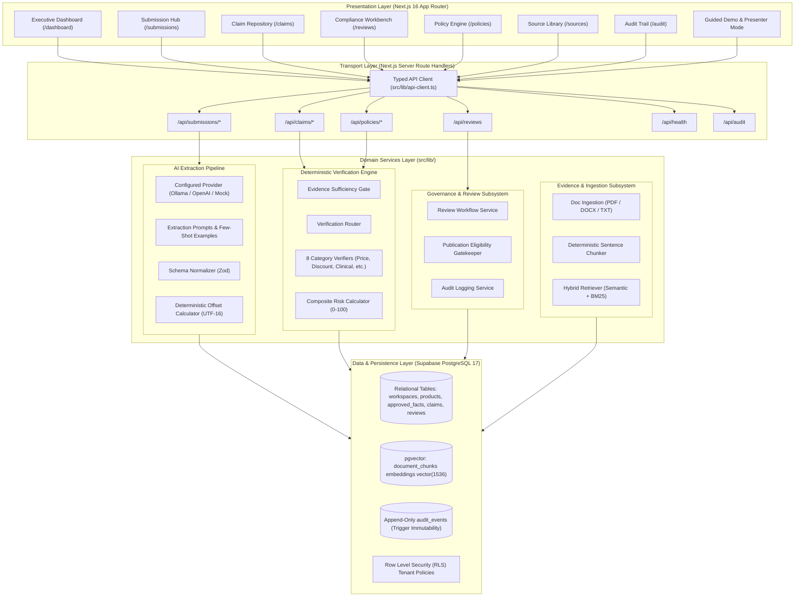
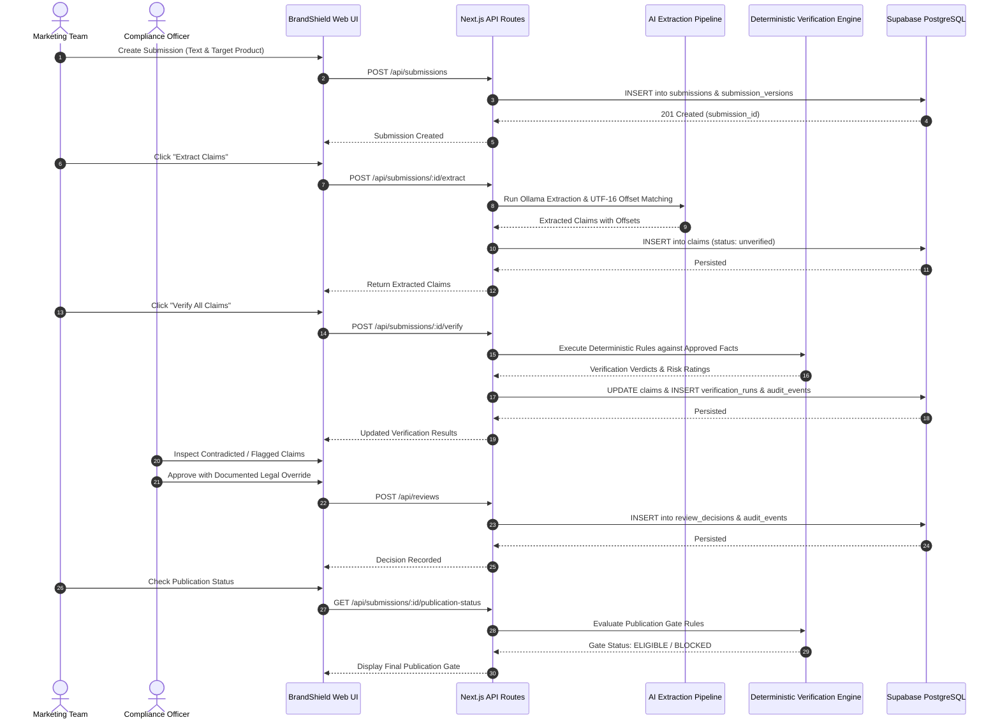
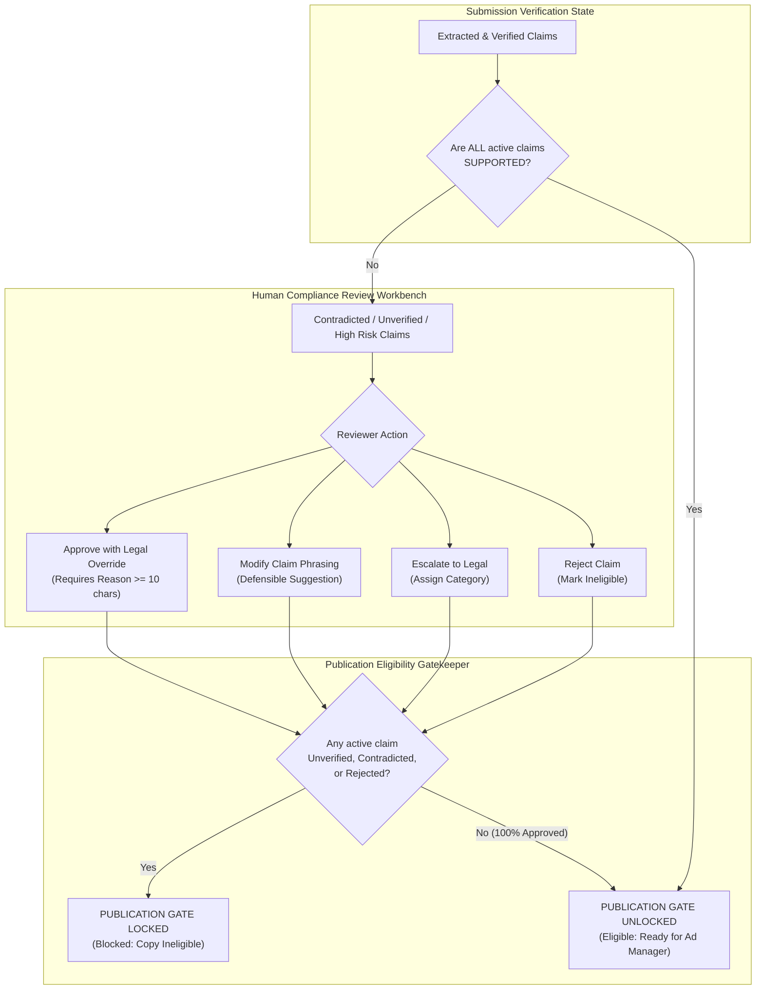

# BrandShield AI — System Architecture Specification

## 1. Architectural Overview

**BrandShield AI** is an enterprise brand compliance platform designed to govern marketing claims for regulated consumer goods organizations. Built on **Next.js 16 (App Router)** and **Supabase PostgreSQL 17** with `pgvector`, it combines AI-driven claim extraction with 100% deterministic, rule-based evidence verification and human-in-the-loop review.

---

## 2. Core Architectural Principles

1. **The LLM Extracts; Deterministic Code Verifies**:
   - Large Language Models are probabilistic and prone to hallucination.
   - LLMs are strictly restricted to **claim extraction** and entity parsing.
   - All verification determinations (verdict, compliance risk, and suggested phrasing) are executed by **100% deterministic, rule-based TypeScript engines**.
   - Zero LLM calls exist inside the verification loop.
2. **Absence of Proof is Never Contradiction**:
   - If an assertion lacks backing evidence, the engine classifies it strictly as `UNVERIFIED` or `NEEDS_REVIEW`.
   - Claims are only classified as `CONTRADICTED` when authoritative approved data explicitly conflicts with the claim.
3. **Decimal-Safe Financial Math**:
   - All currency and discount comparisons use integer paise arithmetic (`Math.round(val * 100)`) to eliminate JavaScript floating-point inaccuracies.
4. **Deterministic UTF-16 Character Offsets**:
   - Extracted claims must satisfy the character offset invariant:
     $$\text{content.slice}(\text{text\_start}, \text{text\_end}) \equiv \text{claim\_text}$$
   - Includes full support for Unicode currency symbols (₹, €, ¥, £, $) and multi-byte UTF-16 emoji surrogate pairs.
5. **Fail-Closed Gatekeeping**:
   - Marketing copy cannot be published unless 100% of its active claims have been verified and approved.
   - Any single active claim that is unverified, contradicted, or rejected locks the publication gate.

---

## 3. Layer Breakdown & Responsibilities

### 3.1 Presentation Layer (`src/components/`, `src/app/`)
- **Pages**: Follows the Next.js 16 App Router architecture. Rendered using server and client components.
- **Feature Modals**:
  - `CreateSubmissionModal.tsx`: Ingests custom marketing text or loads one of the three guided demo presets.
  - `SubmissionDetailModal.tsx`: Controls the end-to-end lifecycle: claim extraction, batch verification, claim filtering, and publication gating.
  - `ClaimDetailModal.tsx`: Detailed forensic claim inspection displaying verified facts, source excerpts, risk justification, and defensible copy recommendations.
  - `SystemHealthModal.tsx`: Live telemetry checking database latency and Ollama reachability.
  - `PresenterViewModal.tsx`: Side-by-side presentation view displaying real-time compliance results.

### 3.2 Transport Layer (`src/app/api/`)
- Pure JSON REST APIs enforcing request schema validation via `zod`.
- Interacts with domain services and returns standard status codes (`200 OK`, `400 Bad Request`, `403 Forbidden`, `404 Not Found`, `500 Internal Error`).
- Resilient client SDK (`src/lib/api-client.ts`) handles timeouts, retries, and offline demo fallbacks.

### 3.3 Domain Services Layer (`src/lib/`)
- **AI Extraction (`src/lib/ai/`)**: Supports local Ollama (`qwen3:4b`), cloud OpenAI (`gpt-4o-mini`), and an offline deterministic mock extractor.
- **Verification Engine (`src/lib/verification/`)**: 8 specialized verifiers:
  1. `price-verification.ts`: Validates MSRP against product catalogue.
  2. `discount-verification.ts`: Validates promotional prices, active campaign dates, and channel permissions.
  3. `product-attribute-verification.ts`: Validates concentrations, formulations, and active ingredients.
  4. `efficacy-verification.ts`: Validates clinical trial endpoints and study durations.
  5. `guarantee-verification.ts`: Enforces brand safety rules against ungrounded absolute guarantees.
  6. `comparative-verification.ts`: Evaluates comparative claims against competitor benchmarks.
  7. `availability-verification.ts`: Validates stock and distribution assertions.
  8. `promotional-verification.ts`: Validates marketing event timelines.
- **Policy Engine (`src/lib/policy/`)**: Declarative AST condition evaluator allowing compliance teams to define brand-wide rules and dry-run simulations.
- **Review Workflow (`src/lib/review/`)**: Enforces human governance, prevents unauthorized reviewer overrides, and evaluates publication gate eligibility.

### 3.4 Data & Persistence Layer (`supabase/`, `src/lib/db/`)
- **Supabase PostgreSQL 17**: Houses normalized relational tables with Row Level Security (RLS) policies.
- **Connection Pooling**: Utilizes native `pg` pool (`server-db.ts`) for high-throughput transactional queries.
- **Audit Immutability**: Uses PostgreSQL trigger `trg_audit_events_immutable` to strictly reject any `UPDATE` or `DELETE` queries on compliance event logs.

---

## 4. End-to-End Data Flow

---

## 5. Human Review & Publication Gate Architecture

