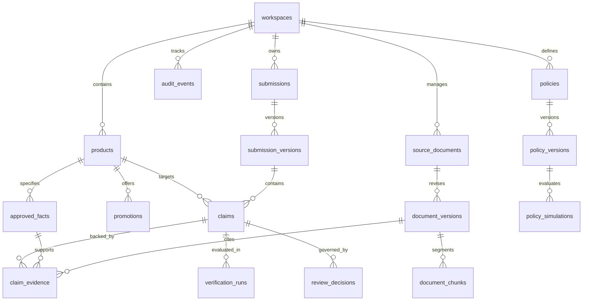

# BrandShield AI — PostgreSQL Database Schema & Migration Status

## 1. Entity-Relationship Model (Mermaid Diagram)

---

## 2. Migration Status & Roadmap

The database schema is managed via timestamped PostgreSQL migrations under `supabase/migrations/`.

| Migration File | Phase | Status on Live Database | Key Schema Additions |
| :--- | :--- | :--- | :--- |
| `20261105000000_initial_schema.sql` | Phase 1 & 2 | **APPLIED (Live)** | Base tenant tables: `workspaces`, `products`, `approved_facts`, `promotions`, `source_documents`, `document_versions`, `document_chunks`. |
| `20261105010000_phase3_submissions_enhancements.sql` | Phase 3 | **APPLIED (Live)** | Submissions pipeline: `submissions`, `submission_versions`, content hash triggers, version tracking. |
| `20261105020000_phase4_extraction_engine.sql` | Phase 4 | **APPLIED (Live)** | AI extraction schema: `claims`, `extraction_runs`, UTF-16 character offsets (`text_start`, `text_end`), confidence ratings. |
| `20261105030000_phase5_verification_engine.sql` | Phase 5 | **APPLIED (Live)** | Verification engine: `verification_runs`, risk ratings (`critical`, `high`, `medium`, `low`), `claim_evidence` linking. |
| `20261105040000_phase6_review_workflow.sql` | Phase 6 | **APPLIED (Live)** | Human compliance review: `review_decisions` table, decision types (`approved`, `rejected`, `escalated`, `modified`). |
| `20261105050000_phase7_evidence_intelligence.sql` | Phase 7 | **PENDING LIVE MIGRATION** | Revised RLS policies permitting approved-fact-only evidence (`document_version_id IS NULL`), workspace validation trigger. |
| `20261105060000_phase8_admin_analytics.sql` | Phase 8 | **PENDING LIVE MIGRATION** | Append-only `audit_events` table hardening, compliance analytics materialized views and indexes. |
| `20261105070000_phase9_policy_intelligence.sql` | Phase 9 | **PENDING LIVE MIGRATION** | Declarative policy tables: `policies`, `policy_versions`, `policy_rules`, `policy_simulations`. |

> [!NOTE]
> Per hackathon database safety protocols, migrations for Phase 7, 8, and 9 have been fully authored, security-audited, and validated with automated test suites, but remain intentionally unapplied to the live database until authorized by the database administrator. The application code handles both live database records and fallback in-memory states gracefully.

---

## 3. Core Table Catalog

### `workspaces`
Top-level multi-tenant container isolating enterprise organizations (e.g. `DermaGlow`).
- `id` (UUID PK): Unique workspace identifier.
- `name` (TEXT): Organization name (`DermaGlow`).
- `slug` (TEXT UNIQUE): URL-safe slug (`dermaglow`).
- `created_at`, `updated_at` (TIMESTAMPTZ).

### `products`
Master catalog of enterprise SKUs and baseline specifications.
- `id` (UUID PK): Product identifier.
- `workspace_id` (UUID FK -> `workspaces.id` ON DELETE CASCADE).
- `name` (TEXT): Display name (`DermaGlow Vitamin C Serum`).
- `sku` (TEXT UNIQUE): Stock keeping unit (`DG-VTC-001`).
- `category` (TEXT): Category classification (`Facial Serums & Antioxidants`).
- `reference_price` (NUMERIC(12,2)): Base catalog MSRP (`2499.00`).
- `currency` (TEXT): 3-letter currency code (`INR`).
- `status` (TEXT): `active` | `archived` | `draft`.

### `approved_facts`
Authoritative ground-truth assertions approved by regulatory or scientific teams.
- `id` (UUID PK): Fact identifier.
- `product_id` (UUID FK -> `products.id` ON DELETE CASCADE).
- `fact_key` (TEXT): Normalized key (e.g. `vitamin_c_concentration`, `clinical_endpoint_4week`).
- `fact_value` (JSONB): Structured payload (e.g. `{"concentration": "10%", "ingredient": "L-Ascorbic Acid"}`).
- `fact_type` (TEXT): `ingredient_specification` | `pricing_catalogue` | `clinical_endpoint` | `safety_claim`.
- `approval_status` (TEXT): `approved` | `superseded` | `pending` | `rejected`.
- `source_document_id` (UUID FK -> `source_documents.id` ON DELETE SET NULL).
- `valid_from` (TIMESTAMPTZ): Start of validity period.
- `valid_until` (TIMESTAMPTZ NULL): End of validity period (NULL = indefinitely valid).

### `promotions`
Dynamic promotional offers, discounts, and channel authorizations.
- `id` (UUID PK): Promotion identifier.
- `product_id` (UUID FK -> `products.id` ON DELETE CASCADE).
- `promotion_name` (TEXT): Campaign name (`Festival Glow Launch Offer`).
- `discount_type` (TEXT): `fixed` | `percentage` | `bundle`.
- `discount_value` (NUMERIC(12,2)): Magnitude (`500.00`).
- `resulting_price` (NUMERIC(12,2)): Discounted price (`1999.00`).
- `start_date`, `end_date` (TIMESTAMPTZ): Valid campaign window (inclusive through 23:59:59.999 UTC).
- `applicable_channels` (TEXT[]): Permitted channels (e.g. `["Instagram", "DTC Website"]`).
- `status` (TEXT): `active` | `expired` | `cancelled`.

### `submissions` & `submission_versions`
Marketing campaigns submitted for compliance extraction and review.
- `id` (UUID PK): Submission identifier.
- `workspace_id` (UUID FK -> `workspaces.id` ON DELETE CASCADE).
- `title` (TEXT): Campaign title.
- `status` (TEXT): `draft` | `pending_review` | `approved` | `rejected`.
- `content` (TEXT): Raw marketing copy submitted for governance.
- `content_hash` (TEXT): SHA-256 hash preventing duplicate evaluations.
- `version_number` (INT): Monotonically increasing revision integer.

### `claims`
Atomic assertions extracted from marketing content.
- `id` (UUID PK): Claim identifier.
- `submission_id` (UUID FK -> `submissions.id` ON DELETE CASCADE).
- `submission_version_id` (UUID FK -> `submission_versions.id` ON DELETE CASCADE).
- `claim_text` (TEXT): Exact verbatim claim substring.
- `claim_type` (TEXT): `price` | `discount` | `product_attribute` | `efficacy` | `guarantee` | `comparative` | `availability` | `promotional`.
- `text_start` (INT): UTF-16 character start index.
- `text_end` (INT): UTF-16 character end index.
- `verification_status` (TEXT): `supported` | `contradicted` | `outdated` | `unverified` | `needs_review`.
- `risk_level` (TEXT): `low` | `medium` | `high` | `critical`.
- `is_active` (BOOLEAN DEFAULT true): Indicates current active claims for a version.
- `explanation` (TEXT NULL): Verification engine rationale.

### `verification_runs`
Immutable historical log of every verification execution.
- `id` (UUID PK): Run identifier.
- `claim_id` (UUID FK -> `claims.id` ON DELETE CASCADE).
- `verdict` (TEXT): Output determination.
- `risk_score` (INT): Computed risk score from 0 to 100.
- `evidence_snapshot` (JSONB): Frozen copy of facts and source documents at execution time.
- `executed_at` (TIMESTAMPTZ): Execution timestamp.

### `review_decisions`
Human reviewer compliance actions and overrides.
- `id` (UUID PK): Decision identifier.
- `claim_id` (UUID FK -> `claims.id` ON DELETE CASCADE).
- `reviewer_id` (TEXT): Reviewer user identifier.
- `decision` (TEXT): `approved` | `rejected` | `escalated` | `modified`.
- `override_reason` (TEXT NULL): Mandatory justification for high-risk / contradicted approvals.
- `revised_text` (TEXT NULL): Legally defensible replacement phrasing.
- `decided_at` (TIMESTAMPTZ).

### `audit_events`
Tamper-evident system activity log.
- `id` (UUID PK): Event identifier.
- `workspace_id` (UUID FK -> `workspaces.id` ON DELETE CASCADE).
- `action` (TEXT): Event action (e.g. `submission_created`, `claims_extracted`, `claim_verified`, `review_decision_recorded`).
- `actor_id` (TEXT): User ID or system service ID.
- `payload` (JSONB): Sanitized event metadata.
- `created_at` (TIMESTAMPTZ).
- *Protected by trigger `trg_audit_events_immutable` preventing any UPDATE or DELETE operations.*
