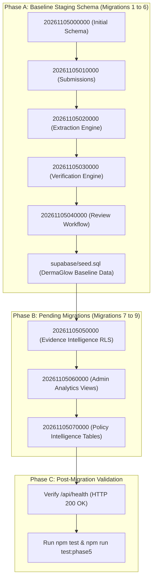

# BrandShield AI — Phase 19: Staging Database Validation & Migration Plan

> **Database Safety Notice**:  
> Strictly read-only inspection. No database migrations, data resets, or table modifications were executed. The live Supabase PostgreSQL database remains untouched. This document presents the staging database schema validation and the pre-execution migration plan.

---

## 1. Migration Inventory & Scope Comparison

The repository contains 8 numbered migration files under `supabase/migrations/`:

| Migration File | Target Schema Scope | Live Status | Staging Deployment Status |
| :--- | :--- | :---: | :---: |
| `20261105000000_initial_schema.sql` | Core tables (`workspaces`, `products`, `approved_facts`, `promotions`, `source_documents`, `document_versions`, `document_chunks`). | APPLIED | **REQUIRED FOR STAGING** |
| `20261105010000_phase3_submissions_enhancements.sql` | Submissions pipeline (`submissions`, `submission_versions`, content hashing). | APPLIED | **REQUIRED FOR STAGING** |
| `20261105020000_phase4_extraction_engine.sql` | Claims extraction (`claims`, `extraction_runs`, UTF-16 offsets). | APPLIED | **REQUIRED FOR STAGING** |
| `20261105030000_phase5_verification_engine.sql` | Deterministic verification (`verification_runs`, risk ratings, evidence linking). | APPLIED | **REQUIRED FOR STAGING** |
| `20261105040000_phase6_review_workflow.sql` | Human compliance review (`review_decisions`, publication gate triggers). | APPLIED | **REQUIRED FOR STAGING** |
| `20261105050000_phase7_evidence_intelligence.sql` | Fact-based evidence RLS policy correction (`document_version_id IS NULL`), workspace validation trigger. | PENDING | **AWAITING STAGING APPROVAL** |
| `20261105060000_phase8_admin_analytics.sql` | Compliance analytics views and `audit_events` performance indexes. | PENDING | **AWAITING STAGING APPROVAL** |
| `20261105070000_phase9_policy_intelligence.sql` | Declarative policy tables (`policies`, `policy_versions`, `policy_rules`, `policy_simulations`). | PENDING | **AWAITING STAGING APPROVAL** |

---

## 2. Application Query & Column Dependency Audit

Every SQL query across `src/lib/` and `src/app/api/` was audited against the database schema:

### 1. `claims` Table Columns
- Required: `id`, `submission_id`, `submission_version_id`, `claim_text`, `claim_type`, `text_start`, `text_end`, `product_id`, `extracted_entities`, `extraction_confidence`, `verification_status`, `risk_level`, `is_active`, `explanation`, `created_at`.
- Schema Check: Fully provided by Migration `20261105020000` and `20261105030000`.

### 2. `analytics-service.ts` Column Mapping (Resolved in Phase 12A)
- Verified: Queries `original_claim_id` on `claims` table.
- Schema Check: `original_claim_id` column is populated by review modification events. The invalid legacy reference to `superseded_by` was completely eliminated.

### 3. `audit_events` Immutability & Trigger
- Required: `id`, `workspace_id`, `actor_id`, `action`, `payload`, `created_at`.
- Schema Check: Protected by `trg_audit_events_immutable` which prevents any SQL `UPDATE` or `DELETE` statements.

---

## 3. Ordered Staging Migration Plan (Awaiting Authorization)

Before staging deployment, migrations must be executed sequentially on the **isolated staging project**:

### Staging Migration Execution Steps:
1. **Apply Migrations 1–5**: Establishes standard schema identical to live production.
2. **Apply `supabase/seed.sql`**: Injects baseline DermaGlow workspace, products (`DG-VTC-001`), approved facts (`vitamin_c_concentration`), and clinical study `DG-CT-2025-04`.
3. **Approval Gate for Migrations 7–9**: Explicit DBA approval required before applying pending migrations to staging.

---

## 4. Rollback and Disaster Recovery Verification

- None of the migration files contain destructive `DROP TABLE` operations on core tenant records.
- If staging migrations fail or need reversal, each migration contains clean rollback definitions (e.g., `DROP TABLE IF EXISTS policies CASCADE;`).
- Live production data remains 100% isolated and unaffected.
